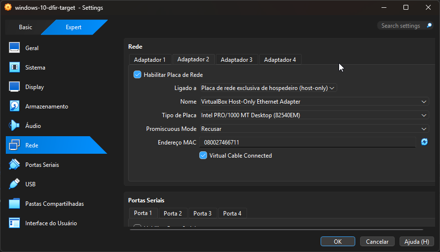

# Module 00 — Lab Environment

## Objective

Set up an isolated virtual lab in which two hosts can communicate with each other, and document how the VirtualBox network modes affect connectivity and isolation.

---

## Lab architecture

```
┌──────────────────────────────────────────────────────┐
│                    HOST (Windows)                    │
│                      VirtualBox                      │
│                                                      │
│  ┌──────────────────────┐  ┌──────────────────────┐  │
│  │  Windows 10 (target) │  │  Kali 2026.1 analyst │  │
│  │                      │  │                      │  │
│  │  NIC 1: NAT          │  │  NIC 1: Host-only    │  │
│  │    10.0.2.15         │  │    192.168.56.104    │  │
│  │  NIC 2: Host-only    │  │    (DHCP)            │  │
│  │    192.168.56.101    │  │                      │  │
│  │    (static)          │  │                      │  │
│  └──────────────────────┘  └──────────────────────┘  │
│                                                      │
│   Host-only network: 192.168.56.0/24                 │
│   DHCP server (VirtualBox): 192.168.56.100           │
└──────────────────────────────────────────────────────┘
```

---

## Hosts

| Field | Windows (target) | Kali (analyst) |
|---|---|---|
| Operating system | Windows 10 Enterprise LTSC | Kali Linux 2026.1 |
| Lab interface | Ethernet 2, `08:00:27:46:67:11` | eth0, `08:00:27:8a:35:d2` |
| Lab IPv4 | `192.168.56.101/24` (static) | `192.168.56.104/24` (DHCP) |
| Internet interface | Ethernet (NAT), `10.0.2.15` | None (see pending item below) |



---

## VirtualBox network modes

| Mode | What it is | Observed behaviour |
|---|---|---|
| **NAT** | A private "router" for each VM, used to reach the internet through the host | Each VM gets its **own isolated** NAT. Kali and Windows both received `10.0.2.15` with no conflict, and they could **not** reach each other. |
| **Host-only** | A private network **shared** by the VMs and the host, with no internet | Both VMs joined `192.168.56.0/24` and reached each other. |
| **NAT Network** | A NAT shared by several VMs (closer to a real office network) | Not used yet. Candidate for later modules. |

**Why Host-only for the lab:** it lets the VMs talk to each other while keeping all test traffic (scans, captures, simulated attacks) off the internet and off the physical home network.

**Recommended layout per VM:** Adapter 1 = NAT (updates and tool installation), Adapter 2 = Host-only (lab traffic). The adapter order is a convention; what matters is the combination.

---

## Isolation and scope

- All testing targets only the VMs in this lab.
- The Host-only network has no route to the internet.
- Outputs that reveal the physical network (for example, the host's ISP DNS servers that appear in the Windows NAT adapter) are **not** published.

---

## Pending

- [ ] Kali: restore Adapter 1 = NAT and add Adapter 2 = Host-only (Kali currently has no internet access).
- [ ] Kali: install VirtualBox Guest Additions (`virtualbox-guest-x11`) for shared clipboard and drag-and-drop.
