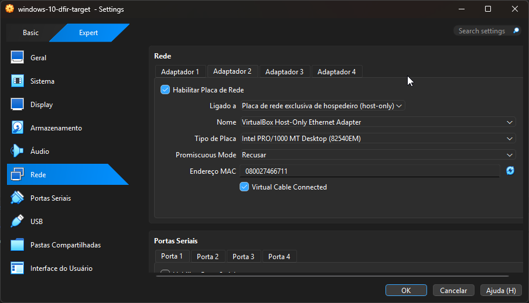
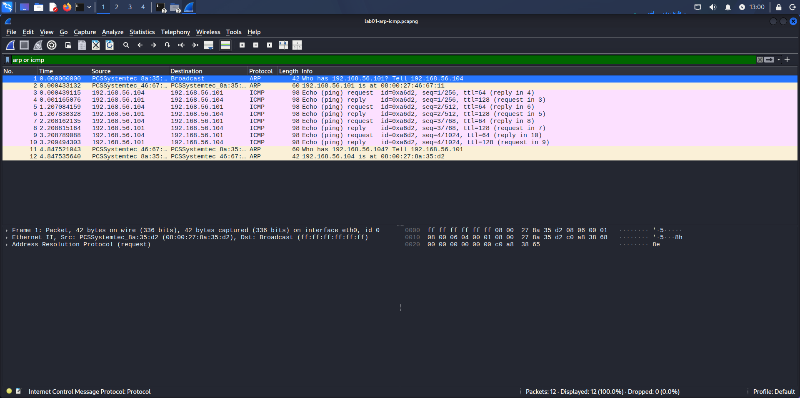
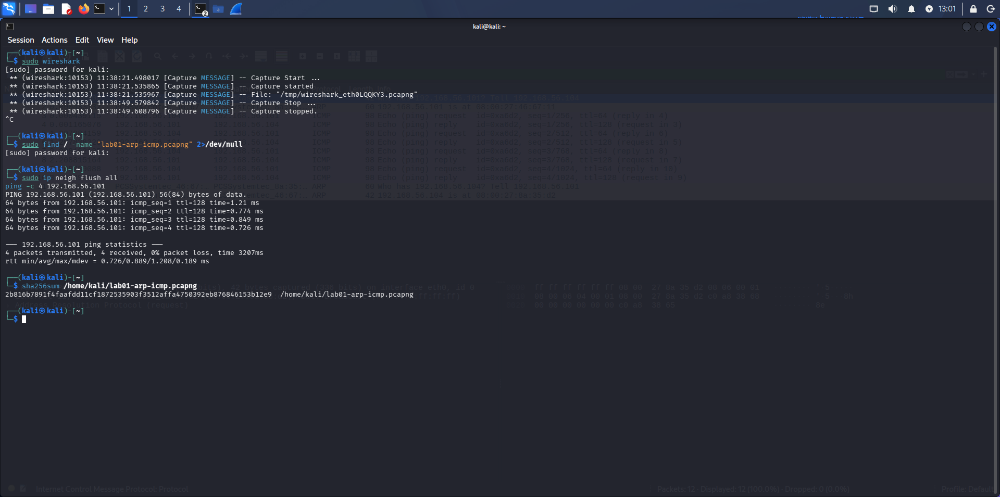

# LAB 01 — Understanding Network Communication

`Module 01 — Networking Fundamentals` · `ARP · ICMP · Wireshark` · `Date: 2026-11-16` · `Status: Complete`

## Objective

Observe how two hosts on the same LAN discover each other (ARP) and exchange ICMP Echo messages, then capture and analyse that exchange in Wireshark.

## Repository contents

| Path | Content |
|---|---|
| `README.md` | This write-up |
| `screenshots/` | VirtualBox configuration, Wireshark capture, ping and hash output |
| `evidence/lab01-arp-icmp.pcapng` | The saved packet capture (12 packets) |
| `evidence/SHA256SUMS` | Hash manifest for integrity verification |

---

## 1. Lab Topology

| Host | Role | Interface | MAC | IPv4 | Addressing |
|---|---|---|---|---|---|
| Kali Linux 2026.1 | Analyst workstation | eth0 | `08:00:27:8a:35:d2` | `192.168.56.104/24` | DHCP |
| Windows 10 (DESKTOP-2F965T3) | Target | Ethernet 2 | `08:00:27:46:67:11` | `192.168.56.101/24` | Static |
| VirtualBox DHCP server | Infrastructure | — | `08:00:27:47:cd:8f` | `192.168.56.100` | — |

- **Network:** VirtualBox Host-only (`VirtualBox Host-Only Ethernet Adapter`), `192.168.56.0/24`
- **Isolation:** Host-only network, with no route to the internet or to the physical home network.
- **Note:** The `08:00:27` OUI on every interface identifies VirtualBox virtual NICs.



VirtualBox network modes (NAT vs Host-only) and why the lab uses Host-only are documented in [Module 00 — Lab Environment](../../module00-lab-environment/).

---

## 2. Concepts (in my own words)

| Term | Definition |
|---|---|
| **PCAP** | A recording of network traffic. It is the file a DFIR analyst receives to investigate and find out what happened. |
| **LAN** | Local network: machines that talk to each other directly, without going through a router. |
| **IP** | The full address of a device on that LAN. |
| **Subnet mask** | Splits the IP into two parts: the network part and the host part. |
| **MAC** | The physical address of the device's network card. |
| **Switch** | Connects several devices to the same local network (LAN). |
| **ARP** | When you have the IP and want to find the MAC: "shout in the hallway" (broadcast) so everyone on the network hears it. |
| **ICMP** | Sends the "letter" to the correct IP address to check whether the host is there. ICMP only goes out after the MAC has been found. |
| **DHCP** | Hands out IP addresses automatically to the devices on a LAN. |

---

## 3. Procedure

### 3.1 Identify host configuration

**Kali — initial state (VirtualBox NAT):**
```console
$ ip a
2: eth0: <BROADCAST,MULTICAST,UP,LOWER_UP> mtu 1500 ...
    link/ether 08:00:27:8a:35:d2 brd ff:ff:ff:ff:ff:ff
    inet 10.0.2.15/24 brd 10.0.2.255 scope global dynamic noprefixroute eth0
```

**Kali — after moving Adapter 1 to Host-only:**
```console
$ ip a
2: eth0: <BROADCAST,MULTICAST,UP,LOWER_UP> mtu 1500 ...
    link/ether 08:00:27:8a:35:d2 brd ff:ff:ff:ff:ff:ff
    inet 192.168.56.104/24 brd 192.168.56.255 scope global dynamic noprefixroute eth0
```
Same MAC, different IP: the NIC did not change, only the network it is attached to.

**Windows — lab adapter (excerpt):**
```console
C:\> ipconfig /all
Adaptador Ethernet Ethernet 2:
   Descrição . . . . . . . . . : Intel(R) PRO/1000 MT Desktop Adapter #2
   Endereço Físico . . . . . . : 08-00-27-46-67-11
   DHCP Habilitado . . . . . . : Não
   Endereço IPv4 . . . . . . . : 192.168.56.101(Preferencial)
   Máscara de Sub-rede . . . . : 255.255.255.0
```

### 3.2 Packet capture

1. Started a Wireshark capture on Kali `eth0`.
2. Cleared the ARP cache to force a new ARP resolution:
   ```bash
   sudo ip neigh flush all
   ```
3. Ran the ping:
   ```console
   $ ping -c 4 192.168.56.101
   64 bytes from 192.168.56.101: icmp_seq=1 ttl=128 time=1.21 ms
   64 bytes from 192.168.56.101: icmp_seq=2 ttl=128 time=0.774 ms
   64 bytes from 192.168.56.101: icmp_seq=3 ttl=128 time=0.849 ms
   64 bytes from 192.168.56.101: icmp_seq=4 ttl=128 time=0.726 ms

   --- 192.168.56.101 ping statistics ---
   4 packets transmitted, 4 received, 0% packet loss, time 3207ms
   rtt min/avg/max/mdev = 0.726/0.889/1.208/0.189 ms
   ```
4. Stopped the capture and saved it immediately as `lab01-arp-icmp.pcapng`.
5. Computed the SHA-256 hash (see Section 7).
6. Applied the display filter `arp or icmp`.

> **Note:** A first capture was taken but closed without saving, so it was not preserved. All analysis below refers only to the saved capture, whose hash is recorded in Section 7.

---

## 4. Troubleshooting Log

| # | Observation | Hypothesis | Verification | Result |
|---|---|---|---|---|
| 1 | Kali and Windows both showed `10.0.2.15` | Both on VirtualBox NAT, which isolates each VM | Checked the VirtualBox adapter settings | Confirmed. Kali moved to Host-only and received `192.168.56.104` via DHCP. |
| 2 | `ping` returned `Destination Host Unreachable`, reported by `192.168.56.104` (Kali itself) | ARP resolution failed, so the ICMP request was never sent | `ip neigh` showed `192.168.56.101 FAILED` | Layer-2 failure confirmed |
| 3 | No ARP reply from `.101` | Target host unavailable | Checked the VM state | Windows VM was powered off. After power-on: 4/4 replies. |

**Step 2 — failed ping:**
```console
$ ping -c 4 192.168.56.101
PING 192.168.56.101 (192.168.56.101) 56(84) bytes of data.
From 192.168.56.104 icmp_seq=1 Destination Host Unreachable
From 192.168.56.104 icmp_seq=2 Destination Host Unreachable
From 192.168.56.104 icmp_seq=3 Destination Host Unreachable
From 192.168.56.104 icmp_seq=4 Destination Host Unreachable

--- 192.168.56.101 ping statistics ---
4 packets transmitted, 0 received, +4 errors, 100% packet loss, time 3057ms
```

**Step 2 — ARP table:**
```console
$ ip neigh
192.168.56.101 dev eth0 FAILED
192.168.56.100 dev eth0 lladdr 08:00:27:47:cd:8f STALE
```
- `.101 FAILED`: an ARP request was sent and no reply came back.
- `.100 STALE`: the DHCP server was resolved earlier, and the entry has not been reconfirmed recently.

**Step 3 — successful ping (Windows VM powered on):**
```console
$ ping -c 4 192.168.56.101
PING 192.168.56.101 (192.168.56.101) 56(84) bytes of data.
64 bytes from 192.168.56.101: icmp_seq=1 ttl=128 time=1.57 ms
64 bytes from 192.168.56.101: icmp_seq=2 ttl=128 time=0.586 ms
64 bytes from 192.168.56.101: icmp_seq=3 ttl=128 time=0.674 ms
64 bytes from 192.168.56.101: icmp_seq=4 ttl=128 time=0.630 ms

--- 192.168.56.101 ping statistics ---
4 packets transmitted, 4 received, 0% packet loss, time 3037ms
rtt min/avg/max/mdev = 0.586/0.864/1.568/0.407 ms
```

**Takeaway:** "Destination Host Unreachable" generated locally on the same subnet points to a failed ARP resolution, not to a filtered ICMP. `ip neigh` confirms this directly.

---

## 5. Traffic Analysis — `lab01-arp-icmp.pcapng`

12 packets captured, all displayed with the filter `arp or icmp` (no background traffic in this capture).



| Frames | Time (s) | Protocol | Description |
|---|---|---|---|
| 1 | 0.000000 | ARP | Request, broadcast: `Who has 192.168.56.101? Tell 192.168.56.104` |
| 2 | 0.000433 | ARP | Reply, unicast: `192.168.56.101 is at 08:00:27:46:67:11` |
| 3–10 | 0.000439–3.209494 | ICMP | 4 Echo Request/Reply pairs (`id=0xa6d2`, `seq` 1–4), about 1 s apart |
| 11–12 | 4.847521–4.847536 | ARP | Windows unicast request to Kali's MAC to revalidate its cache entry, followed by Kali's reply |

### Key observations

- **ARP precedes ICMP.** The ICMP Echo Request (frame 3) was sent only after the ARP reply arrived (frame 2), about 6 µs later.
- **Broadcast vs unicast.** The ARP Request uses destination `ff:ff:ff:ff:ff:ff` because the target MAC is still unknown. The ICMP frames go directly to the resolved MAC.
- **Cross-source correlation.** The MAC in ARP reply frame 2 (`08:00:27:46:67:11`) matches the Windows `ipconfig /all` output for "Ethernet 2". Two independent sources agree.
- **TTL.** Requests leave Kali with `ttl=64` and replies arrive with `ttl=128`. These are the default initial TTLs for Linux and Windows respectively. A TTL of 128 is *consistent with* a Windows host, but it is not conclusive: TTL is configurable and decreases by 1 at every router hop.
- **ARP revalidation.** Frame 11 is a unicast ARP request. Windows already learned Kali's MAC from frame 1 and is only confirming that the entry is still valid.
- **Raw frame (frame 1).** `ff ff ff ff ff ff` (destination: broadcast) → `08 00 27 8a 35 d2` (source: Kali) → `08 06` (EtherType: ARP).

---

## 6. Security / DFIR Relevance

- **ARP has no authentication.** Any host can claim any IP address, which is the basis of ARP spoofing / MITM. One indicator in a PCAP is the same IP mapped to different MACs within a short time window.
- **MAC addresses can be changed in software.** They are an attribution indicator, not proof of device identity.
- **The OUI reveals the vendor.** `08:00:27` on a physical corporate network would indicate a VirtualBox VM.
- **The ARP cache (`ip neigh` / `arp -a`) is volatile evidence** of which local neighbors a host has contacted recently.
- **Display filters do not modify evidence.** They only hide packets from view. Frame numbers stay stable, so findings can be referenced and independently reproduced from the same PCAP.
- **Unsaved captures are lost evidence.** The first capture was closed without saving and could not be recovered. Lesson: save and hash immediately after stopping a capture.

---

## 7. Evidence Integrity

```console
$ sha256sum /home/kali/lab01-arp-icmp.pcapng
2b816b7891f4faafdd11cf1872535903f3512affa4750392eb876846153b12e9  /home/kali/lab01-arp-icmp.pcapng
```

| File | Packets | SHA-256 |
|---|---|---|
| `evidence/lab01-arp-icmp.pcapng` | 12 | `2b816b7891f4faafdd11cf1872535903f3512affa4750392eb876846153b12e9` |



To verify after cloning the repository:

```bash
cd evidence/
sha256sum -c SHA256SUMS
# lab01-arp-icmp.pcapng: OK
```

Any mismatch means the file differs from the capture analysed here.

> **Before publishing:** the Windows NAT adapter output listed the host's ISP DNS servers and home router address. Only the Host-only lab adapter is included above.

---

## 8. Verification Q&A

1. **Why is a second ping (without flushing the cache) not preceded by ARP?**
   The MAC is already stored in the ARP cache, so no new resolution is needed until the entry expires.
2. **Why is the ARP Request broadcast while the ICMP Request is unicast?**
   The sender does not yet know the destination MAC, so it asks every host on the LAN. Once the owner of the IP replies, ICMP is sent directly to that MAC.
3. **What does `ttl=128` on a reply suggest?**
   It is consistent with a Windows host (default initial TTL 128). It is not conclusive, because TTL can be modified and is decremented at each hop.

---

## 9. References

- RFC 826 — An Ethernet Address Resolution Protocol
- RFC 792 — Internet Control Message Protocol
- RFC 3227 — Guidelines for Evidence Collection and Archiving (order of volatility: the ARP cache is short-lived volatile data)
- ISO/IEC 27037 — Preservation of digital evidence (capture saved and hashed immediately)
- NIST SP 800-86 — Guide to Integrating Forensic Techniques into Incident Response (network traffic as a data source)
