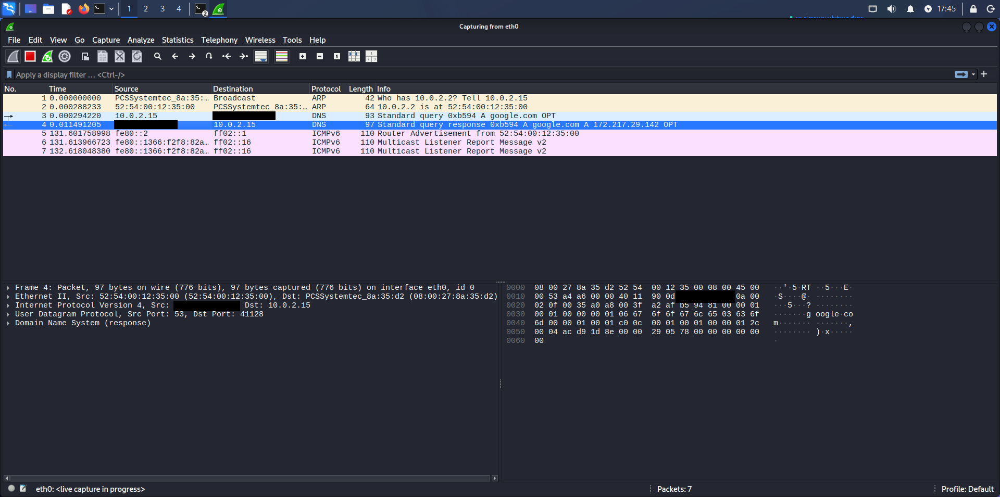
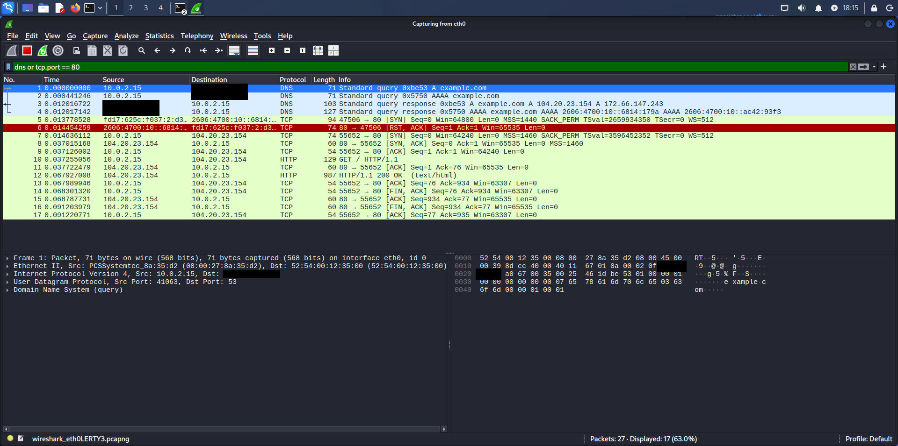
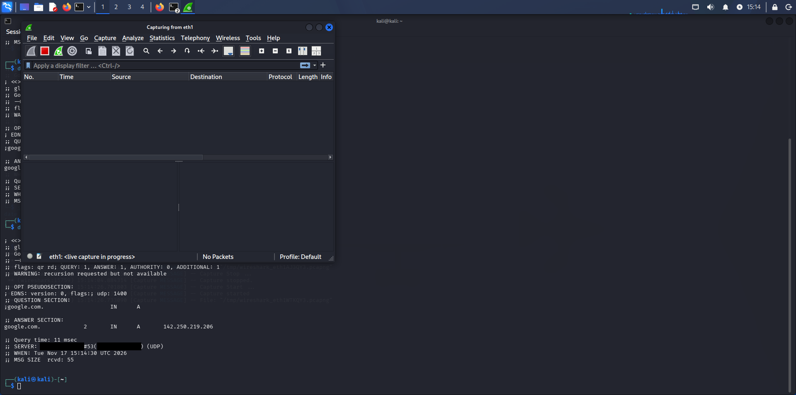
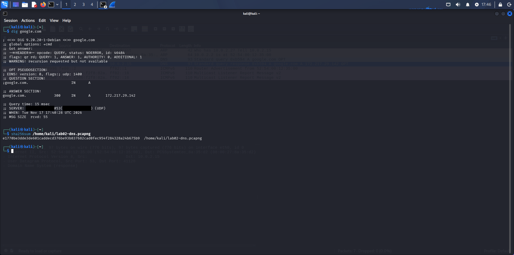
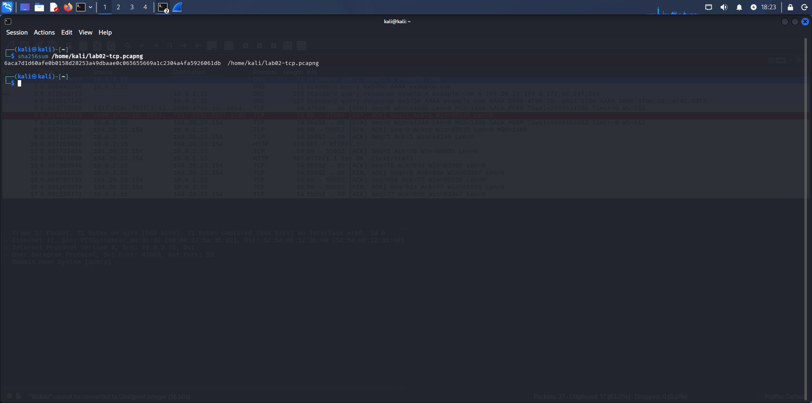

# LAB 02 — DNS Resolution and TCP Connections

`Module 01 — Networking Fundamentals` · `DNS · UDP · TCP · HTTP · Wireshark` · `Date: 2026-11-17` · `Status: Complete`

## Objective

Observe what happens on the wire when a host leaves its local network: how it reaches the gateway, resolves a name through DNS, opens a TCP connection, exchanges an HTTP request and response, and closes the connection.

## Repository contents

| Path | Content |
|---|---|
| `README.md` | This write-up |
| `screenshots/` | Wireshark captures, `dig` output, hash output, troubleshooting |
| `evidence/lab02-dns-sanitized.pcapng` | Capture 1: DNS resolution of `google.com` (7 packets, resolver address redacted) |
| `evidence/lab02-tcp-sanitized.pcapng` | Capture 2: HTTP request to `example.com` (27 packets, resolver address redacted) |
| `evidence/sanitize.sh` | The redaction procedure, so the transformation is reproducible |
| `evidence/SHA256SUMS` | Hash manifest for the published captures |

---

## 1. Setup

| Item | Value |
|---|---|
| Analyst host | Kali Linux 2026.1 |
| Capture interface | `eth0`, VirtualBox NAT, `10.0.2.15/24`, MAC `08:00:27:8a:35:d2` |
| Default gateway | `10.0.2.2` (VirtualBox NAT virtual router), MAC `52:54:00:12:35:00` |
| DNS resolver | The ISP's resolver, inherited from the host through VirtualBox NAT. **Redacted** and shown as `198.51.100.53` (see Section 7). |
| System clock | Set to UTC before capturing (`sudo timedatectl set-timezone UTC`) |

**Why UTC:** before the change, `dig` reported times in EST while the examiner was in BRT (UTC−3). Mixing time zones across sources corrupts timelines, so the analyst workstation runs in UTC.

---

## 2. Key concepts

| Term | Definition |
|---|---|
| **DNS** | The internet's phone book: turns a name (`google.com`) into an IP address |
| **A / AAAA record** | The IPv4 / IPv6 address for a name |
| **UDP** | Send and forget, with no delivery confirmation. Fast. DNS uses UDP port 53. |
| **TCP** | Agrees on the connection first, confirms delivery, resends what was lost. Reliable. |
| **Three-way handshake** | `SYN` → `SYN, ACK` → `ACK`: "hello?", "hello, I'm listening", "OK, let's talk" |
| **FIN** | Polite, agreed close of a TCP connection ("bye") |
| **RST** | Reset: immediate refusal or abort ("hung up on you") |
| **Port** | Identifies the service on a host. The server listens on a fixed port (80 = HTTP); the client uses a temporary ephemeral port. |
| **Gateway** | The router that connects the local network to other networks. All traffic leaving the LAN goes through it. |

---

## 3. Capture 1 — DNS resolution (`lab02-dns.pcapng`)

### Procedure

1. Started Wireshark on `eth0`.
2. Ran `dig google.com`.
3. Stopped the capture, saved it, and computed the SHA-256 hash immediately.

```console
$ dig google.com
;; ->>HEADER<<- opcode: QUERY, status: NOERROR, id: 46484
;; QUESTION SECTION:
;google.com.                    IN      A

;; ANSWER SECTION:
google.com.             300     IN      A       172.217.29.142

;; Query time: 15 msec
;; SERVER: 198.51.100.53#53(198.51.100.53) (UDP)     # resolver address redacted
;; WHEN: Tue Nov 17 17:40:28 UTC 2026
```



### Packet analysis

| Frame | Time (s) | Protocol | From → To | Meaning |
|---|---|---|---|---|
| 1 | 0.000000 | ARP | Kali → Broadcast | `Who has 10.0.2.2? Tell 10.0.2.15` (looking for the **gateway**) |
| 2 | 0.000288 | ARP | Gateway → Kali | `10.0.2.2 is at 52:54:00:12:35:00` |
| 3 | 0.000294 | DNS | `10.0.2.15` → `198.51.100.53` | Query `0xb594`: A record for `google.com` |
| 4 | 0.011491 | DNS | `198.51.100.53` → `10.0.2.15` | Response `0xb594`: `google.com` → `172.217.29.142` |
| 5–7 | 131.6–132.6 | ICMPv6 | link-local → multicast | Background IPv6 router advertisement and listener reports. Unrelated to the test. |

### Key observations

- **ARP targeted the gateway, not the DNS server.** `198.51.100.53` is outside `10.0.2.0/24`, so the host hands the packet to the gateway. ARP only resolves addresses on the local network.
- **Two addresses per packet.** Frame 4 carries the **IP** of the DNS resolver (`198.51.100.53`) but arrives from the **MAC** of the gateway (`52:54:00:12:35:00`). Destination IP = final recipient. Destination MAC = next hop.
- **The resolver answered, not Google.** The query went to the ISP's resolver (redacted as `198.51.100.53`), which already had the answer.
- **Cross-source correlation.** The DNS transaction ID in the capture (`0xb594`) equals `46484` in decimal, the `id` reported by `dig`. The answered IP (`172.217.29.142`) also matches. The capture and the tool output describe the same transaction.
- **Two different "TTLs".** The `300` in the DNS answer is the cache lifetime of the record in seconds. It is unrelated to the IP TTL hop counter seen in LAB 01.

---

## 4. Capture 2 — TCP connection and HTTP (`lab02-tcp.pcapng`)

### Procedure

1. Started Wireshark on `eth0`.
2. Ran `curl http://example.com`.
3. Stopped the capture, saved it, and computed the SHA-256 hash immediately.
4. Applied the display filter `dns or tcp.port == 80` (17 of 27 packets displayed).



### Packet analysis

| Frames | Phase | What happened |
|---|---|---|
| 1–4 | **DNS** | Queries for both A and AAAA records of `example.com`. Answers: IPv4 `104.20.23.154`, `172.66.147.243`; IPv6 `2606:4700:10::6814:179a`, `2606:4700:10::ac42:93f3` |
| 5–6 | **IPv6 attempt refused** | `SYN` to the IPv6 address on port 80, answered by `RST, ACK` |
| 7–9 | **Handshake (IPv4)** | `SYN` → `SYN, ACK` → `ACK` between `10.0.2.15:55652` and `104.20.23.154:80` |
| 10 | **HTTP request** | `GET / HTTP/1.1` |
| 11 | ACK | Server acknowledges the request |
| 12 | **HTTP response** | `HTTP/1.1 200 OK (text/html)` |
| 13 | ACK | Client acknowledges the response |
| 14–17 | **Teardown** | `FIN, ACK` from each side, each acknowledged |

### Key observations

- **DNS always comes first.** No connection can start before the name is resolved (frames 1–4 precede every TCP frame).
- **Happy-eyeballs behaviour.** The client tried IPv6 first. When it was refused, it fell back to IPv4 within about 0.2 ms (frame 6 → frame 7).
- **Who actually sent the RST?** Frame 6 shows the remote IPv6 address as its source, but it arrived about 0.7 ms after the SYN. The IPv4 handshake took about 22 ms (frame 7 → frame 8). A reply that is about 30 times faster than the real round trip is *consistent with* the RST being generated locally (the VirtualBox NAT does not forward IPv6), not by the remote server. **The source address of a packet is a claim, not proof of who sent it.**
- **FIN vs RST.** The IPv4 session ended with an orderly four-step `FIN` exchange. The IPv6 attempt was aborted with a single `RST`.
- **Ports.** The server port is fixed (`80`, HTTP). The client port (`55652` for IPv4, `47506` for IPv6) is ephemeral, chosen for that connection only.
- **HTTP is plaintext.** The request line (`GET /`) and the response status are readable in the capture. With HTTPS this content would be encrypted. Only metadata (endpoints, timing, sizes, SNI) would remain. This limitation is covered in Module 03.

---

## 5. Troubleshooting Log

| # | Observation | Hypothesis | Verification | Result |
|---|---|---|---|---|
| 1 | Capture showed **No Packets** while `dig` succeeded | Capture running on the wrong interface | The Wireshark title bar read **"Capturing from eth1"** (Host-only lab network) | Internet-bound traffic leaves through the default route on `eth0` (NAT). Capture restarted on `eth0`. |



**Takeaway:** capture on the interface the traffic actually uses. `ip route` shows the default route and therefore the egress interface. A capture on the wrong interface is an empty capture, and an empty capture is **not** evidence that the traffic did not happen.

---

## 6. Security / DFIR Relevance

- **DNS is often the first indicator of compromise.** Most malware resolves a domain to find its command-and-control (C2) server. The domain lets the attacker change the server IP without changing the malware. Unusual names queried at regular intervals are *consistent with* beaconing and warrant investigation.
- **DNS query logging is a configuration, not a default.** Many resolvers do not log queries unless it is enabled. The cache is not a log: it does not record who asked, and it expires. In a corporate investigation, look first at the internal DNS server, firewall/proxy logs, existing PCAPs, and the endpoint's DNS cache. ISP records, where they exist, require legal process.
- **Absence of a DNS log is not absence of a query.** The correct wording is "no evidence of a query to X was identified in the available sources".
- **An IP address does not identify a machine.** DHCP leases change, NAT hides internal hosts behind one address, and source addresses can be spoofed or generated by middleboxes (frame 6 above).
- **Many RSTs from many ports** of one host are *consistent with* port scanning (Module 04).
- **Time normalisation.** Normalise every source to UTC before building a timeline.

---

## 7. Evidence Integrity and Redaction

### Original captures (preserved offline, not published)

Hashed immediately after each capture was saved:

```console
$ sha256sum /home/kali/lab02-dns.pcapng
e1770be3dde3de601caddecd376be93b837682cad0fec954f284328a24b675b9  /home/kali/lab02-dns.pcapng

$ sha256sum /home/kali/lab02-tcp.pcapng
6aca7d1d60afe0b0158d28253a49dbaae0c065655669a1c2304a4fa5926061db  /home/kali/lab02-tcp.pcapng
```





| Original file | Packets | SHA-256 |
|---|---|---|
| `lab02-dns.pcapng` | 7 | `e1770be3dde3de601caddecd376be93b837682cad0fec954f284328a24b675b9` |
| `lab02-tcp.pcapng` | 27 | `6aca7d1d60afe0b0158d28253a49dbaae0c065655669a1c2304a4fa5926061db` |

### Published captures (sanitised derivatives)

The original captures contain the examiner's ISP DNS resolver address. Before publication, that address was replaced with `198.51.100.53`, a documentation-only address (RFC 5737), using [`evidence/sanitize.sh`](evidence/sanitize.sh). Nothing else was changed, and IP/UDP checksums were recalculated.

| Published file | Derived from | SHA-256 |
|---|---|---|
| `evidence/lab02-dns-sanitized.pcapng` | `lab02-dns.pcapng` | `cbd0e3e47e9d10c5648b0138a00e20432b053c43bcbadeb32a1e401aff31570f` |
| `evidence/lab02-tcp-sanitized.pcapng` | `lab02-tcp.pcapng` | `c3202379714244b67de009a743a95e47189f205cc47ab19526c09931f48a99f9` |

**Sanitisation checks (output of `sanitize.sh`):**

| Check | DNS capture | TCP capture |
|---|---|---|
| Original hash unchanged after the run | ✅ | ✅ |
| Packet count, original / sanitised | 7 / 7 | 27 / 27 |
| Packets still containing the original resolver address | 0 | 0 |
| Packets rewritten to `198.51.100.53` | 2 | 4 |

**Note on tool warnings:** for the TCP capture, `tcprewrite` reported that it skipped packets 8, 11, 15 and 16 ("caplen 60 minus L2 length 14 does not equal IPv4 header length"). These are the server's 60-byte frames (SYN-ACK, ACKs, FIN-ACK), which carry Ethernet padding. They were written to the output unmodified. They involve only `104.20.23.154` and `10.0.2.15`, not the resolver address, so the redaction was not affected. The zero-match check above confirms this.

To verify after cloning the repository:

```bash
cd evidence/
sha256sum -c SHA256SUMS
```

**Screenshots:** the resolver address is masked with black boxes in the list pane, packet details, and hex bytes (all four address bytes). Faint copies visible through the transparent terminal window were masked too.

> **Why this matters:** publishing a derivative is a normal forensic practice. The original stays untouched and keeps its original hash. The derivative gets its own hash, and the transformation is documented and reproducible, so any reviewer can see exactly what changed and why (ISO/IEC 27037, preservation; ISO/IEC 27042, documented analysis).

---

## 8. Verification Q&A

1. **Why did the host ARP for the gateway instead of the DNS server?**
   The DNS server is outside the local network. Traffic leaving the LAN is handed to the gateway, so the host needs the gateway's MAC. ARP cannot resolve addresses beyond the local network.
2. **Do DNS servers always keep a record of the queries they receive?**
   No. Query logging must be enabled. The cache only stores answers temporarily and does not record who asked.
3. **What does a TCP `RST` mean, compared with `FIN`?**
   `RST` is an immediate refusal or abort ("hung up on you"). `FIN` is an orderly close agreed by both sides.
4. **Why does DNS use UDP while HTTP uses TCP?**
   A DNS query and answer are tiny, and a lost query can simply be resent, so the overhead of a TCP connection is unnecessary. An HTTP page must arrive complete and in order, so it needs TCP's reliability.

---

## 9. References

- RFC 1034 / RFC 1035 — Domain Names: concepts and implementation
- RFC 768 — User Datagram Protocol
- RFC 9293 — Transmission Control Protocol
- RFC 9110 / RFC 9112 — HTTP semantics and HTTP/1.1
- RFC 8305 — Happy Eyeballs v2 (IPv6/IPv4 connection racing)
- RFC 3227 — Guidelines for Evidence Collection and Archiving
- ISO/IEC 27037 — Preservation of digital evidence (captures saved and hashed immediately)
- NIST SP 800-86 — Guide to Integrating Forensic Techniques into Incident Response (network traffic as a data source)
