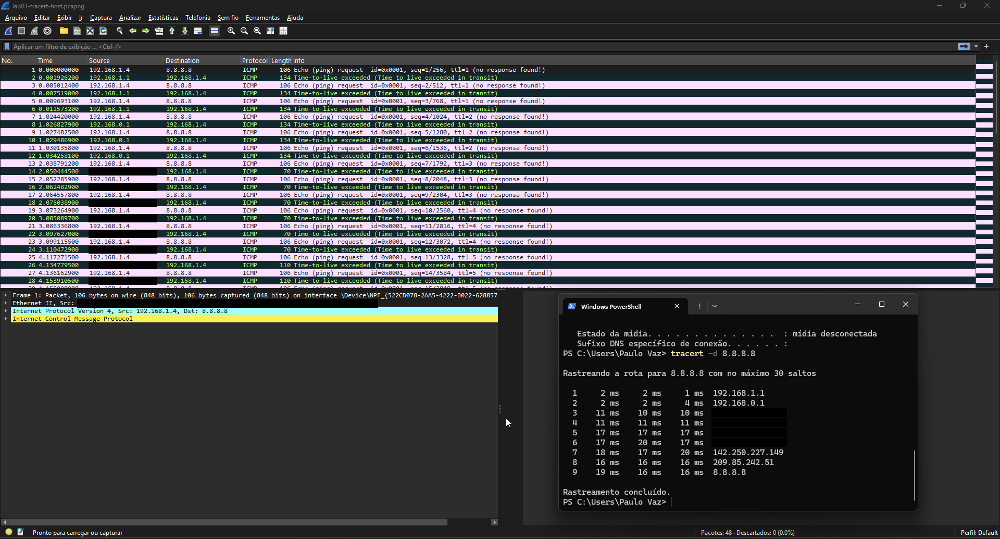
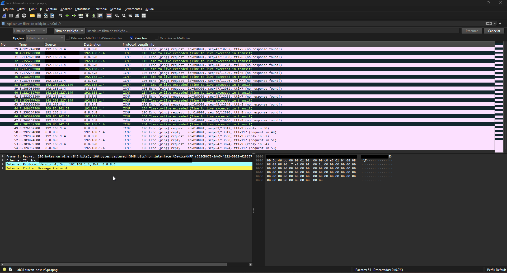
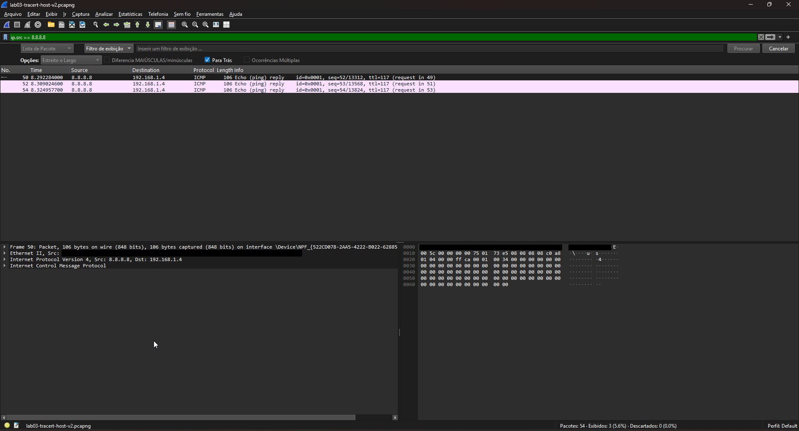

# LAB 03 — Routing and the Path to the Internet

`Module 01 — Networking Fundamentals` · `Routing table · traceroute · ICMP Time Exceeded · NAT` · `Dates: 2026-11-19 / 2026-11-20` · `Status: Complete`

## Objective

Understand how a host decides where to send each packet (routing table), then trace the real path a packet takes from the lab to an internet host, and observe the traceroute technique packet by packet in Wireshark.

## Repository contents

| Path | Content |
|---|---|
| `README.md` | This write-up |
| `screenshots/` | Wireshark captures of `tracert` (redacted) |

The packet captures for this lab are **retained privately and not published**. Their hashes are recorded in Section 8, which explains why.

---

## 1. Setup

| Host | Interface | Address | Gateway | Role in this lab |
|---|---|---|---|---|
| Kali Linux 2026.1 (VM) | eth0 (VirtualBox NAT) | `10.0.2.15/24` | `10.0.2.2` | Routing table, traceroute from inside the VM |
| Kali Linux 2026.1 (VM) | eth1 (Host-only) | `192.168.56.102/24` | none | Lab network |
| Windows host PC | Ethernet (physical NIC) | `192.168.1.4/24` | `192.168.1.1` | `tracert` and capture of the real path |
| Windows host PC | Ethernet 2 (VirtualBox Host-only) | `192.168.56.1/24` | none | The host's own presence on the lab network |

**Clocks:** Kali runs in UTC. The Windows host runs in local time (BRT, UTC−3). Wireshark stores capture timestamps internally in UTC.

---

## 2. Key concepts

| Term | Definition |
|---|---|
| **Routing table** | The host's list of "road signs": for each destination network, which interface to use and whether a router is needed |
| **Default route** | "Any destination not listed → send to this router." The exit to the rest of the world |
| **TTL** | A counter in every IP packet. Each router subtracts 1. At 0 the packet is discarded. |
| **ICMP Time Exceeded** | The message a router sends back when it discards a packet because its TTL reached 0 ("the TTL ran out here") |
| **traceroute / tracert** | Sends packets with TTL 1, 2, 3… Each router that discards one reveals itself, which maps the path hop by hop |
| **ICMP Echo Reply** | The normal answer to a ping. In traceroute it means the packet **reached the destination**, so the trace stops. |
| **Double NAT** | Two routers doing NAT in series, for example the ISP's modem plus the user's own router |
| **CGNAT** | Carrier-grade NAT: the ISP places many customers behind one public IP address |

---

## 3. Part A — Kali routing table

```console
$ ip route
default via 10.0.2.2 dev eth0 proto dhcp src 10.0.2.15 metric 100
10.0.2.0/24 dev eth0 proto kernel scope link src 10.0.2.15 metric 100
192.168.56.0/24 dev eth1 proto kernel scope link src 192.168.56.102 metric 101
```

| Route | Meaning |
|---|---|
| `default via 10.0.2.2 dev eth0` | Any unknown destination goes to the router `10.0.2.2` through `eth0`. The only line with `via`, i.e. the only one that uses a router. |
| `10.0.2.0/24 dev eth0` | Destinations in `10.0.2.x` are delivered directly through `eth0` |
| `192.168.56.0/24 dev eth1` | Destinations in the lab network are delivered directly through `eth1` |

The routing table is where the subnet-mask decision ("same network or another network?") is applied. It also explains the empty capture in LAB 02: internet-bound traffic follows the default route out of `eth0`, not `eth1`.

---

## 4. Part B — traceroute from inside the VM

```console
$ sudo traceroute -I -n 8.8.8.8
traceroute to 8.8.8.8 (8.8.8.8), 30 hops max, 60 byte packets
 1  8.8.8.8  16.810 ms  16.468 ms  17.437 ms
```

**Observed:** a single hop, directly to `8.8.8.8`, although the real path has nine (Part C).

**Interpretation:** the VirtualBox NAT engine does not forward the guest's ICMP packets as they are. It issues its own request from the host and answers the guest **on behalf of** the destination. The low-TTL probes therefore never travel the real path, so no intermediate router can reveal itself.

**Conclusion (high confidence, corroborated):** inside the VirtualBox NAT, traceroute cannot map the path. This is consistent with two earlier observations: the `ttl=64` reply from `8.8.8.8` (Module 00) and the locally generated IPv6 `RST` (LAB 02).

---

## 5. Part C — tracert from the host (real path)

```console
PS C:\> tracert -d 8.8.8.8
Rastreando a rota para 8.8.8.8 com no máximo 30 saltos
  1     1 ms     1 ms     1 ms  192.168.1.1
  2     2 ms     2 ms     2 ms  192.168.0.1
  3    10 ms    10 ms    10 ms  10.x.x.x          [ISP, redacted]
  4    10 ms     9 ms    10 ms  [ISP public address, redacted]
  5    16 ms    15 ms    15 ms  [ISP public address, redacted]
  6    17 ms    16 ms    16 ms  [ISP public address, redacted]
  7    16 ms    16 ms    15 ms  142.250.227.149
  8    16 ms    15 ms    15 ms  209.85.242.51
  9    15 ms    15 ms    15 ms  8.8.8.8
Rastreamento concluído.
```

| Hops | Segment | Evidence |
|---|---|---|
| 1–2 | **Inside the home** | Private `192.168.x.x` addresses, 1–2 ms |
| 3–6 | **ISP network** | Hop 3 is a private `10.x` address. Hops 4–6 are public. Latency jumps to about 10 ms at hop 3. |
| 7–8 | **Google's network** | Address ranges commonly allocated to Google (verifiable via WHOIS/RDAP) |
| 9 | **Destination** | `8.8.8.8` (Google Public DNS) |

### Key observations

- **Two routers in the home (hops 1–2).** This is consistent with **double NAT**: the ISP-supplied device plus the user's own router.
- **The packet leaves the home between hops 2 and 3.** Two independent indicators agree: the address type changes from home-private `192.168.x.x` to ISP addressing, and latency rises from about 2 ms to about 10 ms (the "last mile").
- **Hop 3 uses private addressing inside the ISP.** This is *consistent with* CGNAT, but not conclusive: ISPs also use private addresses on internal infrastructure. Confirmation would require the public IP observed externally and/or ISP information.

---

## 6. Part D — Capturing tracert in Wireshark (host)

### Procedure

1. Installed Wireshark (with Npcap) on the Windows host.
2. Set the **capture filter** `icmp` *before* starting, so only ICMP was recorded. The host carries personal traffic (browser, messaging, games), and the filter keeps it out of the file entirely (**data minimisation**).
3. Captured on the physical interface `Ethernet` (identified with `ipconfig` by its gateway `192.168.1.1`).
4. Ran `tracert -d 8.8.8.8`, waited for "Rastreamento concluído", then stopped, saved, and hashed.





### Packet analysis (capture v2, 54 packets)

| Packets | Probe sent to `8.8.8.8` | Who answered | Answer |
|---|---|---|---|
| 1–6 | Echo Request, **TTL 1** (×3) | `192.168.1.1` (home router) | Time-to-live exceeded |
| 7–12 | **TTL 2** (×3) | `192.168.0.1` (second home router) | Time-to-live exceeded |
| 13–18 | **TTL 3** (×3) | ISP hop (redacted) | Time-to-live exceeded |
| 19–24 | **TTL 4** (×3) | ISP hop (redacted) | Time-to-live exceeded |
| 25–30 | **TTL 5** (×3) | ISP hop (redacted) | Time-to-live exceeded |
| 31–36 | **TTL 6** (×3) | ISP hop (redacted) | Time-to-live exceeded |
| 37–42 | **TTL 7** (×3) | `142.250.227.149` | Time-to-live exceeded |
| 43–48 | **TTL 8** (×3) | `209.85.242.51` | Time-to-live exceeded |
| 49–54 | **TTL 9** (×3) | `8.8.8.8` | **Echo (ping) reply** |



### Key observations

- **Three probes per TTL.** This is why `tracert` prints three latency columns per hop.
- **The destination is always `8.8.8.8`; the responder changes.** Each router that discards a probe identifies itself. Collecting the responders gives the path.
- **The trace ends with an Echo Reply, not Time Exceeded.** The TTL 9 probes arrived with TTL to spare, so the destination answered normally. That is the signal for `tracert` to stop.
- **Real TTL vs the VM's TTL.** Google's replies arrived with `ttl=117`, a value decremented along the return path. Inside the VM, the same destination appeared with `ttl=64`. This directly confirms that the VirtualBox NAT rewrites the reply.
- **"No response found!"** on the requests only means Wireshark found no matching Echo Reply. The answer to those probes was a different ICMP type (Time Exceeded).
- **Vendor from MAC.** The next-hop MAC OUI identified the home router's vendor, the same technique as in LAB 01. The MAC itself is redacted here.

---

## 7. Troubleshooting Log

| # | Observation | Hypothesis | Verification | Result |
|---|---|---|---|---|
| 1 | Capture v1 contained 48 packets, and the display filter `ip.src == 8.8.8.8` returned **nothing** | The capture was stopped before the final TTL 9 phase | 8 intermediate hops × 6 packets = exactly 48. The `tracert` output (an independent source) showed `8.8.8.8` answering at hop 9. | Capture repeated (v2), stopping only after "Rastreamento concluído". v2 contains 54 packets (48 + 6) including the three Echo Replies. |

**Takeaway:** if something is not in a capture, that does not mean it did not happen. It may mean the capture missed it. Cross-check with an independent source before concluding. v1 is retained and documented as incomplete. It is not discarded.

---

## 8. Evidence Integrity and Data Handling

| File | Packets | Status | SHA-256 |
|---|---|---|---|
| `lab03-tracert-host.pcapng` (v1) | 48 | Incomplete, missing the TTL 9 phase | `56408ad0735292f31554f8004cad4262cfb6f272bca3b36f310d7c87cc5e12e4` |
| `lab03-tracert-host-v2.pcapng` | 54 | Complete, used for the analysis | `5f452ea094bd8e6eac813d4d994c90cbf78245c8dcf9120798c4f77840089454` |

Hashes were computed on the Windows host immediately after saving:

```powershell
(Get-FileHash "$HOME\Documents\lab03-tracert-host-v2.pcapng" -Algorithm SHA256).Hash
```

**Why the captures are not published.** Unlike the lab captures, these were taken on the examiner's own home network. They contain ISP infrastructure addresses and the MAC addresses of the examiner's network interface and home router, which together identify the examiner's network. Under the data-minimisation principle, only what the analysis needs is published: the hashes, redacted screenshots, and the written analysis. The original files are retained unaltered and can be provided for independent review. Any copy can be verified against the hashes above.

**Redactions applied to the screenshots:** ISP hop addresses (hops 3–6) in the packet list and the `tracert` output; MAC addresses in the packet details, hex bytes, and ASCII column; the Windows taskbar (cropped).

---

## 9. Security / DFIR Relevance

- **The routing table is evidence.** An unexpected default gateway or route on a suspect host (for example, all traffic via an unknown internal address) is *consistent with* traffic redirection or man-in-the-middle activity, and is worth collecting during triage.
- **Middleboxes can answer on someone else's behalf.** NAT engines, proxies, and firewalls can generate replies in the name of the destination, which hides the real path and alters values such as TTL. Before trusting a network observation, ask whether something in the middle could have produced it.
- **CGNAT complicates attribution.** When many customers share one public IP, "IP X at time T" does not identify a subscriber. The source port and a precise timestamp are also needed, which is a frequent problem in Brazilian legal requests for subscriber data.
- **traceroute is also reconnaissance.** The same technique that maps a path for troubleshooting reveals network topology to an attacker. Many organisations filter ICMP Time Exceeded at their edge for this reason.
- **Capture completeness.** Confirm that a capture covers the full window of interest before drawing conclusions from what it lacks.

---

## 10. Verification Q&A

1. **Why did traceroute show 1 hop inside the VM and 9 hops on the host?**
   Inside the VM, the VirtualBox NAT intercepts the probes and answers on behalf of the destination, so the low-TTL packets never travel the real path. On the host, the probes actually traverse each router, and each one reveals itself when the TTL runs out.
2. **At which hop does the packet leave the home, and how do you know?**
   Between hops 2 and 3. The address type changes from home-private `192.168.x.x` to ISP addressing, and latency rises from about 2 ms to about 10 ms.
3. **What does the destination reply in a traceroute, and why does the trace stop there?**
   An ICMP Echo Reply, because the probe arrived with TTL remaining. Receiving a reply from the target instead of Time Exceeded tells `tracert` the destination was reached.
4. **What did the incomplete first capture teach?**
   Absence in a capture is not absence of the event. Independent sources (here, the `tracert` output) must be cross-checked, and the capture window verified.

---

## 11. References

- RFC 792 — Internet Control Message Protocol (Echo, Time Exceeded)
- RFC 1812 — Requirements for IP Version 4 Routers (TTL handling)
- RFC 1918 — Address Allocation for Private Internets
- RFC 3022 — Traditional IP Network Address Translator (NAT)
- RFC 6888 — Common Requirements for Carrier-Grade NATs (CGNs)
- RFC 3227 — Guidelines for Evidence Collection and Archiving
- ISO/IEC 27037 — Preservation of digital evidence
- NIST SP 800-86 — Guide to Integrating Forensic Techniques into Incident Response
- LGPD (Lei 13.709/2018), art. 6º, III — necessity principle (data minimisation)
