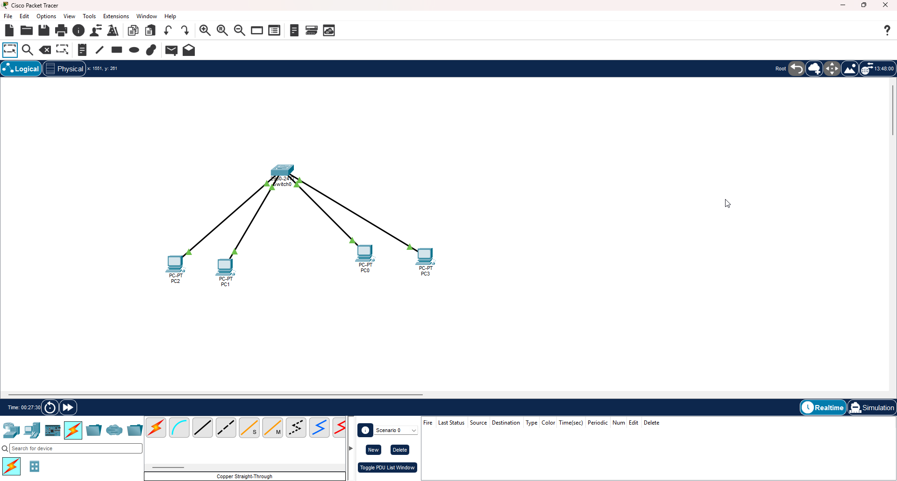
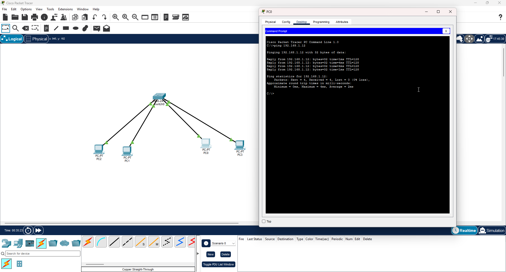
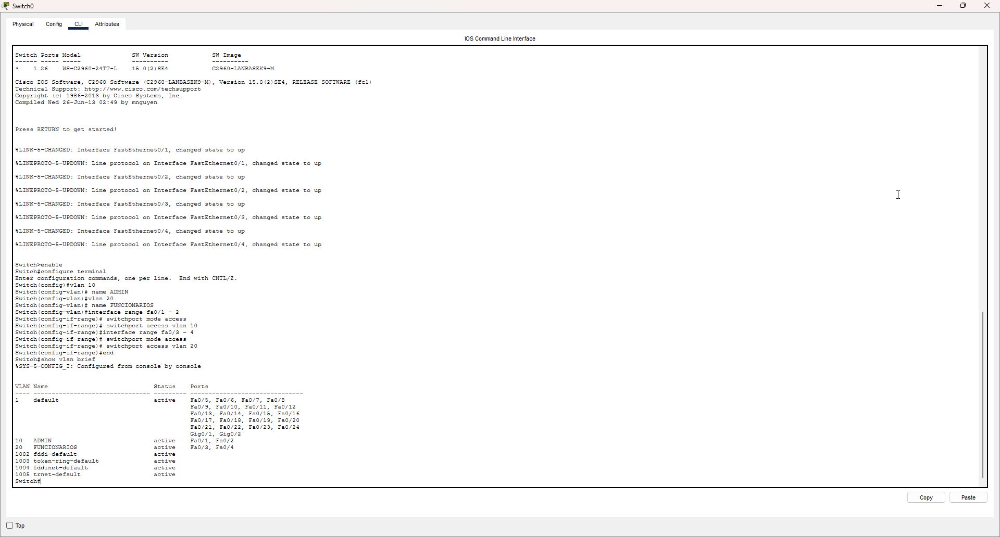
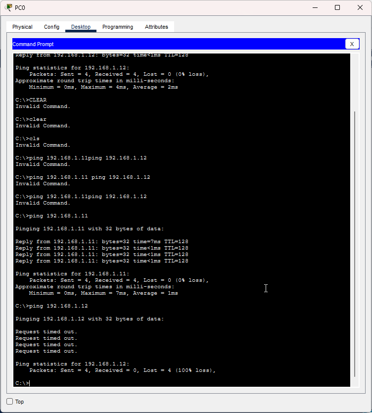
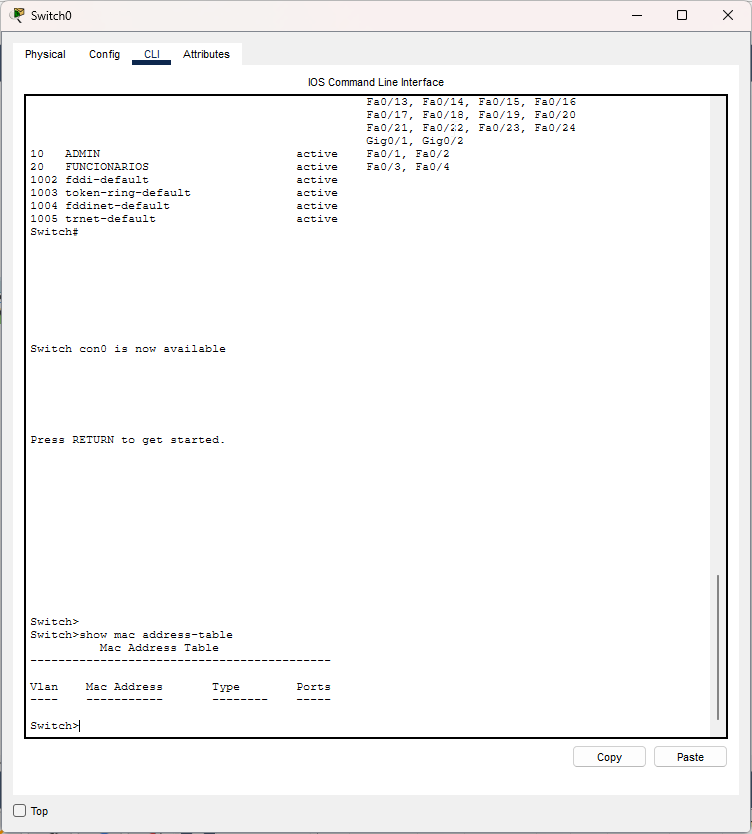
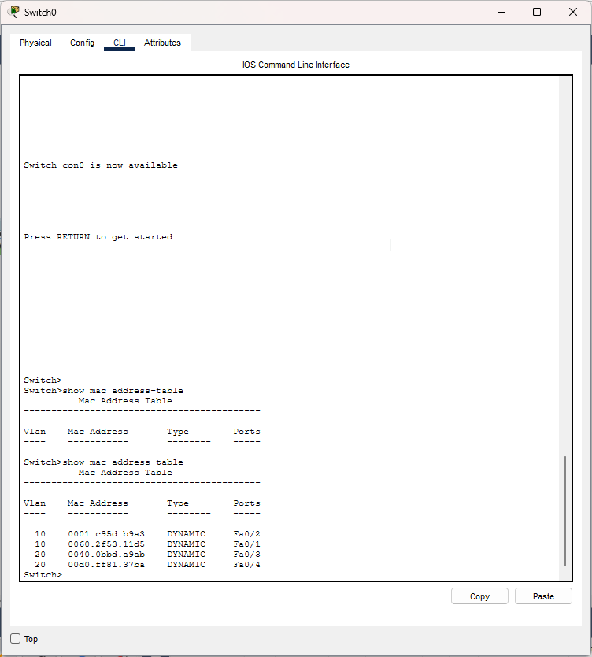

# LAB 05 — VLANs: Segmenting One Switch

`Module 02 — Network Architecture` · `Cisco Packet Tracer · Catalyst 2960 IOS` · `Date: 2026-11-23` · `Status: Complete`

## Objective

Split one physical switch into two isolated groups using VLANs, and prove the effect with a before/after test: the same four PCs, on the same cables and the same IP network, stop reaching each other across the VLAN boundary once the switch is reconfigured. Then read the switch's MAC address table the way an investigator would.

## Repository contents

| Path | Content |
|---|---|
| `README.md` | This write-up |
| `screenshots/` | Topology, command output and test results |
| `evidence/lab05-vlans.pkt` | The Packet Tracer project (final state) |
| `evidence/SHA256SUMS` | SHA-256 of the project file |

This lab runs entirely inside the Packet Tracer simulator on the host PC. No VM, no real network and no packet capture are involved.

---

## 1. Setup

| Device | Port on Switch0 | IP / mask | VLAN (after Part C) |
|---|---|---|---|
| PC0 | Fa0/1 | `192.168.1.10/24` | 10 — ADMIN |
| PC1 | Fa0/2 | `192.168.1.11/24` | 10 — ADMIN |
| PC2 | Fa0/3 | `192.168.1.12/24` | 20 — FUNCIONARIOS (employees) |
| PC3 | Fa0/4 | `192.168.1.13/24` | 20 — FUNCIONARIOS (employees) |

Switch0 is a Catalyst 2960-24TT (IOS 15.0(2)SE4). PCs are connected with copper straight-through cables. No gateway or DNS is configured, because there is no router yet.

**All four PCs deliberately share one IP subnet.** That way the only thing that changes between the "before" and "after" tests is the VLAN configuration, so any change in reachability can be attributed to it.



---

## 2. Key concepts

| Term | Definition |
|---|---|
| **Switch** | Connects devices on the same LAN and forwards each frame to the right port using the MAC address |
| **Router** | Connects different networks and chooses the path using the IP address. On a LAN it is the **gateway**. |
| **VLAN** | A virtual LAN: a group of switch ports that behaves like its own separate switch. Separation by configuration, not by cabling. |
| **Access port** | A switch port that belongs to exactly one VLAN and carries untagged traffic for an end device |
| **MAC address table** | The switch's record of which MAC was last seen on which port and VLAN. Learned automatically, aged out after inactivity (300 s by default). |

---

## 3. Part A — Baseline: one flat network

```console
C:\>ping 192.168.1.12

Reply from 192.168.1.12: bytes=32 time<1ms TTL=128
Reply from 192.168.1.12: bytes=32 time=4ms TTL=128
Reply from 192.168.1.12: bytes=32 time=4ms TTL=128
Reply from 192.168.1.12: bytes=32 time<1ms TTL=128

Ping statistics for 192.168.1.12:
    Packets: Sent = 4, Received = 4, Lost = 0 (0% loss),
```



**Observed:** PC0 → PC2, 4/4 replies. Every port is in the default VLAN 1, so all four PCs are in one broadcast domain.

---

## 4. Part B — Creating the VLANs

```console
Switch>enable
Switch#configure terminal
Switch(config)#vlan 10
Switch(config-vlan)# name ADMIN
Switch(config-vlan)#vlan 20
Switch(config-vlan)# name FUNCIONARIOS
Switch(config-vlan)#interface range fa0/1 - 2
Switch(config-if-range)# switchport mode access
Switch(config-if-range)# switchport access vlan 10
Switch(config-if-range)#interface range fa0/3 - 4
Switch(config-if-range)# switchport mode access
Switch(config-if-range)# switchport access vlan 20
Switch(config-if-range)#end
Switch#show vlan brief

VLAN Name                             Status    Ports
---- -------------------------------- --------- -------------------------------
1    default                          active    Fa0/5, Fa0/6, ... Gig0/1, Gig0/2
10   ADMIN                            active    Fa0/1, Fa0/2
20   FUNCIONARIOS                     active    Fa0/3, Fa0/4
```

*(VLAN 1 port list and the reserved VLANs 1002–1005 condensed.)*



**Observed:** ports Fa0/1–2 moved to VLAN 10 and Fa0/3–4 to VLAN 20. Nothing else changed: same cables, same IPs.

---

## 5. Part C — Testing the wall

```console
C:\>ping 192.168.1.11
    Packets: Sent = 4, Received = 4, Lost = 0 (0% loss),

C:\>ping 192.168.1.12
Request timed out.
Request timed out.
Request timed out.
Request timed out.
    Packets: Sent = 4, Received = 0, Lost = 4 (100% loss),
```

*(Reply lines of the first ping condensed.)*



| Test | Before VLANs | After VLANs |
|---|---|---|
| PC0 → PC1 (same VLAN 10) | — | 4/4 replies |
| PC0 → PC2 (VLAN 10 → 20) | 4/4 replies | 0/4, 100% loss |

### Interpretation

- **PC0 and PC2 are still in the same IP subnet**, so PC0 still treats PC2 as local and sends an ARP broadcast for it. That broadcast now stays inside VLAN 10 and never reaches PC2, so PC0 cannot resolve PC2's MAC and the ping times out.
- **The physical layer did not change.** Looking only at cabling ("all four PCs are on the same switch"), one would wrongly conclude that they can talk. The logical configuration overrides that.
- **To cross VLANs, traffic needs a router** (or a layer-3 switch), and each VLAN needs its own subnet and gateway. That is LAB 06.

**Conclusion (high confidence, controlled before/after test with a single variable changed):** the loss of reachability between PC0 and PC2 is consistent with the VLAN configuration isolating VLAN 10 from VLAN 20 at layer 2.

---

## 6. Part D — The switch as a witness: MAC address table

The first look at the table, a few minutes after the last ping, came back **empty**:

```console
Switch>show mac address-table
          Mac Address Table
-------------------------------------------

Vlan    Mac Address       Type        Ports
----    -----------       --------    -----
```



After generating fresh traffic inside each VLAN (PC0 → PC1 and PC2 → PC3), it was queried again immediately:

```console
Switch>show mac address-table
          Mac Address Table
-------------------------------------------

Vlan    Mac Address       Type        Ports
----    -----------       --------    -----

  10    0001.c95d.b9a3    DYNAMIC     Fa0/2
  10    0060.2f53.11d5    DYNAMIC     Fa0/1
  20    0040.0bbd.a9ab    DYNAMIC     Fa0/3
  20    00d0.ff81.37ba    DYNAMIC     Fa0/4
```



### Interpretation

- **Each entry ties a MAC to a physical port and a VLAN.** In a real investigation, this answers "where was this machine plugged in, and which segment was it on?" at the time of the query.
- **The table is volatile.** Entries are `DYNAMIC`: learned from traffic and dropped after about 5 minutes of silence. The empty first query shows that collecting it late can return nothing, even though the hosts were connected the whole time.
- **An empty table is not evidence that no host was connected.** It only shows that no host had sent traffic recently.

**Conclusion (high confidence, direct observation):** the switch learned two MACs per VLAN, each on the port assigned to that VLAN, consistent with the configuration in Part B.

---

## 7. Troubleshooting Log

| Symptom | Cause | Fix |
|---|---|---|
| `Invalid Command` in the PC prompt | Two commands typed on one line, and `cls`/`clear` used | The Packet Tracer PC prompt accepts one command per line and has no clear-screen command |
| `show mac address-table` returned no entries | Entries had aged out (no traffic for several minutes) | Generated traffic in each VLAN and queried again immediately |

---

## 8. Security / DFIR Relevance

- **Segmentation limits lateral movement.** If an employee PC is compromised, VLAN separation keeps it from reaching the admin segment directly at layer 2. Any path across must go through a router or firewall, which is where it can be filtered and logged.
- **Scoping an incident starts with segmentation.** "Which VLAN was the host in, and what could it reach from there?" bounds how far an attacker could have moved.
- **Broadcast containment.** ARP and other broadcasts stay inside their VLAN, which reduces noise and limits ARP-based attacks (spoofing, discovery sweeps) to one segment.
- **The MAC address table is volatile evidence** of physical location (switch port) and segment (VLAN). Like the ARP cache in LAB 01, it should be collected early, with a timestamp.
- **VLANs are not a security boundary on their own.** Misconfigurations such as unused ports left in an active VLAN or trunk negotiation left on can be abused (e.g. VLAN hopping). In this lab, all unused ports remained in VLAN 1, which a hardened config would move to an unused, shut-down VLAN.

---

## 9. Evidence and Data Handling

| Evidence | Form |
|---|---|
| Final Packet Tracer project | `evidence/lab05-vlans.pkt`, SHA-256 in `evidence/SHA256SUMS` |
| Ping results, `show vlan brief`, `show mac address-table` | Screenshots 02–06, transcribed above |

Verify with:

```bash
cd evidence && sha256sum -c SHA256SUMS
```

**Redactions:** the Windows taskbar was cropped from the full-screen screenshots (01–03). All MAC and IP addresses shown are simulated by Packet Tracer and do not belong to any real device.

---

## 10. Verification Q&A

1. **What is the difference between a switch and a router?**
   A switch connects devices on the same LAN and forwards by MAC. A router connects different networks and forwards by IP.
2. **What is a VLAN?**
   A logical LAN created by switch configuration. One physical switch behaves like several separate switches.
3. **Why did PC0 stop reaching PC2 if nothing changed in the cables or IPs?**
   They were placed in different VLANs. PC0's ARP broadcast for PC2 stays inside VLAN 10, so it never learns PC2's MAC.
4. **What would be needed for VLAN 10 and VLAN 20 to communicate?**
   A router (or layer-3 switch), a separate subnet per VLAN, and each PC configured with its VLAN's gateway.
5. **Why was the MAC address table empty the first time?**
   Dynamic entries age out after about 5 minutes without traffic. It shows the table is volatile.
6. **What can an investigator learn from the MAC address table?**
   Which MAC was seen on which physical port and in which VLAN, at the time of the query.

---

## 11. References

- IEEE 802.1Q — Bridges and Bridged Networks (VLANs)
- Cisco — Catalyst 2960 Software Configuration Guide: Configuring VLANs; Managing the MAC Address Table
- RFC 826 — An Ethernet Address Resolution Protocol (ARP)
- RFC 3227 — Guidelines for Evidence Collection and Archiving (order of volatility)
- NIST SP 800-86 — Guide to Integrating Forensic Techniques into Incident Response
