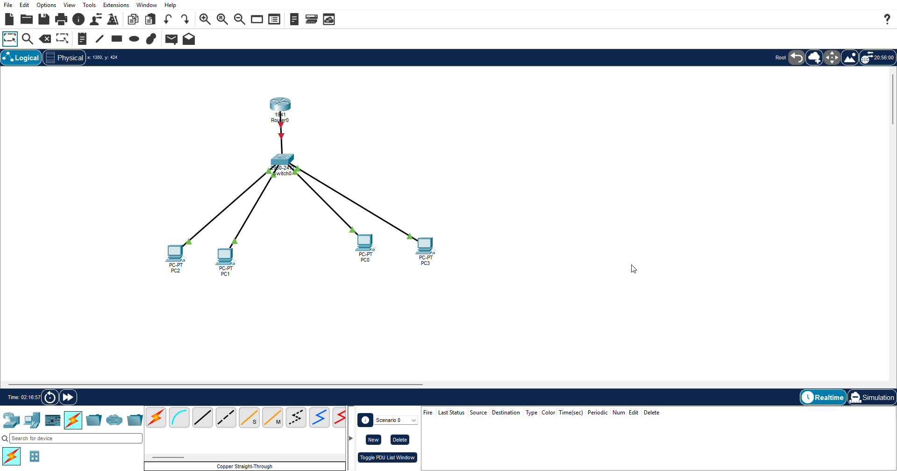
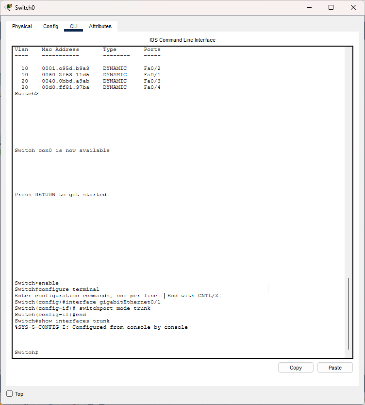
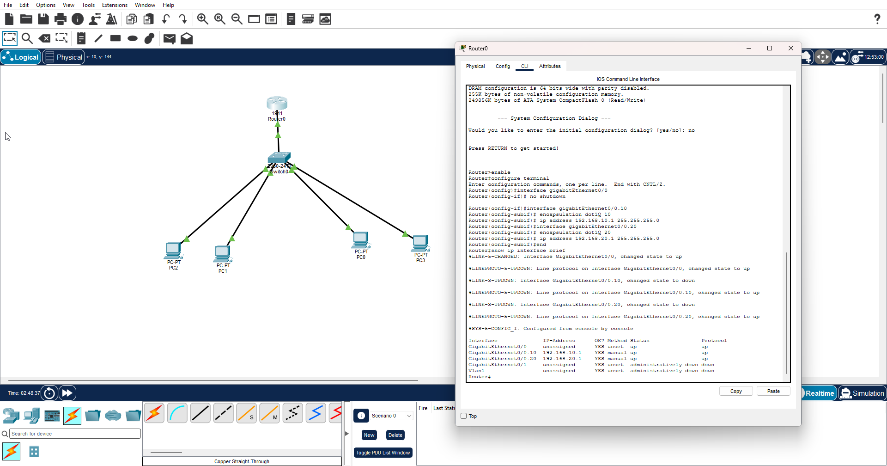
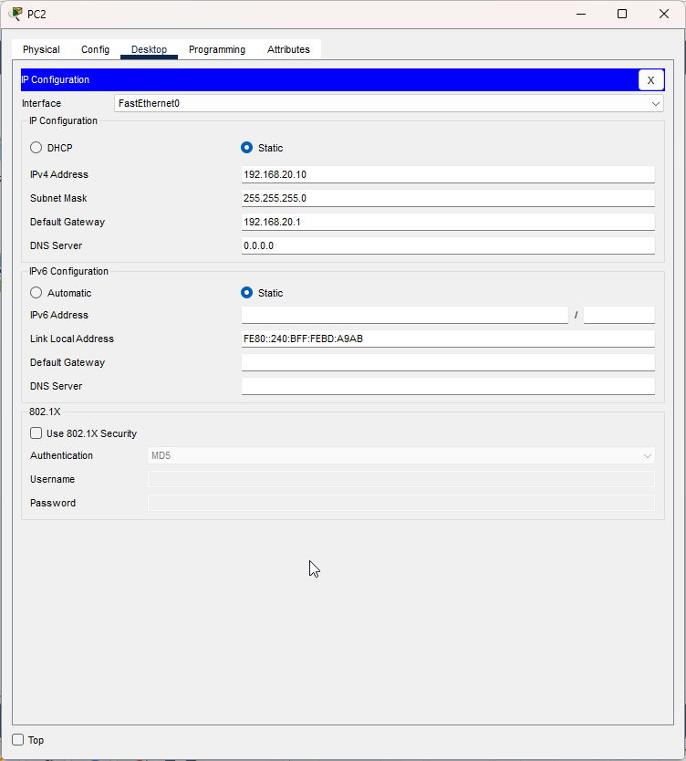
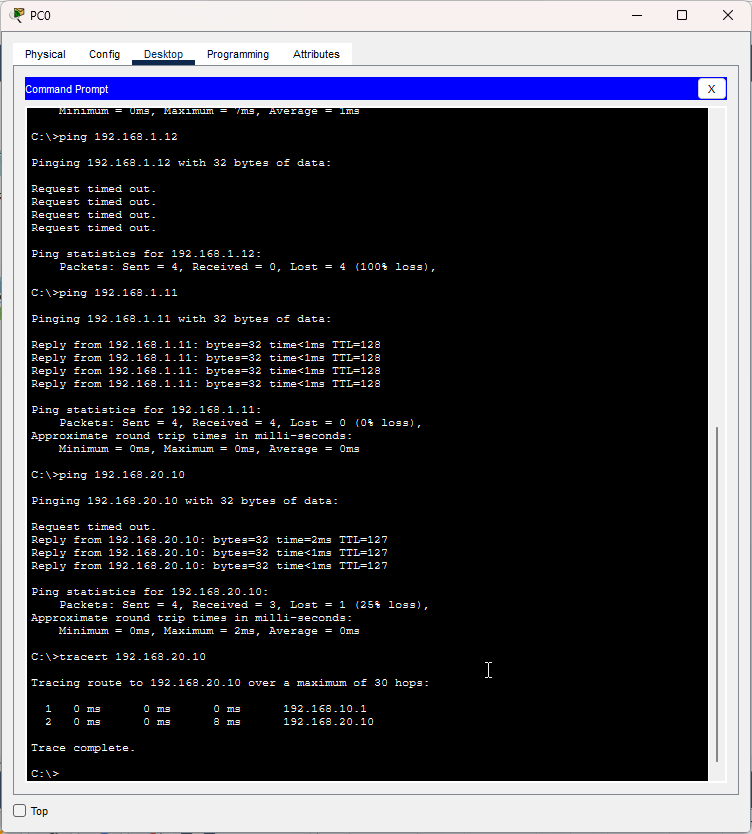

# LAB 06 — Inter-VLAN Routing (Router-on-a-Stick)

`Module 02 — Network Architecture` · `Cisco Packet Tracer · Catalyst 2960 · ISR 1941` · `Date: 2026-11-23` · `Status: Complete`

## Objective

Reconnect the two VLANs isolated in [LAB 05](../lab05-vlans/), this time through a router: give each VLAN its own subnet and gateway, carry both VLANs to the router over a single 802.1Q trunk, and verify the routed path with `ping`, `tracert` and the TTL.

## Repository contents

| Path | Content |
|---|---|
| `README.md` | This write-up |
| `screenshots/` | Topology, command output and test results |
| `evidence/lab06-intervlan.pkt` | The Packet Tracer project (final state) |
| `evidence/SHA256SUMS` | SHA-256 of the project file |

This lab runs entirely inside the Packet Tracer simulator on the host PC. It starts from the LAB 05 project, saved under a new name so the LAB 05 file stays unchanged.

---

## 1. Setup

| Device | Interface | VLAN | IP / mask | Gateway |
|---|---|---|---|---|
| PC0 | Fa0 → Switch0 Fa0/2 | 10 — ADMIN | `192.168.10.10/24` | `192.168.10.1` |
| PC1 | Fa0 → Switch0 Fa0/1 | 10 — ADMIN | `192.168.10.11/24` | `192.168.10.1` |
| PC2 | Fa0 → Switch0 Fa0/3 | 20 — FUNCIONARIOS | `192.168.20.10/24` | `192.168.20.1` |
| PC3 | Fa0 → Switch0 Fa0/4 | 20 — FUNCIONARIOS | `192.168.20.11/24` | `192.168.20.1` |
| Router0 (1941) | Gig0/0 → Switch0 Gig0/1 (trunk) | 10 and 20 | `Gig0/0.10` = `192.168.10.1/24`, `Gig0/0.20` = `192.168.20.1/24` | — |

> **Correction (2026-11-24, LAB 09):** PC0 is cabled to **Fa0/2** and PC1 to **Fa0/1**, not the reverse as originally written. Found by correlating the DHCP binding table (LAB 09) and the PC0 IPv6 link-local address with the MAC address table in LAB 05; confirmed in Packet Tracer. Both ports are in VLAN 10, so no result changes.

**What changed from LAB 05:** one router, one trunk link, and the PCs moved from the shared `192.168.1.0/24` to one subnet per VLAN. The VLAN assignment of the access ports is unchanged.



**Observed:** the new link shows red. Router interfaces on Cisco IOS are administratively shut down by default, unlike switch ports.

---

## 2. Key concepts

| Term | Definition |
|---|---|
| **Trunk** *(logical)* | A switch port mode that carries several VLANs over one cable, tagging each frame with its VLAN |
| **Access port** *(logical)* | A switch port that belongs to one VLAN and sends untagged frames; the end device never sees a tag |
| **802.1Q tag** | The 4-byte "badge" a trunk adds to a frame to say which VLAN it belongs to |
| **Subinterface** *(logical)* | A virtual interface on a router's physical port, e.g. `Gig0/0.10`. Each one handles one VLAN tag and holds that VLAN's gateway IP. |
| **Router-on-a-stick** | Inter-VLAN routing with a single router port, connected to the switch by one trunk |
| **Gateway** *(logical)* | The router's address inside a subnet; where a host sends any packet whose destination is outside its own subnet |
| **GigabitEthernet vs FastEthernet** *(physical)* | 1000 Mbps vs 100 Mbps. The trunk uses a Gig port because all inter-VLAN traffic shares it. |

---

## 3. Part A — Trunk on the switch

```console
Switch>enable
Switch#configure terminal
Switch(config)#interface gigabitEthernet0/1
Switch(config-if)# switchport mode trunk
Switch(config-if)#end
Switch#show interfaces trunk
Switch#
```



**Observed:** `show interfaces trunk` printed nothing.

**Interpretation:** the command lists only trunks that are operational. The router end of the cable was still shut down, so the link was down and no trunk was active yet. The configuration was in place but not yet in effect.

---

## 4. Part B — Subinterfaces on the router

```console
Router>enable
Router#configure terminal
Router(config)#interface gigabitEthernet0/0
Router(config-if)# no shutdown
Router(config-if)#interface gigabitEthernet0/0.10
Router(config-subif)# encapsulation dot1Q 10
Router(config-subif)# ip address 192.168.10.1 255.255.255.0
Router(config-subif)#interface gigabitEthernet0/0.20
Router(config-subif)# encapsulation dot1Q 20
Router(config-subif)# ip address 192.168.20.1 255.255.255.0
Router(config-subif)#end
Router#show ip interface brief

Interface              IP-Address      OK? Method Status                Protocol
GigabitEthernet0/0     unassigned      YES unset  up                    up
GigabitEthernet0/0.10  192.168.10.1    YES manual up                    up
GigabitEthernet0/0.20  192.168.20.1    YES manual up                    up
GigabitEthernet0/1     unassigned      YES unset  administratively down down
Vlan1                  unassigned      YES unset  administratively down down
```



**Observed:** `Gig0/0` and both subinterfaces are `up/up`, and the link to the switch turned green.

**Interpretation:** `no shutdown` brought the physical port up. `encapsulation dot1Q <n>` tells each subinterface which VLAN tag it handles, so the router's end of the trunk now understands the switch's tags. Unlike the switch, the router also has an IP address in each VLAN: the switch only separates, the router connects.

---

## 5. Part C — One subnet and gateway per VLAN

Each PC was moved into its VLAN's subnet and given the matching gateway (see the table in Section 1).



The first check showed PC2 still on its LAB 05 address (`192.168.1.12`, no gateway); it was corrected before testing (see Troubleshooting Log). Only PC2's configuration was screenshotted; PC0's is confirmed indirectly by its successful ping and trace.

---

## 6. Part D — Testing the routed path

```console
C:\>ping 192.168.20.10

Request timed out.
Reply from 192.168.20.10: bytes=32 time=2ms TTL=127
Reply from 192.168.20.10: bytes=32 time<1ms TTL=127
Reply from 192.168.20.10: bytes=32 time<1ms TTL=127

Ping statistics for 192.168.20.10:
    Packets: Sent = 4, Received = 3, Lost = 1 (25% loss),

C:\>tracert 192.168.20.10

Tracing route to 192.168.20.10 over a maximum of 30 hops:

  1   0 ms      0 ms      0 ms      192.168.10.1
  2   0 ms      0 ms      8 ms      192.168.20.10

Trace complete.
```



| Test (from PC0, VLAN 10) | LAB 05 (no router) | LAB 06 (router-on-a-stick) |
|---|---|---|
| Ping to PC2 (VLAN 20) | 0/4, 100% loss | 3/4 (first lost, see below) |
| TTL in replies | — (same-VLAN replies: 128) | 127 |
| Path (`tracert`) | — | `192.168.10.1` → `192.168.20.10` |

### Interpretation

- **The first lost packet** is consistent with ARP resolution: PC0 had to resolve its gateway's MAC, and the router had to resolve PC2's, before the first echo could be delivered. The remaining three succeeded.
- **The trace shows the gateway as hop 1.** PC0 compared `192.168.20.10` with its own subnet, decided it was remote, and sent the packet to `192.168.10.1`.
- **TTL dropped from 128 to 127.** Windows-style hosts start at 128 and each router decrements it by one, so 127 is consistent with exactly one routed hop. Unlike `tracert`, this can be read from any captured packet.
- **The packet crossed the same cable twice.** From PC0 it went up the trunk tagged VLAN 10, the router re-sent it down the same trunk tagged VLAN 20, and the switch removed the tag and delivered it on Fa0/3.

**Conclusion (high confidence, three independent indicators agree: ping success, trace path, TTL decrement):** traffic between VLAN 10 and VLAN 20 is now routed through Router0, consistent with the router-on-a-stick configuration in Parts A and B.

---

## 7. Troubleshooting Log

| Symptom | Cause | Fix |
|---|---|---|
| New router link shown red | Cisco router interfaces are shut down by default | `no shutdown` on `Gig0/0` |
| `show interfaces trunk` returned nothing | Trunk configured on the switch, but the router end was still down, so no trunk was operational | Resolved by Part B |
| PC2 still showed `192.168.1.12` with gateway `0.0.0.0` | New addressing not yet applied | Set `192.168.20.10/24`, gateway `192.168.20.1`, and re-checked |

---

## 8. Security / DFIR Relevance

- **The router is now the choke point between segments.** All inter-VLAN traffic passes through one device, which is exactly where filtering (ACLs) and logging belong. Right now it permits everything: segmentation without policy restores reachability, not security. That is the next step.
- **TTL is a hop counter you get for free.** A reply with TTL 127 from a Windows host says "one router in between" without running a trace. In a PCAP, an unexpected TTL can expose an extra hop or a different OS than claimed.
- **The gateway's MAC is on every routed frame.** In a capture taken in VLAN 10, packets to VLAN 20 carry the router's MAC as destination, not PC2's. The MAC identifies the next hop, the IP identifies the endpoint.
- **Trunks are high-value links.** A trunk carries every VLAN, so a host that negotiates or is placed on a trunk can see or inject traffic into all segments (VLAN hopping). Trunks should be set statically and limited to the VLANs they need.
- **Lateral-movement scoping.** After this lab, "which VLAN was the host in?" is no longer enough: an investigator also has to check what the router permitted between VLANs.

---

## 9. Evidence and Data Handling

| Evidence | Form |
|---|---|
| Final Packet Tracer project | `evidence/lab06-intervlan.pkt`, SHA-256 in `evidence/SHA256SUMS` |
| Switch and router CLI output, PC configuration, test results | Screenshots 01–05, transcribed above |

Verify with:

```bash
cd evidence && sha256sum -c SHA256SUMS
```

**Redactions:** the Packet Tracer title bar (which showed the local Windows path including the examiner's user name) and the Windows taskbar were cropped from the full-screen screenshots (01, 03). All MAC and IP addresses are simulated by Packet Tracer.

---

## 10. Verification Q&A

1. **What is a trunk, and is it physical or logical?**
   A switch port mode that carries several VLANs over one cable, tagging each frame. It is logical: the cable is an ordinary one.
2. **Why does the link to the router need to be a trunk?**
   Both VLANs share one cable to the router. Without tags, the router could not tell which VLAN a frame came from.
3. **What does `encapsulation dot1Q 20` do on `Gig0/0.20`?**
   It makes that subinterface handle frames tagged VLAN 20.
4. **Why did each VLAN need its own subnet?**
   A router connects different networks. With one shared subnet (LAB 05), the PCs would treat each other as local and never use the gateway.
5. **Why did the first ping fail?**
   ARP: the MACs of the gateway and of PC2 had to be resolved first.
6. **What does TTL 127 tell you?**
   The reply crossed one router (128 − 1), consistent with the trace.
7. **Is the network more secure now than in LAB 05?**
   No. VLAN 10 and VLAN 20 can reach each other freely again. Security returns only when the router filters traffic (ACLs).

---

## 11. References

- IEEE 802.1Q — Bridges and Bridged Networks (VLAN tagging)
- Cisco — Catalyst 2960 Software Configuration Guide: Configuring VLAN Trunks
- Cisco — ISR 1900 Software Configuration Guide: Configuring 802.1Q subinterfaces
- RFC 791 — Internet Protocol (Time to Live)
- RFC 826 — An Ethernet Address Resolution Protocol (ARP)
- NIST SP 800-86 — Guide to Integrating Forensic Techniques into Incident Response
