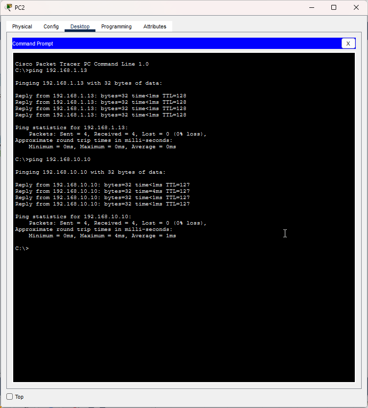
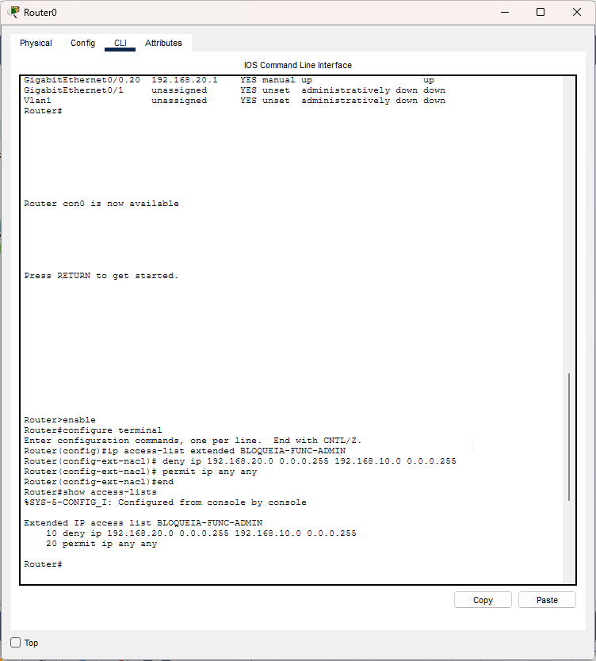
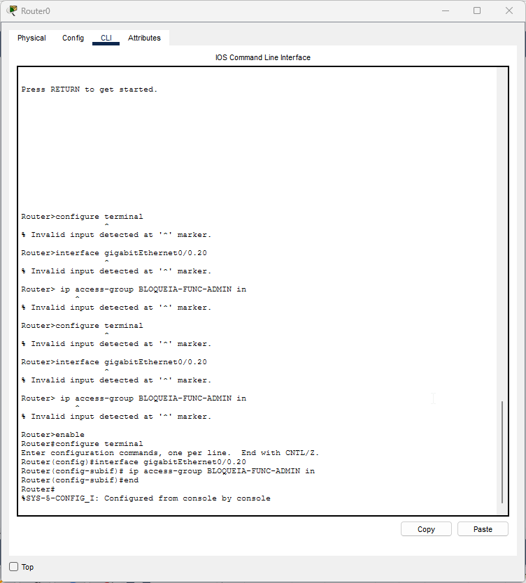
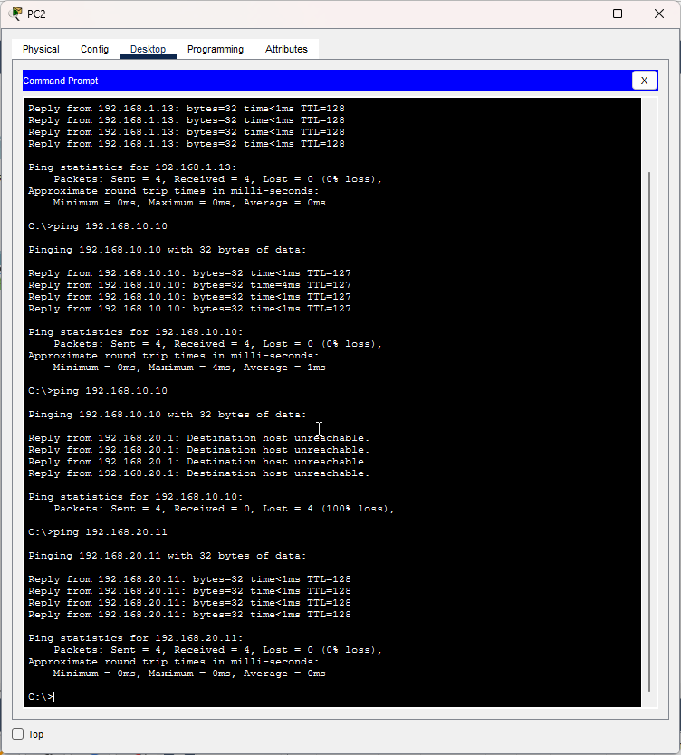
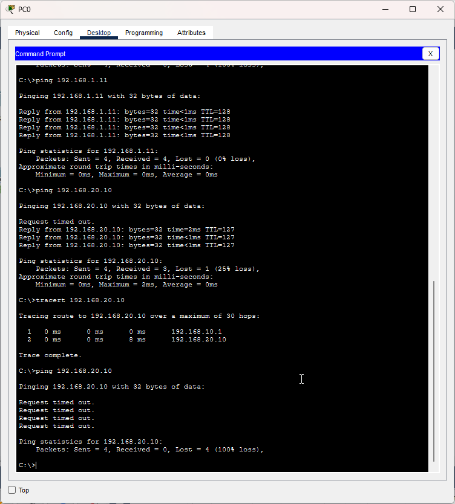
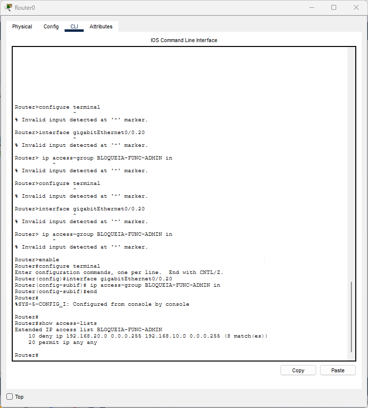

# LAB 07 — ACLs: Filtering Traffic Between VLANs

`Module 02 — Network Architecture` · `Cisco Packet Tracer · ISR 1941 IOS` · `Date: 2026-11-23` · `Status: Complete`

## Objective

Put a policy on the router that [LAB 06](../lab06-inter-vlan-routing/) turned into the only path between VLANs: block the Employees VLAN (FUNCIONARIOS, 20) from reaching the Administration VLAN (ADMIN, 10) while leaving everything else open. Then test both directions, read the ACL hit counters, and explain why the two blocked directions fail with different symptoms.

## Repository contents

| Path | Content |
|---|---|
| `README.md` | This write-up |
| `screenshots/` | Command output and test results |
| `evidence/lab07-acl.pkt` | The Packet Tracer project (final state) |
| `evidence/SHA256SUMS` | SHA-256 of the project file |

This lab runs entirely inside the Packet Tracer simulator. It starts from the LAB 06 project, saved under a new name.

---

## 1. Setup

Unchanged from LAB 06:

| Device | VLAN | IP | Gateway |
|---|---|---|---|
| PC0 | 10 — ADMIN | `192.168.10.10/24` | `192.168.10.1` |
| PC1 | 10 — ADMIN | `192.168.10.11/24` | `192.168.10.1` |
| PC2 | 20 — FUNCIONARIOS | `192.168.20.10/24` | `192.168.20.1` |
| PC3 | 20 — FUNCIONARIOS | `192.168.20.11/24` | `192.168.20.1` |
| Router0 | trunk via `Gig0/0` | `Gig0/0.10` = `192.168.10.1`, `Gig0/0.20` = `192.168.20.1` | — |

**Policy to implement:** FUNCIONARIOS → ADMIN denied; all other traffic permitted.

---

## 2. Key concepts

| Term | Definition |
|---|---|
| **ACL** *(logical)* | Access Control List: an ordered list of permit/deny rules the router checks against each packet, top to bottom, stopping at the first match |
| **Extended ACL** | An ACL that can match on source **and** destination (and protocol/ports), not only source |
| **Wildcard mask** | Tells the ACL which bits to ignore. `0.0.0.255` = "any value in the last octet", i.e. the whole /24 |
| **Implicit deny** | An invisible `deny ip any any` at the end of every ACL. Anything not explicitly permitted is dropped. |
| **`ip access-group … in`** | Applies the ACL to packets **entering** the router on that interface |
| **Stateless vs stateful** | A router ACL judges each packet on its own (stateless). A stateful firewall remembers connections and lets replies back in. |
| **User EXEC vs privileged EXEC** | `Router>` = view-only mode. `Router#` (after `enable`) = mode that allows configuration. |

---

## 3. Part A — Baseline before the ACL

```console
C:\>ping 192.168.10.10

Reply from 192.168.10.10: bytes=32 time<1ms TTL=127
Reply from 192.168.10.10: bytes=32 time=4ms TTL=127
Reply from 192.168.10.10: bytes=32 time<1ms TTL=127
Reply from 192.168.10.10: bytes=32 time<1ms TTL=127

Ping statistics for 192.168.10.10:
    Packets: Sent = 4, Received = 4, Lost = 0 (0% loss),
```



**Observed:** PC2 (FUNCIONARIOS) → PC0 (ADMIN), 4/4, TTL 127 (one routed hop, as in LAB 06). The earlier ping to `192.168.1.13` at the top of the window is left over from LAB 05, before PC2 was re-addressed; the PC's command history is saved in the project file.

---

## 4. Part B — Writing the ACL

```console
Router#configure terminal
Router(config)#ip access-list extended BLOQUEIA-FUNC-ADMIN
Router(config-ext-nacl)# deny ip 192.168.20.0 0.0.0.255 192.168.10.0 0.0.0.255
Router(config-ext-nacl)# permit ip any any
Router(config-ext-nacl)#end
Router#show access-lists
Extended IP access list BLOQUEIA-FUNC-ADMIN
    10 deny ip 192.168.20.0 0.0.0.255 192.168.10.0 0.0.0.255
    20 permit ip any any
```



| Seq | Rule | Meaning |
|---|---|---|
| 10 | `deny ip 192.168.20.0 0.0.0.255 192.168.10.0 0.0.0.255` | Any IP traffic from the FUNCIONARIOS subnet to the ADMIN subnet is dropped |
| 20 | `permit ip any any` | Everything else passes. Without it, the implicit deny would cut VLAN 20 off from every destination. |

At this point the ACL exists but is not attached to any interface, so it has no effect yet.

---

## 5. Part C — Applying the ACL

```console
Router>configure terminal
                 ^
% Invalid input detected at '^' marker.
...
Router>enable
Router#configure terminal
Router(config)#interface gigabitEthernet0/0.20
Router(config-subif)# ip access-group BLOQUEIA-FUNC-ADMIN in
Router(config-subif)#end
```



**Placement:** inbound on `Gig0/0.20`, the FUNCIONARIOS gateway. Extended ACLs are placed as close to the **source** as possible, so denied traffic is dropped as soon as it enters the router and never consumes further resources.

---

## 6. Part D — Testing both directions

### Test 1 — FUNCIONARIOS → ADMIN (and within FUNCIONARIOS)

```console
C:\>ping 192.168.10.10

Reply from 192.168.20.1: Destination host unreachable.
Reply from 192.168.20.1: Destination host unreachable.
Reply from 192.168.20.1: Destination host unreachable.
Reply from 192.168.20.1: Destination host unreachable.

Ping statistics for 192.168.10.10:
    Packets: Sent = 4, Received = 0, Lost = 4 (100% loss),

C:\>ping 192.168.20.11

Reply from 192.168.20.11: bytes=32 time<1ms TTL=128
...
    Packets: Sent = 4, Received = 4, Lost = 0 (0% loss),
```



### Test 2 — ADMIN → FUNCIONARIOS

```console
C:\>ping 192.168.20.10

Request timed out.
Request timed out.
Request timed out.
Request timed out.

Ping statistics for 192.168.20.10:
    Packets: Sent = 4, Received = 0, Lost = 4 (100% loss),
```



### ACL hit counters

```console
Router#show access-lists
Extended IP access list BLOQUEIA-FUNC-ADMIN
    10 deny ip 192.168.20.0 0.0.0.255 192.168.10.0 0.0.0.255 (8 match(es))
    20 permit ip any any
```



### Results

| Test | Before ACL | After ACL | Symptom |
|---|---|---|---|
| PC2 → PC0 (FUNC → ADMIN) | 4/4 | 0/4 | `Destination host unreachable` from `192.168.20.1` |
| PC2 → PC3 (inside FUNC) | — | 4/4, TTL 128 | none |
| PC0 → PC2 (ADMIN → FUNC) | 3/4 (LAB 06) | 0/4 | `Request timed out` |

### Interpretation

- **The policy blocks both directions, although only one was written.** The ACL is stateless. In Test 2, PC0's echo request (10 → 20) enters the router on `Gig0/0.10`, where no ACL applies, and is delivered. PC2's echo **reply** (20 → 10) then enters on `Gig0/0.20` and matches rule 10. Only a stateful firewall would recognise it as a reply and let it through.
- **The two failures look different because the drop notice goes to the sender of the dropped packet.** In Test 1, the dropped packet is PC2's request, so the router sends PC2 an ICMP unreachable from its gateway address (`192.168.20.1`). In Test 2, the dropped packet is PC2's reply, so the notice goes to PC2 again, and PC0 never hears anything: it just times out.
- **Intra-VLAN traffic is untouched.** PC2 → PC3 is switched inside VLAN 20 and never reaches the router (TTL 128, no hop), so the ACL cannot affect it.
- **The counter matches the tests exactly.** 8 matches = 4 echo requests from PC2 (Test 1) + 4 echo replies from PC2 (Test 2). The `permit` rule shows no matches because no other traffic crossed the router during the tests.

**Conclusion (high confidence, behaviour and counters agree):** the ACL drops all IP traffic from VLAN 20 to VLAN 10 at `Gig0/0.20` inbound. Because it is stateless, it also breaks ADMIN-initiated conversations with FUNCIONARIOS, which may or may not match the intended policy.

---

## 7. Troubleshooting Log

| Symptom | Cause | Fix |
|---|---|---|
| `% Invalid input detected` on `configure terminal` | The router had returned to user EXEC mode (`Router>`) after an idle timeout; configuration commands only exist in privileged mode | `enable` first, then the same commands. The command list given for this step had omitted `enable`. |

---

## 8. Security / DFIR Relevance

- **A timeout is ambiguous; an ICMP unreachable is a clue.** From PC0's side, "Request timed out" is consistent with a host that is off, a broken link, or a filter. The `unreachable` that PC2 received names the device that dropped the packet (`192.168.20.1`), which points to where the block happened.
- **ACL counters are evidence.** `match(es)` counts how many packets a rule hit, so they can corroborate (or contradict) a claim about what traffic was attempted. Like the MAC table in LAB 05, they are volatile: they reset with `clear access-list counters` or a reboot. Collect `show access-lists` early, with a timestamp. A rule with `log` would also record each hit to syslog, which survives longer.
- **Stateless filters have side effects.** "Block FUNC → ADMIN" also blocked "ADMIN → FUNC replies". Realistic policies use `established` on TCP rules, a reflexive ACL, or a stateful firewall (Module 05) to allow replies to sessions started from the trusted side.
- **Rule order and the implicit deny matter.** Forgetting `permit ip any any` would have silently isolated VLAN 20 from everything. When reviewing a configuration during an investigation, read ACLs top to bottom and remember the invisible last line.
- **Privilege levels are an access control too.** `Router>` cannot change anything; `Router#` can. On a real device, `enable` should require a password and every privileged session should be logged.

---

## 9. Evidence and Data Handling

| Evidence | Form |
|---|---|
| Final Packet Tracer project | `evidence/lab07-acl.pkt`, SHA-256 in `evidence/SHA256SUMS` |
| CLI output and test results | Screenshots 01–06, transcribed above |

Verify with:

```bash
cd evidence && sha256sum -c SHA256SUMS
```

**Redactions:** none needed; all screenshots are single Packet Tracer windows with no taskbar or local path. All addresses are simulated by Packet Tracer.

---

## 10. Verification Q&A

1. **What does an ACL do?**
   It checks each packet against an ordered list of permit/deny rules and applies the first one that matches.
2. **Why is `permit ip any any` needed?**
   Every ACL ends with an implicit deny. Without the permit, VLAN 20 would lose access to every destination, not only ADMIN.
3. **Why apply the ACL inbound on `Gig0/0.20`?**
   It is closest to the source of the traffic being denied, so the packet is dropped as soon as it enters the router.
4. **Only FUNC → ADMIN was denied. Why did ADMIN → FUNC fail too?**
   The ACL is stateless: PC2's replies to PC0 are also FUNC → ADMIN packets and match the deny rule.
5. **Why did PC2 get "Destination host unreachable" but PC0 got "Request timed out"?**
   The router notifies the sender of the dropped packet. That was PC2 in both tests, so PC0 never received any notice.
6. **What do the 8 matches correspond to?**
   4 echo requests from PC2 plus 4 echo replies from PC2.
7. **Why did the first commands fail with "Invalid input"?**
   The router was in user EXEC mode (`Router>`). Configuration requires privileged mode (`enable` → `Router#`).

---

## 11. References

- Cisco — ISR 1900 / IOS Security Configuration Guide: Access Control Lists (extended ACLs, wildcard masks, implicit deny)
- RFC 792 — Internet Control Message Protocol (Destination Unreachable)
- RFC 1812 — Requirements for IP Version 4 Routers (ICMP unreachable for administratively prohibited traffic)
- NIST SP 800-41 Rev. 1 — Guidelines on Firewalls and Firewall Policy (stateless vs stateful filtering)
- NIST SP 800-86 — Guide to Integrating Forensic Techniques into Incident Response
