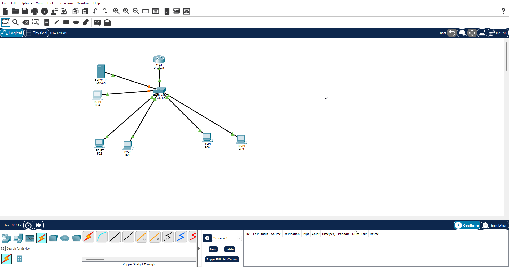
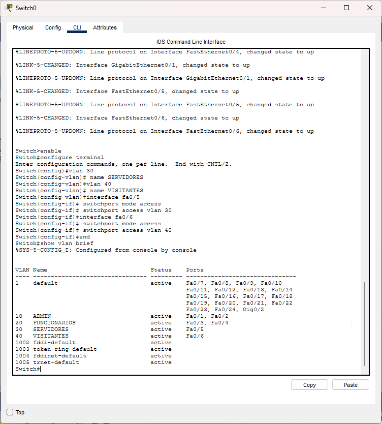
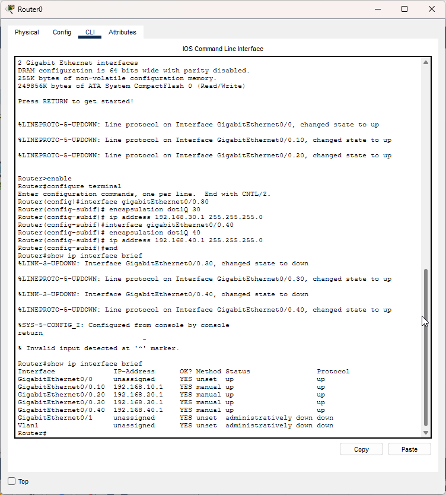
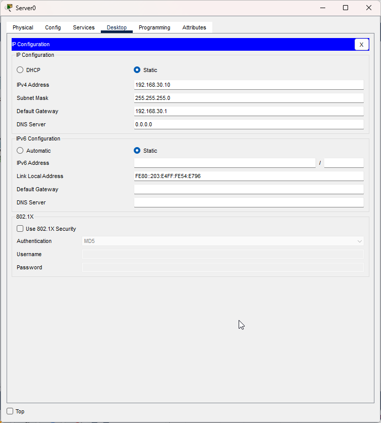
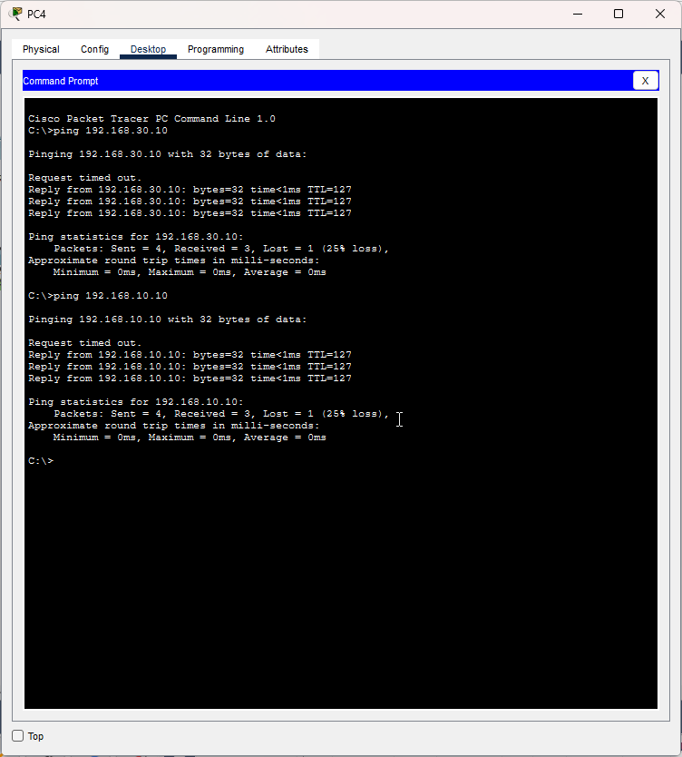
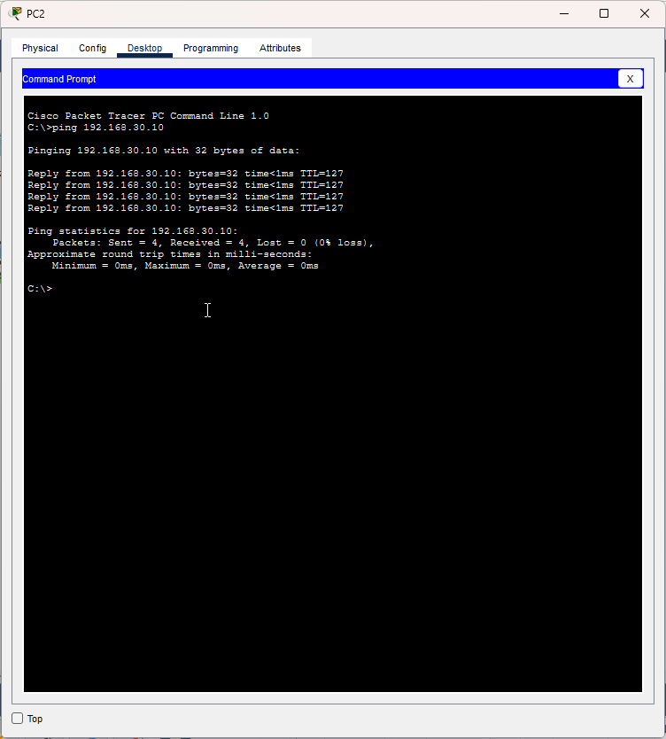
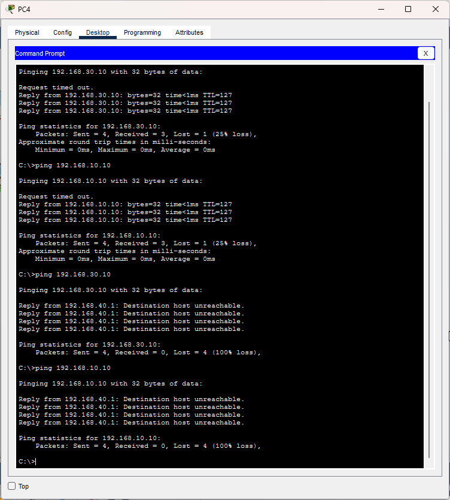
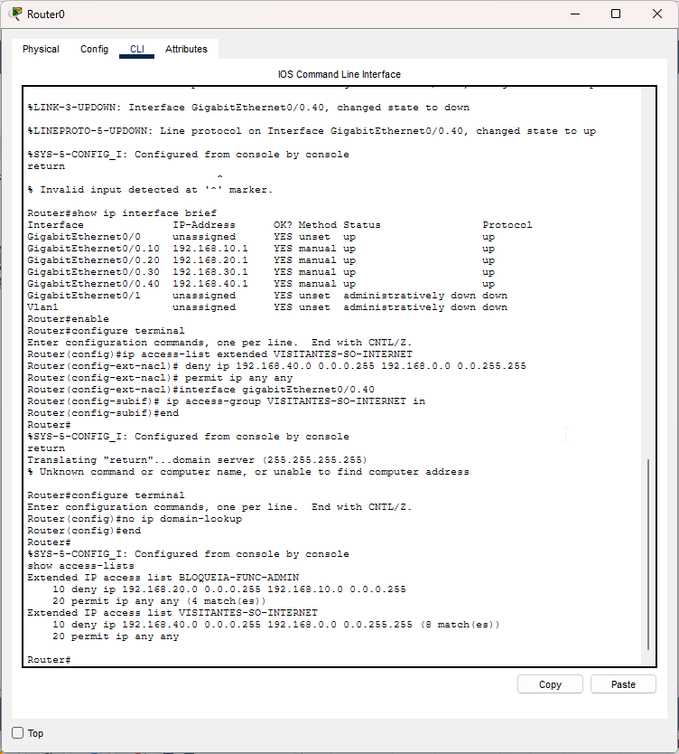

# LAB 08 — Servers and Guests VLANs: Completing the Segmentation

`Module 02 — Network Architecture` · `Cisco Packet Tracer · Catalyst 2960 · ISR 1941` · `Date: 2026-11-24` · `Status: Complete`

## Objective

Complete the four-segment corporate design by adding the **Servers** (VLAN 30) and **Guests** (VLAN 40) networks to the topology built in LABs [05](../lab05-vlans/)–[07](../lab07-acl/). Then test reachability between all segments, find the gap the existing policy leaves open, and close it with a guest ACL.

## Repository contents

| Path | Content |
|---|---|
| `README.md` | This write-up |
| `screenshots/` | Topology, command output and test results |
| `evidence/lab08-servers-guests.pkt` | The Packet Tracer project (final state) |
| `evidence/SHA256SUMS` | SHA-256 of the project file |

This lab runs entirely inside the Packet Tracer simulator. It starts from the LAB 07 project, saved under a new name.

---

## 1. Setup

| Device | Switch port | VLAN | IP / mask | Gateway |
|---|---|---|---|---|
| PC0 | Fa0/2 | 10 — ADMIN | `192.168.10.10/24` | `192.168.10.1` |
| PC1 | Fa0/1 | 10 — ADMIN | `192.168.10.11/24` | `192.168.10.1` |
| PC2 | Fa0/3 | 20 — FUNCIONARIOS (employees) | `192.168.20.10/24` | `192.168.20.1` |
| PC3 | Fa0/4 | 20 — FUNCIONARIOS (employees) | `192.168.20.11/24` | `192.168.20.1` |
| **Server0** | **Fa0/5** | **30 — SERVIDORES (servers)** | **`192.168.30.10/24`** | **`192.168.30.1`** |
| **PC4 (guest)** | **Fa0/6** | **40 — VISITANTES (guests)** | **`192.168.40.10/24`** | **`192.168.40.1`** |
| Router0 | Gig0/0 ↔ Switch0 Gig0/1 (trunk) | all | `.10.1`, `.20.1`, `.30.1`, `.40.1` on subinterfaces | — |

> **Correction (2026-11-24, LAB 09):** PC0 is cabled to **Fa0/2** and PC1 to **Fa0/1**, not the reverse as originally written. Found by correlating the DHCP binding table (LAB 09) and the PC0 IPv6 link-local address with the MAC address table in LAB 05; confirmed in Packet Tracer. Both ports are in VLAN 10, so no result changes.

New in this lab: Server0, PC4, VLANs 30 and 40, subinterfaces `Gig0/0.30` and `Gig0/0.40`, and a second ACL.



The two new links briefly showed orange on the switch side before turning green: the switch keeps a new port in a listening/learning state (Spanning Tree) for about 30 seconds before forwarding.

---

## 2. Part A — VLANs 30 and 40 on the switch

```console
Switch(config)#vlan 30
Switch(config-vlan)# name SERVIDORES
Switch(config-vlan)#vlan 40
Switch(config-vlan)# name VISITANTES
Switch(config-vlan)#interface fa0/5
Switch(config-if)# switchport mode access
Switch(config-if)# switchport access vlan 30
Switch(config-if)#interface fa0/6
Switch(config-if)# switchport mode access
Switch(config-if)# switchport access vlan 40
Switch(config-if)#end
Switch#show vlan brief

VLAN Name                             Status    Ports
---- -------------------------------- --------- -------------------------------
1    default                          active    Fa0/7, ... Fa0/24, Gig0/2
10   ADMIN                            active    Fa0/1, Fa0/2
20   FUNCIONARIOS                     active    Fa0/3, Fa0/4
30   SERVIDORES                       active    Fa0/5
40   VISITANTES                       active    Fa0/6
```



**Observed:** all four corporate VLANs are present with the expected ports. `Gig0/1` is absent from the list because it is a trunk (LAB 06) and does not belong to a single VLAN.

---

## 3. Part B — Gateways on the router

```console
Router(config)#interface gigabitEthernet0/0.30
Router(config-subif)# encapsulation dot1Q 30
Router(config-subif)# ip address 192.168.30.1 255.255.255.0
Router(config-subif)#interface gigabitEthernet0/0.40
Router(config-subif)# encapsulation dot1Q 40
Router(config-subif)# ip address 192.168.40.1 255.255.255.0
Router(config-subif)#end
Router#show ip interface brief

Interface              IP-Address      OK? Method Status                Protocol
GigabitEthernet0/0     unassigned      YES unset  up                    up
GigabitEthernet0/0.10  192.168.10.1    YES manual up                    up
GigabitEthernet0/0.20  192.168.20.1    YES manual up                    up
GigabitEthernet0/0.30  192.168.30.1    YES manual up                    up
GigabitEthernet0/0.40  192.168.40.1    YES manual up                    up
```



Same router-on-a-stick pattern as LAB 06: one subinterface per VLAN tag, each holding that VLAN's gateway.



---

## 4. Part C — Reachability test and finding

With only the LAB 07 ACL in place (`BLOQUEIA-FUNC-ADMIN`, inbound on `Gig0/0.20`):





| Test | Result |
|---|---|
| PC2 (employees) → Server0 | 4/4, TTL 127 |
| PC4 (guest) → Server0 | 3/4 (first lost to ARP), TTL 127 |
| PC4 (guest) → PC0 (ADMIN) | 3/4 (first lost to ARP), TTL 127 |

The prediction before running the test was correct: the guest would reach ADMIN, because the only ACL filters traffic from VLAN 20.

**Finding:** a host on the guest network could reach the administration workstation and the server. In a real assessment this would be reported as a **segmentation failure**: the guest network is the least trusted segment (visitors' own devices), and adding a VLAN without a matching policy gave it the same reach as an employee.

---

## 5. Part D — Guest ACL

**Policy:** guests may not reach any internal network; everything else (the internet, from LAB 10) is allowed.

```console
Router(config)#ip access-list extended VISITANTES-SO-INTERNET
Router(config-ext-nacl)# deny ip 192.168.40.0 0.0.0.255 192.168.0.0 0.0.255.255
Router(config-ext-nacl)# permit ip any any
Router(config-ext-nacl)#interface gigabitEthernet0/0.40
Router(config-subif)# ip access-group VISITANTES-SO-INTERNET in
Router(config-subif)#end
```

The destination `192.168.0.0 0.0.255.255` covers every internal subnet at once (`192.168.x.x`), so the rule does not need updating when a new internal VLAN is added. Note that it also covers the router's own guest gateway address (`192.168.40.1`), so guests can no longer ping their gateway; traffic forwarded through the router to non-internal destinations is unaffected.



| Test from PC4 (guest) | Before guest ACL | After guest ACL |
|---|---|---|
| → Server0 | 3/4 | 0/4, `Destination host unreachable` from `192.168.40.1` |
| → PC0 (ADMIN) | 3/4 | 0/4, `Destination host unreachable` from `192.168.40.1` |

### ACL counters

```console
Router#show access-lists
Extended IP access list BLOQUEIA-FUNC-ADMIN
    10 deny ip 192.168.20.0 0.0.0.255 192.168.10.0 0.0.0.255
    20 permit ip any any (4 match(es))
Extended IP access list VISITANTES-SO-INTERNET
    10 deny ip 192.168.40.0 0.0.0.255 192.168.0.0 0.0.255.255 (8 match(es))
    20 permit ip any any
```



### Interpretation

- **8 matches on the guest deny** = 4 echo requests to Server0 + 4 to PC0, exactly the blocked tests.
- **4 matches on the employee permit** = PC2's 4 echo requests to Server0, which passed the LAB 07 ACL through its `permit ip any any`.
- **The LAB 07 deny counter is back to zero** (it showed 8 matches at the end of LAB 07). The project was closed and reopened between labs; this is consistent with ACL counters being runtime state that is not saved in the configuration file.
- **The unreachable messages come from `192.168.40.1`,** the guest gateway, which points to where the traffic was dropped (as in LAB 07).

**Conclusion (high confidence, behaviour and counters agree):** after the guest ACL, PC4 can no longer reach the ADMIN or Servers networks, consistent with `VISITANTES-SO-INTERNET` dropping all guest traffic to `192.168.0.0/16` at `Gig0/0.40` inbound. Employees can still reach the server.

### Resulting access matrix (tested paths)

| From \ To | ADMIN (10) | FUNCIONARIOS (20) | SERVIDORES (30) |
|---|---|---|---|
| **FUNCIONARIOS (20)** | ❌ blocked (LAB 07) | — | ✅ tested |
| **VISITANTES (40)** | ❌ blocked | not tested (blocked by the same rule) | ❌ blocked |

---

## 6. Troubleshooting Log

| Symptom | Cause | Fix |
|---|---|---|
| Screenshot showed the commands but no `show vlan brief` / `show ip interface brief` table | Screenshot taken before the output printed (status messages arrived first) | Ran the `show` command again |
| `show ip interface brief` run on the switch instead of the router | Wrong device window | Exited `--More--` with `q`, opened Router0 |
| `% Invalid input detected` on a stray `return` | An extra word pasted after the commands | Harmless; ignored |
| Router CLI appeared frozen after `return`: `Translating "return"...domain server (255.255.255.255)` | In privileged mode, IOS treats an unknown word as a host name and tries a DNS lookup; with no DNS server it waits for a timeout | Waited for the timeout; then `no ip domain-lookup` to prevent it |

---

## 7. Security / DFIR Relevance

- **Every new segment needs its own policy.** Adding VLAN 40 without an ACL silently gave guests the same reach as employees. A configuration review should check that each segment has an explicit policy, not just that segments exist.
- **The guest network is the least trusted.** It hosts unmanaged devices; a compromised visitor laptop is a classic first foothold. The rule here ("no internal access") is the usual baseline.
- **Summarised rules age better.** Denying `192.168.0.0/16` instead of each subnet keeps new internal VLANs protected automatically. When reviewing ACLs, look for policies that only cover the subnets that existed when they were written.
- **ACL counters are runtime state.** They reset on reload (here, on reopening the project). Collect `show access-lists` from the live device early; for durable evidence, add `log` to deny rules and send logs to a syslog server.
- **`no ip domain-lookup` is basic hygiene,** and its absence on a device is a small indicator of an unhardened configuration.

---

## 8. Evidence and Data Handling

| Evidence | Form |
|---|---|
| Final Packet Tracer project | `evidence/lab08-servers-guests.pkt`, SHA-256 in `evidence/SHA256SUMS` |
| CLI output, configuration and test results | Screenshots 01–08, transcribed above |

Verify with:

```bash
cd evidence && sha256sum -c SHA256SUMS
```

**Redactions:** none needed; screenshot 01 was provided already without title bar and taskbar, the rest are single Packet Tracer windows. All addresses are simulated by Packet Tracer.

---

## 9. Verification Q&A

1. **What had to be added for each new VLAN?**
   The VLAN and access port on the switch, a dot1Q subinterface with the gateway IP on the router, and an IP/gateway on the host.
2. **Why did the guest reach ADMIN before the guest ACL?**
   The only ACL (LAB 07) filtered traffic entering from VLAN 20. Nothing filtered VLAN 40.
3. **What does `192.168.0.0 0.0.255.255` match?**
   Any address starting with `192.168.`, i.e. all internal subnets in this lab.
4. **Why is the guest ACL applied inbound on `Gig0/0.40`?**
   It is closest to the source of the traffic being denied.
5. **Why did the LAB 07 deny counter show no matches?**
   ACL counters are runtime state; the project was reopened, which reset them.
6. **Why did the router "freeze" after typing `return`?**
   It tried to resolve the unknown word as a host name via DNS and waited for a timeout. `no ip domain-lookup` prevents this.

---

## 10. References

- IEEE 802.1Q — Bridges and Bridged Networks (VLAN tagging)
- Cisco — IOS Security Configuration Guide: Access Control Lists
- Cisco — IOS IP Addressing Services: `ip domain-lookup`
- NIST SP 800-41 Rev. 1 — Guidelines on Firewalls and Firewall Policy
- NIST SP 800-86 — Guide to Integrating Forensic Techniques into Incident Response
