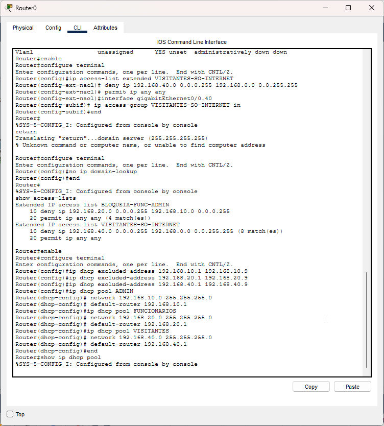
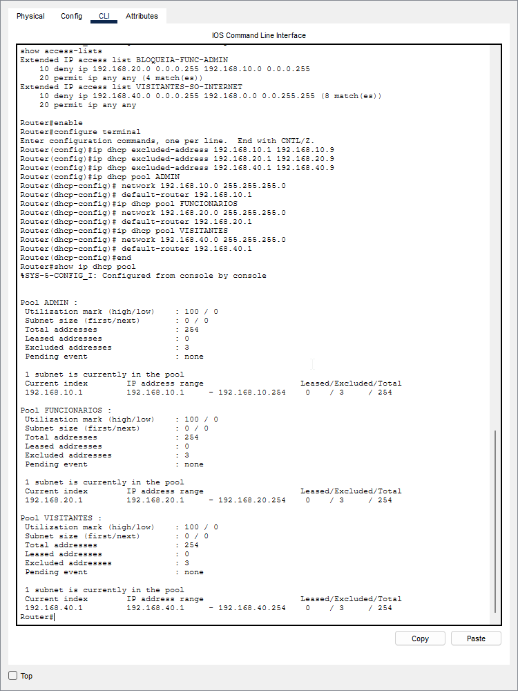
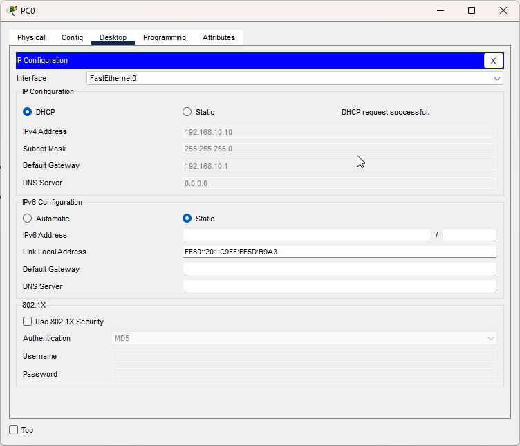
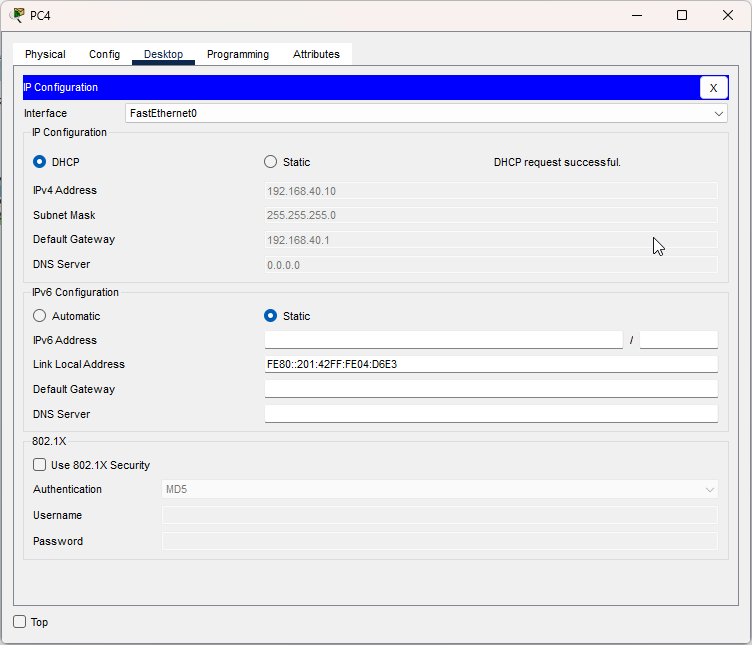
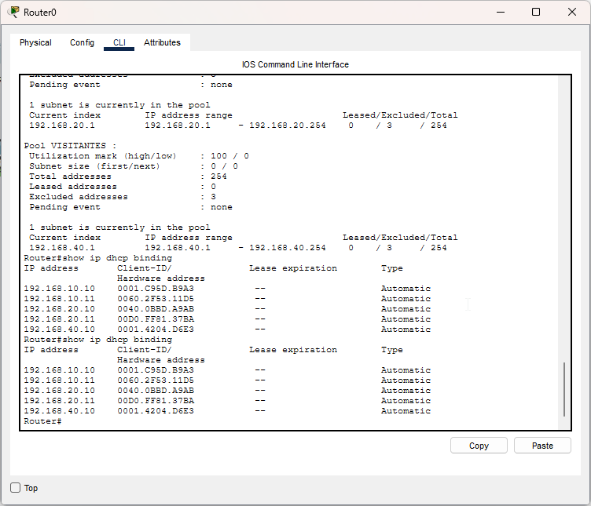

# LAB 09 — DHCP: Automatic Addressing per VLAN

`Module 02 — Network Architecture` · `Cisco Packet Tracer · ISR 1941 IOS` · `Date: 2026-11-24` · `Status: Complete`

## Objective

Replace manual IP configuration with DHCP served by the router, one pool per client VLAN, keeping the server on a fixed address. Then read the DHCP binding table as an investigator would, and use it to cross-check earlier evidence.

## Repository contents

| Path | Content |
|---|---|
| `README.md` | This write-up |
| `screenshots/` | Configuration, client results and binding table |
| `evidence/lab09-dhcp.pkt` | The Packet Tracer project (final state) |
| `evidence/SHA256SUMS` | SHA-256 of the project file |

This lab runs entirely inside the Packet Tracer simulator. It starts from the [LAB 08](../lab08-servers-guests/) project, saved under a new name.

---

## 1. Setup

Same topology as LAB 08 (four VLANs, router-on-a-stick, two ACLs). Changes in this lab:

| Item | Before | After |
|---|---|---|
| PC0–PC3, PC4 | Static IP and gateway | DHCP from Router0 |
| Server0 | Static `192.168.30.10` | Unchanged (servers keep fixed addresses so clients can find them) |
| Router0 | — | DHCP server with pools for VLANs 10, 20 and 40 |

---

## 2. Key concepts

| Term | Definition |
|---|---|
| **DHCP** *(logical)* | Dynamic Host Configuration Protocol: a server hands each client an IP address, mask, gateway (and optionally DNS) for a limited time |
| **Pool** | The range of addresses and options the server offers on one subnet |
| **Excluded address** | Addresses inside a pool's subnet that the server must never hand out (reserved for the gateway and infrastructure) |
| **Lease** | The time a client may keep its address before renewing |
| **Binding** | The server's record of which address was leased to which client (MAC) |
| **DORA** | Discover → Offer → Request → Acknowledge: the four-message exchange in which a client obtains a lease. The Discover is broadcast from source `0.0.0.0`. |

---

## 3. Part A — Pools on the router

```console
Router(config)#ip dhcp excluded-address 192.168.10.1 192.168.10.9
Router(config)#ip dhcp excluded-address 192.168.20.1 192.168.20.9
Router(config)#ip dhcp excluded-address 192.168.40.1 192.168.40.9
Router(config)#ip dhcp pool ADMIN
Router(dhcp-config)# network 192.168.10.0 255.255.255.0
Router(dhcp-config)# default-router 192.168.10.1
Router(dhcp-config)#ip dhcp pool FUNCIONARIOS
Router(dhcp-config)# network 192.168.20.0 255.255.255.0
Router(dhcp-config)# default-router 192.168.20.1
Router(dhcp-config)#ip dhcp pool VISITANTES
Router(dhcp-config)# network 192.168.40.0 255.255.255.0
Router(dhcp-config)# default-router 192.168.40.1
Router(dhcp-config)#end
```



| Pool | Subnet | Gateway handed out | Assignable range |
|---|---|---|---|
| ADMIN | `192.168.10.0/24` | `192.168.10.1` | `.10` – `.254` |
| FUNCIONARIOS | `192.168.20.0/24` | `192.168.20.1` | `.10` – `.254` |
| VISITANTES | `192.168.40.0/24` | `192.168.40.1` | `.10` – `.254` |

No pool exists for VLAN 30 (Servers) by design.

```console
Router#show ip dhcp pool

Pool ADMIN :
 Total addresses                : 254
 Leased addresses               : 0
 Excluded addresses             : 3
 ...
```



**Observed:** three pools, 254 addresses each, 0 leased. Each pool reports **3** excluded addresses although each excluded range covers 9. This is consistent with Packet Tracer counting the three `excluded-address` statements rather than the addresses they cover; the exclusions themselves worked (no client received an address below `.10`).

---

## 4. Part B — Clients request addresses

Each PC was switched from **Static** to **DHCP** in *Desktop → IP Configuration*.





| Client | Result | Address | Gateway |
|---|---|---|---|
| PC0 | `DHCP request successful` | `192.168.10.10` | `192.168.10.1` |
| PC4 (guest) | `DHCP request successful` | `192.168.40.10` | `192.168.40.1` |

### Why the guest ACL did not block DHCP

The guest ACL from LAB 08 (`VISITANTES-SO-INTERNET`, inbound on `Gig0/0.40`) denies traffic **from** `192.168.40.0/24` to `192.168.0.0/16`. A client asking for an address does not have one yet: its Discover and Request are sent from `0.0.0.0` to the broadcast address `255.255.255.255`. Neither source nor destination matches the deny rule, so the packets fall through to `permit ip any any`.

A side effect to keep in mind: a lease **renewal** is sent as unicast from the client's leased address to the server (`192.168.40.10` → `192.168.40.1`), which **does** match the deny rule. In a real network this would make renewals fail and clients fall back to broadcast rebinding. It was not observed in this lab (Packet Tracer showed no lease expiry), but a production guest ACL would add `permit udp any any eq bootps` above the deny.

---

## 5. Part C — The binding table

```console
Router#show ip dhcp binding
IP address       Client-ID/              Lease expiration        Type
                 Hardware address
192.168.10.10    0001.C95D.B9A3           --                     Automatic
192.168.10.11    0060.2F53.11D5           --                     Automatic
192.168.20.10    0040.0BBD.A9AB           --                     Automatic
192.168.20.11    00D0.FF81.37BA           --                     Automatic
192.168.40.10    0001.4204.D6E3           --                     Automatic
```



**Observed:** five leases, one per client PC, each tied to a MAC address. Lease expiration shows `--` in Packet Tracer.

### Cross-checking the binding table against earlier evidence

The binding table links an IP address to a MAC address. The MAC address table in [LAB 05](../lab05-vlans/) linked MAC addresses to switch ports. Joining the two:

| IP (this lab) | MAC (binding) | Switch port (LAB 05 MAC table) | Port documented in LABs 05–08 |
|---|---|---|---|
| `192.168.10.10` (PC0) | `0001.C95D.B9A3` | **Fa0/2** | Fa0/1 ❌ |
| `192.168.10.11` (PC1) | `0060.2F53.11D5` | **Fa0/1** | Fa0/2 ❌ |
| `192.168.20.10` (PC2) | `0040.0BBD.A9AB` | Fa0/3 | Fa0/3 ✅ |
| `192.168.20.11` (PC3) | `00D0.FF81.37BA` | Fa0/4 | Fa0/4 ✅ |

A third, independent source agrees: PC0's IPv6 link-local address `FE80::201:C9FF:FE5D:B9A3` (screenshot 03) is derived from its MAC (EUI-64), so `0001.C95D.B9A3` belongs to PC0.

**Conclusion (high confidence, three sources agree and confirmed by inspecting the cable in Packet Tracer):** PC0 is connected to Fa0/2 and PC1 to Fa0/1. The earlier write-ups had them swapped. Both ports are in VLAN 10, so no test result in LABs 05–08 changes; the setup tables in those READMEs have been corrected with a dated note.

---

## 6. Troubleshooting Log

| Symptom | Cause | Fix |
|---|---|---|
| `show ip dhcp pool` output missing from the first screenshot | Screenshot taken before the output printed | Ran the command again |
| PC0/PC1 switch ports documented incorrectly since LAB 05 | Ports assumed from the cabling instructions, not verified | Found by cross-referencing evidence (Section 5), confirmed in Packet Tracer, earlier READMEs corrected |
| First `.pkt` copy lacked the DHCP configuration | File saved with *Save As* before the lab, not saved again afterwards | Saved again after the lab; the published file is the final state |

---

## 7. Security / DFIR Relevance

- **The DHCP binding table is the IP → machine map.** Alerts, firewall logs and proxy logs usually record only an IP address. With dynamic addressing, the same IP can belong to different machines at different times, so attribution needs the binding (or the DHCP server log) **for that time**. Collect it early: leases expire and addresses are reused.
- **Joining tables is how attribution is built.** DHCP binding (IP → MAC) + switch MAC table (MAC → port) + port documentation (port → desk/user) leads from an IP in an alert to a physical location. This lab also showed the reverse use: the join exposed an error in our own documentation.
- **Documentation is a claim, not evidence.** The cabling had been documented from the instructions, not from observation. Three independent technical sources contradicted it. In an investigation, network diagrams and asset inventories must be verified against live data.
- **MAC addresses are self-reported.** A client can spoof its MAC, so a binding shows which MAC asked for an address, not which physical device. Corroborate with switch port and other sources.
- **Rogue DHCP is a classic attack.** Any device on a VLAN can answer DHCP Discovers and hand out a malicious gateway or DNS server (man-in-the-middle). Switch features such as DHCP snooping restrict DHCP offers to trusted ports.
- **Servers stay static** so that clients, DNS records and firewall rules can rely on their address.

---

## 8. Evidence and Data Handling

| Evidence | Form |
|---|---|
| Final Packet Tracer project | `evidence/lab09-dhcp.pkt`, SHA-256 in `evidence/SHA256SUMS` |
| Pool configuration, client results, binding table | Screenshots 01–05, transcribed above |

Verify with:

```bash
cd evidence && sha256sum -c SHA256SUMS
```

**Redactions:** none needed; all screenshots are single Packet Tracer windows. All MAC and IP addresses are simulated by Packet Tracer.

---

## 9. Verification Q&A

1. **What does a DHCP server give a client?**
   An IP address and mask, a default gateway (and optionally DNS), for the duration of a lease.
2. **Why exclude `.1` to `.9`?**
   To keep the gateway and future infrastructure addresses from being handed to clients.
3. **Why does the server not use DHCP?**
   Clients and rules need to find it at a fixed address.
4. **How did the guest obtain an address despite the guest ACL?**
   DHCP Discover/Request are sent from `0.0.0.0` to `255.255.255.255`, which does not match the deny rule.
5. **What would break later for guests, and how would you fix it?**
   Unicast lease renewals to `192.168.40.1` match the deny rule. Permit DHCP (`udp eq bootps`) above it.
6. **An alert names `192.168.20.11`. How do you find the machine?**
   DHCP binding → MAC `00D0.FF81.37BA` → switch MAC table → port Fa0/4 → PC3.
7. **What error did the cross-check reveal?**
   PC0 and PC1 were documented on swapped switch ports since LAB 05.

---

## 10. References

- RFC 2131 — Dynamic Host Configuration Protocol
- RFC 4291 — IPv6 Addressing Architecture (modified EUI-64 interface identifiers)
- Cisco — IOS IP Addressing Configuration Guide: Configuring the Cisco IOS DHCP Server
- Cisco — Catalyst 2960 Configuration Guide: DHCP Snooping
- NIST SP 800-86 — Guide to Integrating Forensic Techniques into Incident Response
