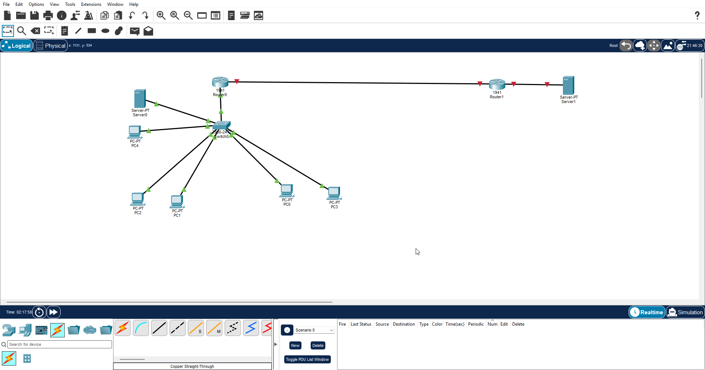
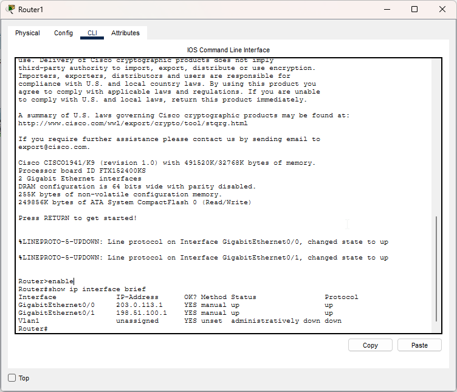
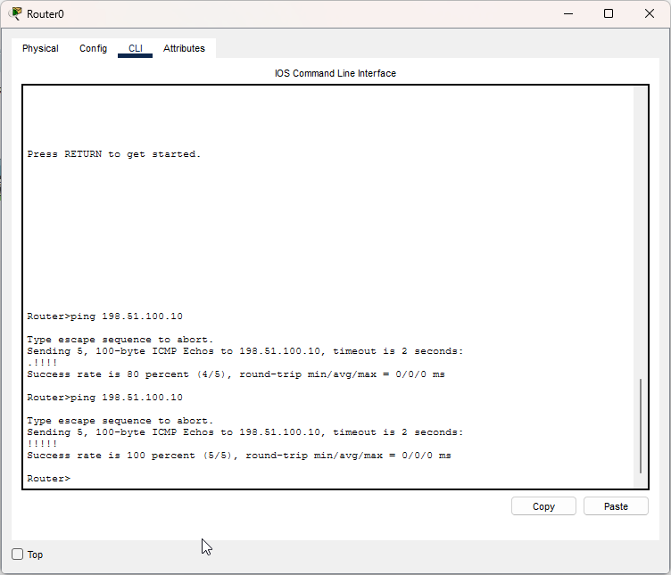
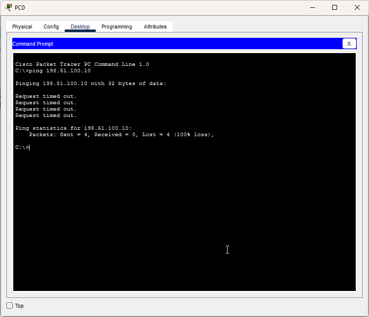
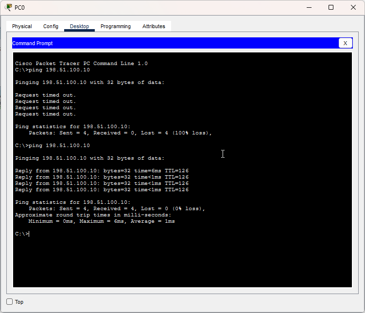
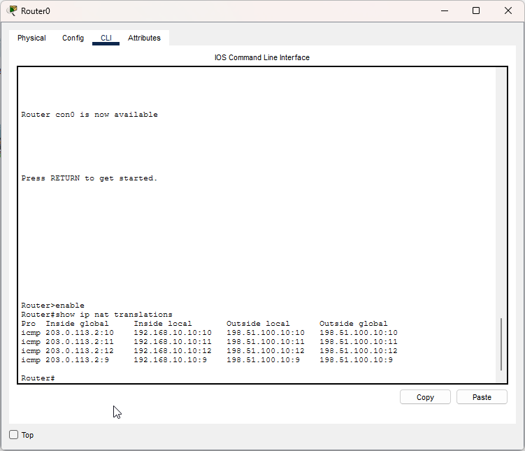
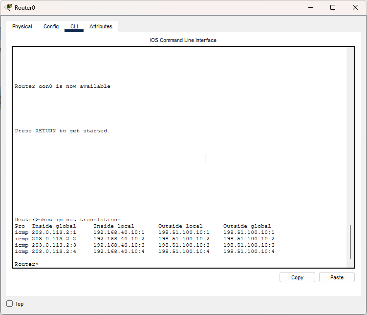
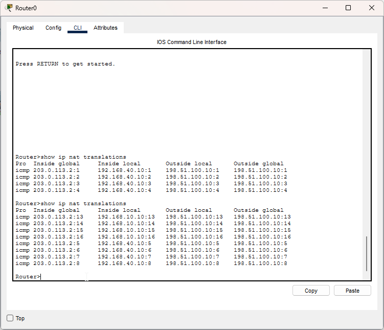
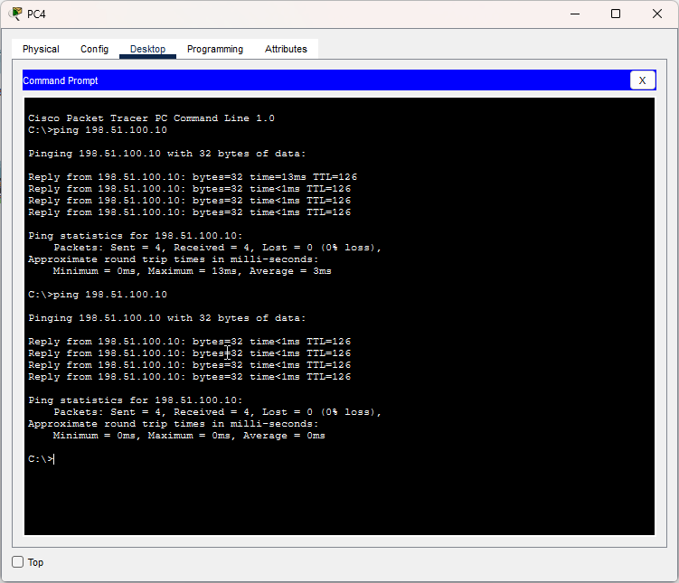

# LAB 10 — NAT: Sharing One Public Address

`Module 02 — Network Architecture` · `Cisco Packet Tracer · ISR 1941 IOS` · `Date: 2026-11-25` · `Status: Complete`

## Objective

Connect the corporate network to a simulated internet and show, with a before/after test, why private addresses cannot reach it on their own. Then configure NAT overload (PAT) on the edge router and read its translation table as the record that ties a public address back to an internal host.

## Repository contents

| Path | Content |
|---|---|
| `README.md` | This write-up |
| `screenshots/` | Topology, command output and test results |
| `evidence/lab10-nat.pkt` | The Packet Tracer project (final state) |
| `evidence/SHA256SUMS` | SHA-256 of the project file |

This lab runs entirely inside the Packet Tracer simulator. It starts from the [LAB 09](../lab09-dhcp/) project, saved under a new name.

---

## 1. Setup

The corporate side is unchanged from LAB 09 (four VLANs, router-on-a-stick, two ACLs, DHCP). Added in this lab:

| Device | Role | Interface | Address |
|---|---|---|---|
| Router0 | Corporate edge router | `Gig0/1` → Router1 | `203.0.113.2/30` (the company's only public address) |
| Router1 (1941) | Internet service provider | `Gig0/0` → Router0 | `203.0.113.1/30` |
| | | `Gig0/1` → Server1 | `198.51.100.1/24` |
| Server1 | A site on the internet | `Fa0` | `198.51.100.10/24`, gateway `198.51.100.1` |

The "public" addresses come from the RFC 5737 documentation ranges (`203.0.113.0/24`, `198.51.100.0/24`), which are never routed on the real internet.



---

## 2. Key concepts

| Term | Definition |
|---|---|
| **Private address** *(logical)* | Ranges reserved for internal use (`10/8`, `172.16/12`, `192.168/16`). Reused by every network, so the internet does not route them. |
| **Public address** *(logical)* | Globally unique, assigned by a provider, routable on the internet |
| **Default route** | `0.0.0.0/0`: "anything I have no specific route for, send to this next hop" |
| **NAT** | Network Address Translation: the edge router rewrites the private source address to its public one on the way out, and reverses it on the way back |
| **PAT / NAT overload** | Many inside hosts share one public address; the router tells their conversations apart by port (TCP/UDP) or query ID (ICMP) |
| **Inside local / inside global** | The host's real (private) address / the address it appears as outside (public) |
| **Translation table** | The router's live record of which inside host owns which outside address and port/ID |

---

## 3. Part A — The internet side

```console
Router1(config)#interface g0/0
Router1(config-if)# ip address 203.0.113.1 255.255.255.252
Router1(config-if)# no shutdown
Router1(config-if)#interface g0/1
Router1(config-if)# ip address 198.51.100.1 255.255.255.0
Router1(config-if)# no shutdown

Router0(config)#interface g0/1
Router0(config-if)# ip address 203.0.113.2 255.255.255.252
Router0(config-if)# no shutdown
Router0(config-if)#exit
Router0(config)#ip route 0.0.0.0 0.0.0.0 203.0.113.1
```



The `/30` mask (`255.255.255.252`) gives a link with exactly two usable addresses, one per end of the cable, as is typical between a customer and its provider. Router1 has no route to any `192.168.x.x` network, just like a real ISP.

```console
Router>ping 198.51.100.10
.!!!!
Success rate is 80 percent (4/5)
Router>ping 198.51.100.10
!!!!!
Success rate is 100 percent (5/5)
```



**Observed:** Router0 reaches the internet server. A ping from the router itself is sourced from its outgoing interface, `203.0.113.2`, which Router1 knows how to reach. The first lost packet is consistent with ARP resolution.

---

## 4. Part B — Before NAT: private hosts cannot reach the internet

```console
C:\>ping 198.51.100.10
Request timed out.
Request timed out.
Request timed out.
Request timed out.
    Packets: Sent = 4, Received = 0, Lost = 4 (100% loss),
```



**Interpretation:** PC0's echo request leaves with source `192.168.10.10`. Router0 forwards it via the default route, and Router1 delivers it to Server1. Server1 replies to `192.168.10.10`, and Router1 has no route to that private network, so the reply is dropped. The outbound path works; the return path does not.

---

## 5. Part C — Configuring NAT overload

```console
Router(config)#access-list 1 permit 192.168.0.0 0.0.255.255
Router(config)#ip nat inside source list 1 interface g0/1 overload
Router(config)#interface g0/0.10
Router(config-subif)# ip nat inside
Router(config-subif)#interface g0/0.20
Router(config-subif)# ip nat inside
Router(config-subif)#interface g0/0.30
Router(config-subif)# ip nat inside
Router(config-subif)#interface g0/0.40
Router(config-subif)# ip nat inside
Router(config-subif)#interface g0/1
Router(config-if)# ip nat outside
```

| Line | Meaning |
|---|---|
| `access-list 1 permit 192.168.0.0 0.0.255.255` | Which source addresses may be translated: every internal VLAN |
| `ip nat inside source list 1 interface g0/1 overload` | Translate them to the address of `Gig0/1` (`203.0.113.2`), shared by all (`overload`) |
| `ip nat inside` / `ip nat outside` | Which side of the router is the private network and which is the internet |

### After NAT

```console
C:\>ping 198.51.100.10
Reply from 198.51.100.10: bytes=32 time=6ms TTL=126
Reply from 198.51.100.10: bytes=32 time<1ms TTL=126
Reply from 198.51.100.10: bytes=32 time<1ms TTL=126
Reply from 198.51.100.10: bytes=32 time<1ms TTL=126
    Packets: Sent = 4, Received = 4, Lost = 0 (0% loss),
```



| Test (PC0 → Server1) | Before NAT | After NAT |
|---|---|---|
| Replies | 0/4 | 4/4 |
| TTL in replies | — | 126 |

**TTL 126** is consistent with two routed hops (128 − 2): Router1 and Router0.

**Conclusion (high confidence, before/after test with a single change):** the loss of the return path is consistent with the internet having no route to private addresses, and the recovery with NAT rewriting PC0's source to `203.0.113.2`.

---

## 6. Part D — The translation table

Queried right after the ping from PC0:

```console
Router#show ip nat translations
Pro  Inside global     Inside local       Outside local      Outside global
icmp 203.0.113.2:9     192.168.10.10:9    198.51.100.10:9    198.51.100.10:9
icmp 203.0.113.2:10    192.168.10.10:10   198.51.100.10:10   198.51.100.10:10
icmp 203.0.113.2:11    192.168.10.10:11   198.51.100.10:11   198.51.100.10:11
icmp 203.0.113.2:12    192.168.10.10:12   198.51.100.10:12   198.51.100.10:12
```



| Column | Value | Meaning |
|---|---|---|
| Inside local | `192.168.10.10:10` | Who really sent it (PC0) |
| Inside global | `203.0.113.2:10` | How it appeared on the internet |
| Outside local / global | `198.51.100.10:10` | Who it talked to |

One entry per echo request. The number after the colon is the ICMP query identifier, which plays the role a port plays for TCP and UDP.

### Two hosts, one public address

The guest PC4 then pinged the server, followed by PC0 and PC4 again:



```console
Router>show ip nat translations
Pro  Inside global     Inside local       Outside local      Outside global
icmp 203.0.113.2:13    192.168.10.10:13   198.51.100.10:13   198.51.100.10:13
...
icmp 203.0.113.2:16    192.168.10.10:16   198.51.100.10:16   198.51.100.10:16
icmp 203.0.113.2:5     192.168.40.10:5    198.51.100.10:5    198.51.100.10:5
...
icmp 203.0.113.2:8     192.168.40.10:8    198.51.100.10:8    198.51.100.10:8
```



**Observed:** to the server, PC0 (ADMIN) and PC4 (guest) are the same address, `203.0.113.2`. Only the identifier differs (`:13`–`:16` for PC0, `:5`–`:8` for PC4), and the router uses it to deliver each reply to the right host. The identifiers come from each PC's own counter; they did not collide here, so the router kept them unchanged. On a collision PAT would assign a different outside number.

### The guest policy now works as named



PC4 got 4/4 replies (TTL 126). The guest ACL from LAB 08 (`VISITANTES-SO-INTERNET`) denies only `192.168.0.0/16` as destination; `198.51.100.10` falls through to `permit ip any any`. Guests are now limited to "internet only", as the ACL's name intended.

---

## 7. Troubleshooting Log

| Symptom | Cause | Fix |
|---|---|---|
| "Initial configuration dialog?" prompt on Router1 | New router with no saved configuration | Answered `no` |
| Ping from Router0 to `198.51.100.10` failed 0/5, twice | Server1 had no IP configuration; Router1 was checked first (`show ip interface brief`, both interfaces up) | Set `198.51.100.10/24`, gateway `198.51.100.1`; ping then succeeded |
| First `lab10-nat.pkt` copy predated the NAT configuration | File saved at the end of the first session, not after the lab | Saved again after the lab; the published file is the final state |

---

## 8. Security / DFIR Relevance

- **A public IP in a log is a building, not an apartment.** Every host behind PAT appears as `203.0.113.2`. A complaint or alert naming that address cannot identify the machine on its own.
- **The translation table is the attribution record**, and it is extremely volatile: ICMP entries vanish within about a minute, TCP/UDP entries soon after the connection ends. Real networks need NAT logging (with timestamps, ports and time zone) to answer "who was `203.0.113.2:51234` at 14:03?" after the fact.
- **The attribution chain is now complete for Module 02:** public IP + port and time → NAT log → private IP → DHCP binding (LAB 09) → MAC → switch MAC table (LAB 05) → port → desk.
- **The same problem exists one level up.** An ISP using CGNAT (LAB 03) puts many customers behind one address, so investigators must request the provider's NAT logs with exact port and time.
- **NAT is not a firewall.** PAT happens to drop unsolicited inbound traffic because there is no table entry for it, but filtering decisions still belong in ACLs or a firewall. Publishing a server (static NAT or port forwarding) opens a deliberate inbound path.
- **Order of operations matters for evidence:** inbound ACLs on the inside interfaces are evaluated on the private address, before translation. Logs taken on the inside and outside of the same router show different source addresses for the same packet.

---

## 9. Evidence and Data Handling

| Evidence | Form |
|---|---|
| Final Packet Tracer project | `evidence/lab10-nat.pkt`, SHA-256 in `evidence/SHA256SUMS` |
| Configuration, before/after tests, translation tables | Screenshots 01–09, transcribed above |

Verify with:

```bash
cd evidence && sha256sum -c SHA256SUMS
```

**Redactions:** the Packet Tracer title bar (local path with the examiner's user name) and the Windows taskbar were cropped from the full-screen screenshot (01). All addresses are simulated; the public side uses RFC 5737 documentation ranges.

---

## 10. Verification Q&A

1. **Why could PC0 not reach the server before NAT?**
   The request arrived, but the reply was addressed to `192.168.10.10`, and the provider has no route to private addresses.
2. **Why could Router0 reach it?**
   Its ping is sourced from its public interface address, `203.0.113.2`.
3. **What does `overload` do?**
   Lets every inside host share the one public address, distinguished by port or ICMP identifier.
4. **What is the difference between inside local and inside global?**
   The host's real private address vs the public address it appears as outside.
5. **Two hosts appear as `203.0.113.2`. How does the router tell their replies apart?**
   By the port or ICMP identifier recorded in the translation table.
6. **An abuse report names `203.0.113.2`. What else do you need to find the machine?**
   The source port and exact time, then the NAT log for that moment, then the DHCP binding and the switch MAC table.
7. **Why can the guest reach the internet but not internal VLANs?**
   The guest ACL denies only `192.168.0.0/16` as destination; everything else is permitted and then translated.

---

## 11. References

- RFC 1918 — Address Allocation for Private Internets
- RFC 3022 — Traditional IP Network Address Translator (Traditional NAT)
- RFC 5737 — IPv4 Address Blocks Reserved for Documentation
- RFC 6888 — Common Requirements for Carrier-Grade NATs (logging and attribution)
- Cisco — IOS IP Addressing Configuration Guide: Configuring NAT for IP Address Conservation
- NIST SP 800-86 — Guide to Integrating Forensic Techniques into Incident Response
