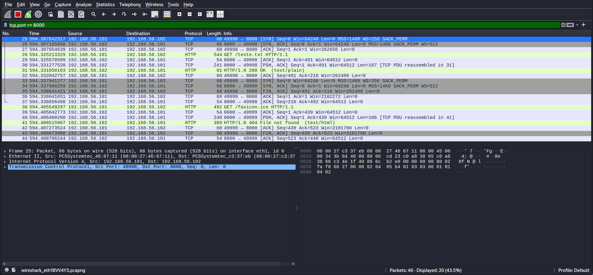
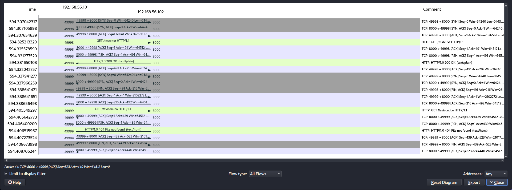
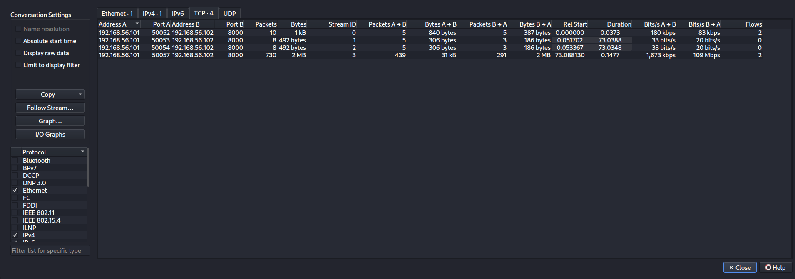
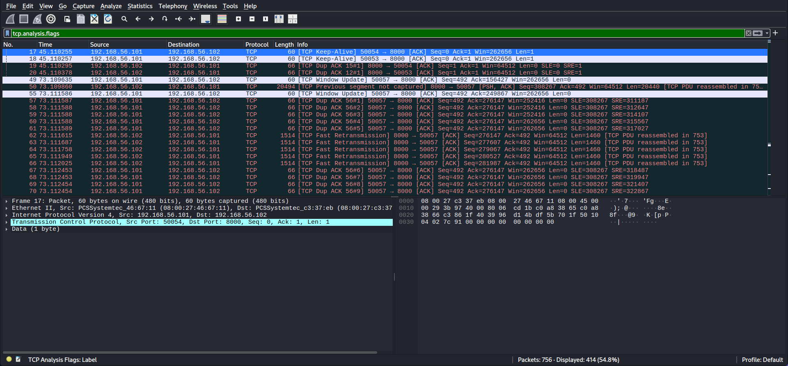
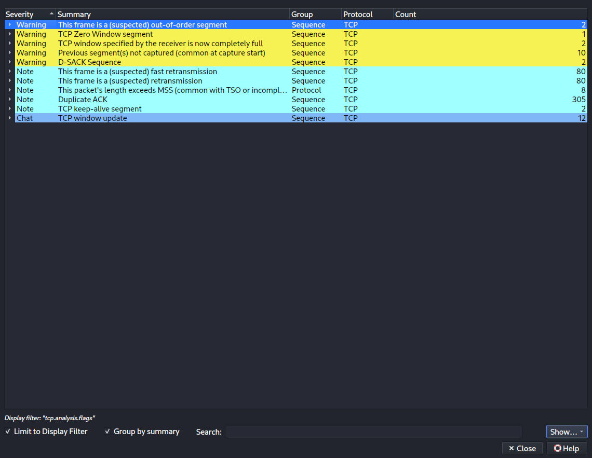

# LAB 11 — TCP in Depth: Handshakes, Retransmissions and Capture Integrity

`Module 03 — Traffic Analysis` · `TCP · HTTP · Wireshark · tcpdump · tc netem` · `Date: 2026-11-25` · `Status: Complete`

## Objective

Read a TCP conversation end to end in Wireshark (handshake, data, acknowledgements, teardown), then degrade the network on purpose and observe how TCP recovers from packet loss. Along the way, preserve the capture as evidence and document an integrity error caught during hashing.

## Repository contents

| Path | Content |
|---|---|
| `README.md` | This write-up |
| `screenshots/` | Wireshark packet list, Flow Graph, analysis flags, Expert Information, Conversations |
| `evidence/lab11-tcp.pcap` | The capture (756 packets, 73 s, lab-only addresses) |
| `evidence/SHA256SUMS` | SHA-256 of the capture |

---

## 1. Setup

| Item | Value |
|---|---|
| Server | Kali Linux 2026.1, `eth1` host-only, `192.168.56.102`, Python `http.server` on TCP 8000 |
| Client | Windows 10 VM, `192.168.56.101`, Microsoft Edge |
| Capture point | Kali `eth1` (the server side of the conversation) |
| Network | VirtualBox host-only `192.168.56.0/24`; does not reach the home router |
| Kali VM | 4 GB RAM at the start of the lab, raised to 6 GB after a freeze (Section 4) |

```console
mkdir ~/lab11 && cd ~/lab11
echo "arquivo de teste do LAB 11" > teste.txt
python3 -m http.server 8000
```

The server publishes the `~/lab11` folder on port 8000. Because the whole exchange stays inside the host-only network, the capture contains only lab addresses and VirtualBox MACs, and is published without redaction.

---

## 2. Key concepts

| Term | Definition |
|---|---|
| **Port** | Door number on a host; the server listens on a fixed one (8000) |
| **Ephemeral port** | Random port the client picks for each new connection |
| **Stream** | One TCP connection: client IP:port ↔ server IP:port |
| **SYN / SYN-ACK / ACK** | Three-way handshake that opens a connection |
| **FIN** | "I have finished sending"; closes one direction |
| **Retransmission** | Sender resends data that was not acknowledged |
| **Duplicate ACK** | Receiver repeats "still waiting for byte N" after a gap |
| **Fast retransmission** | Resend triggered by duplicate ACKs, without waiting for a timer |
| **Zero window** | Receiver says "my buffer is full, pause" |
| **TSO** | NIC splits large segments; a sender-side capture sees them unsplit |

---

## 3. Part A — First look: one click, two connections

A live Wireshark capture on `eth1` (filter `tcp.port == 8000`) while the Windows VM opened `http://192.168.56.102:8000/teste.txt`:



| Frames | Stream (client port) | What happens |
|---|---|---|
| 25–27 | 49998 | Handshake: `SYN` → `SYN, ACK` → `ACK` |
| 28 / 31 | 49998 | `GET /teste.txt` → `HTTP/1.0 200 OK (text/plain)` |
| 33–34 | 49999 | A **second** handshake, opened before the first connection closed |
| 38 / 41 | 49999 | `GET /favicon.ico` → `404 File not found` |
| 35, 43 | both | `FIN` teardown of each connection |



**Observed:** the user requested one file; the wire shows two requests on two connections. The browser fetched the tab icon (`favicon.ico`) on its own.

**Interpretation:** network traffic records what the **software** did, not what the **person** intended. A statement such as "the user requested X" goes beyond the evidence; "the traffic is consistent with the client requesting X" does not.

**Detail:** the server's `FIN` travelled in the same segment as the 200 OK body. The client acknowledged `216` = 1 (SYN) + 187 (headers) + 27 (body) + 1 (FIN), because a FIN consumes one sequence number.

> This first capture was **not preserved**: the Kali VM froze before it was saved (Section 4). Screenshots 01–02 document it; the published evidence is the second capture below.

---

## 4. Troubleshooting — VM freeze and a lighter capture method

Opening a third terminal while Wireshark (run as root) captured live froze the Kali VM, which then had 4 GB RAM. The unsaved capture was lost on reset.

| Change | Why |
|---|---|
| Kali RAM 4 → 6 GB (host has 32 GB) | Headroom for Wireshark plus terminals |
| Capture with `tcpdump -w`, analyse in Wireshark afterwards | No GUI while recording; the file is on disk from the first packet |
| Server and capture as background jobs in one terminal | Avoids the extra terminal windows |

```console
cd ~/lab11
head -c 2000000 /dev/urandom > grande.bin          # 2 MB random test file
python3 -m http.server 8000 > /dev/null 2>&1 &      # web server, background
sudo -v                                             # cache sudo credentials first
sudo tcpdump -i eth1 -w lab11-tcp.pcap port 8000 > /dev/null 2>&1 &
```

`sudo -v` comes first because a background job that asks for a password is suspended by the shell. That happened earlier with `sudo wireshark &`.

---

## 5. Part B — Recording a clean and a degraded transfer

| Phase | Action |
|---|---|
| Clean | Windows opens `/teste.txt` again |
| Degraded | `sudo tc qdisc add dev eth1 root netem loss 10%` on Kali, then Windows downloads `/grande.bin` (2 MB) |
| Stop | `sudo tc qdisc del dev eth1 root`, `sudo pkill tcpdump` |

`netem loss 10%` makes Kali's `eth1` discard about 1 in 10 outgoing packets: a controlled, reversible fault.

---

## 6. Evidence integrity — a hash taken too early

The capture was hashed immediately after stopping it:

```console
$ sudo tc qdisc del dev eth1 root
$ sudo pkill tcpdump
$ ls -l lab11-tcp.pcap
-rw-r--r-- 1 tcpdump tcpdump 2060288 Nov 25 16:05 lab11-tcp.pcap
$ sha256sum lab11-tcp.pcap | tee SHA256SUMS
011a4a56e5a0a001fc61dd0e825cea819a8e4c6b01affca25a6e995239f43f47  lab11-tcp.pcap

[2]  + done       sudo tcpdump -i eth1 -w lab11-tcp.pcap port 8000
```

Two signs suggested the file was not final:

1. The shell reported the `tcpdump` job as **done only after** the hash was printed.
2. `2,060,288` = 503 × 4,096: a size made only of full write buffers, as if the last partial buffer had not been flushed yet.

Re-checked once the job had ended:

```console
$ ls -l lab11-tcp.pcap
-rw-r--r-- 1 tcpdump tcpdump 2061168 Nov 25 16:07 lab11-tcp.pcap
$ sha256sum lab11-tcp.pcap
e0d1e52cfa8284e0b8e25571a0719e11586376a01886c3f3cca9fb59c61d914b  lab11-tcp.pcap
```

| Hash | Size | Status |
|---|---|---|
| `011a4a56…f43f47` | 2,060,288 B | **Invalid**: taken while `tcpdump` was still writing (880 B missing) |
| `e0d1e52c…c61d914b` | 2,061,168 B | **Final**: recorded in `SHA256SUMS` |

**Why it matters:** the hash is the seal on the evidence. A seal taken on an incomplete file makes every faithful copy look altered. Here, the error was caught, the hash was re-taken, and both values are documented.

**Corrected procedure:** stop the capture, **wait for the process to exit** (`sudo pkill tcpdump; wait`, or confirm with `jobs`), then hash. Hashing twice and comparing is a cheap check that the file is no longer changing.

The capture was then copied from Kali to the host over the still-running HTTP server, after `tcpdump` had stopped, so the copy is not in the capture. The copy's hash was verified (`sha256sum -c SHA256SUMS` → `OK`).

---

## 7. Part C — Analysis of the preserved capture

Capture window: 2026-11-25 16:04:33 to 16:05:47 UTC, 756 packets, 4 TCP streams.



| Stream | Client port | Packets | Duration | Content |
|---|---|---|---|---|
| 0 | 50052 | 10 | 0.04 s | `GET /teste.txt` → **`304 Not Modified`** |
| 1 | 50053 | 8 | 73.04 s | No request; opened in advance, kept alive, closed |
| 2 | 50054 | 8 | 73.03 s | Same as stream 1 |
| 3 | 50057 | 730 | 0.15 s | `GET /grande.bin` → `200 OK`, 2,000,000 B body |

### 7.1 Stream 0: a 304 instead of a 200

The browser had `teste.txt` cached from Part A and sent `If-Modified-Since`. The server answered `304 Not Modified` with no body (105 bytes of payload in total), and the file was shown from cache.

**Forensic note:** a page that appears on screen does not imply the file crossed the network at that moment. Only the 200 in Part A shows the content on the wire.

### 7.2 Streams 1 and 2: connections that carried nothing

Edge opened two extra connections right after stream 0 and sent no request on them. At 45 s both sides exchanged **TCP keep-alive** probes ("still there?"). At 73 s they were closed as the download began. Speculative pre-connection like this is normal browser behaviour, and it is another case of traffic generated by software rather than by the user.

### 7.3 Stream 3: TCP recovering from 10 % loss

Filter `tcp.analysis.flags` (packets Wireshark marks as anomalous) shows 414 of 756 packets:





| Expert Information entry | Count | Reading |
|---|---|---|
| Duplicate ACK | 305 | Client repeatedly signalling a gap ("still waiting for byte N") |
| Fast retransmission (also counted as retransmission) | 80 | Server resending the missing segments after duplicate ACKs |
| Previous segment(s) not captured | 10 | Gaps in the capture itself (see 7.4) |
| Out-of-order / D-SACK | 2 / 2 | Retransmissions arriving after later data; client reporting a duplicate |
| Zero window / window full | 1 / 2 | Client buffer briefly full (frame 440): the server was sending faster than the client consumed |
| Length exceeds MSS | 8 | TSO artefact (see 7.4) |
| Keep-alive | 2 | Streams 1 and 2 |

An independent count with a Python script (Scapy) over the same file gave 82 retransmitted server segments: 80 fast retransmissions plus the 2 out-of-order ones. The script also found 10 gaps and none of the retransmitted segments duplicating a segment already in the capture. This agrees with Wireshark.

Despite the loss, the 2 MB transfer completed in about 0.15 s. Fast retransmission repaired each gap within milliseconds, without waiting for a timeout.

### 7.4 What the capture point hides

| Observation | Explanation |
|---|---|
| None of the 80 retransmissions duplicates a captured segment; 10 "previous segment not captured" gaps | `netem` drops packets inside Kali **before** `tcpdump` sees them, so the lost originals were never recorded. Only the resends appear. |
| Frames up to 64,294 bytes (MSS is 1,460) | With TSO, the kernel hands large segments to the NIC, which splits them. A capture on the **sending** host sees the unsplit version, which never existed on the wire in that form. |

The same conversation captured on the Windows side would show neither artefact: it would show the gaps as missing arrivals and every frame at or under the MTU. Where the capture is taken determines what it can show.

---

## 8. Findings

| # | Finding | Confidence |
|---|---|---|
| 1 | One browser navigation produced two TCP connections and two HTTP requests (page + favicon) | High: both visible in screenshots 01–02 |
| 2 | A re-visit of a cached file produced `304 Not Modified`; the content did not cross the network in that capture | High: request and response headers in the capture |
| 3 | Two connections were opened and held for 73 s without carrying a request | High: Conversations, keep-alives at 45 s |
| 4 | Retransmissions (80), duplicate ACKs (305) and 10 capture gaps in stream 3 are **consistent with** packet loss on the path. The cause is known only because it was introduced deliberately; the traffic alone would not identify it | High for loss; cause known from the lab setup, not from the traffic |
| 5 | The first hash recorded for the capture belonged to an incomplete file; it was detected, replaced and documented | High: two sizes and two hashes, Section 6 |

---

## 9. Key takeaways

- **Every TCP connection opens with SYN, SYN-ACK, ACK and closes with FIN.** The client port changes per connection; the server port stays fixed.
- **Traffic shows what the software did.** Favicons, cached 304s and pre-opened connections all come from the browser, not the user.
- **Packet loss leaves a signature:** duplicate ACKs, then fast retransmissions. It shows loss happened, not who caused it.
- **The capture point shapes the evidence.** A sender-side capture misses packets dropped locally and shows TSO "giant" frames.
- **Hash only after the capture process has exited.** "Stop" is a request, and the file can still change for a moment after it.
- **Document errors, don't hide them.** An explained discrepancy keeps the evidence credible; an unexplained one undermines it.

---

## Reproduce / verify

```console
cd evidence
sha256sum -c SHA256SUMS       # lab11-tcp.pcap: OK
```

Open `lab11-tcp.pcap` in Wireshark and apply `tcp.analysis.flags`, or use Statistics → Conversations.

**References:** RFC 9293 (TCP), RFC 5681 (TCP congestion control, fast retransmit), RFC 9110 (HTTP semantics, 304), RFC 3227 and ISO/IEC 27037 (evidence collection and preservation).
