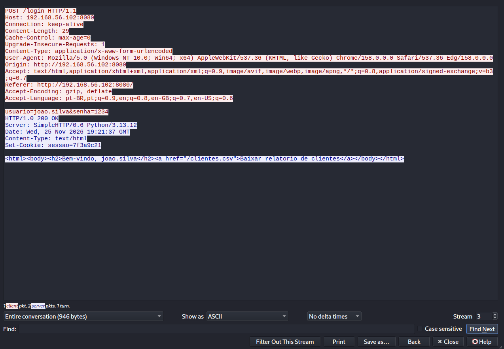
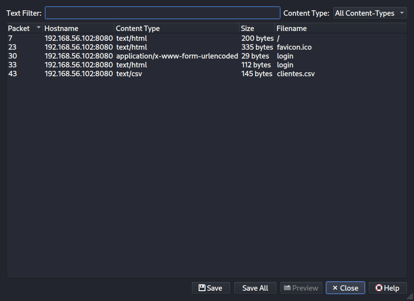

# LAB 12 — HTTP: Reading Streams and Extracting Files

`Module 03 — Traffic Analysis` · `HTTP · Wireshark · tcpdump` · `Date: 2026-11-25` · `Status: Complete`

## Objective

Show what an observer on the network path can recover from cleartext HTTP: credentials, a session cookie, the navigation path, and a complete file. Recover the file from the capture alone and check that it is byte-identical to the original.

## Repository contents

| Path | Content |
|---|---|
| `README.md` | This write-up |
| `site/intranet.py` | Lab-only fake intranet: login form (POST), session cookie, file download |
| `site/clientes.csv` | The "confidential" file (three **fictitious** customers) |
| `screenshots/` | Follow TCP Stream and Export Objects |
| `evidence/lab12-http.pcap` | The capture (49 packets, 27 s, lab-only addresses) |
| `evidence/SHA256SUMS` | SHA-256 of the capture |

All credentials and data in this lab are invented. Nothing here is a real account.

---

## 1. Setup

| Item | Value |
|---|---|
| Server | Kali `192.168.56.102`, `site/intranet.py` on TCP 8080 (Python `http.server`, single-threaded) |
| Client | Windows 10 VM `192.168.56.101`, Microsoft Edge |
| Capture | `tcpdump` on Kali `eth1`, `port 8080` |
| Original file | `clientes.csv`, 145 B, SHA-256 `76d5db5823b89b808d65c589715191aa0ffd53869972c60af7f9b47672f97b2e` (hashed before the test) |

The intranet serves a login page at `/`. A POST to `/login` returns "Bem-vindo, *user*", sets `Set-Cookie: sessao=7f3a9c21` and links to `/clientes.csv`. Every other path is served from the `site/` folder. The capture is written to `~/lab12`, outside `site/`, so the server cannot hand it out.

```console
cd ~/lab12/site
python3 intranet.py > /dev/null 2>&1 &                                       # [1]
sudo -v
sudo tcpdump -i eth1 -w ~/lab12/lab12-http.pcap port 8080 > /dev/null 2>&1 &  # [2]
```

On the Windows VM: open `http://192.168.56.102:8080`, log in as `joao.silva` / `1234`, click the download link.

---

## 2. Key concepts

| Term | Definition |
|---|---|
| **Cleartext** | Sent as readable text; anyone on the path can read it |
| **GET / POST** | Ask for a resource / send data (e.g. a form) to the server |
| **Form body** | `field=value&field=value` text carried in a POST |
| **Session cookie** | Token the server issues after login; the browser sends it back instead of the password |
| **Session hijacking** | Reusing a stolen session cookie to act as the user |
| **Referer** | Header naming the page the request came from |
| **User-Agent** | Header describing the client's OS and browser |
| **Follow TCP Stream** | Wireshark view that reassembles one connection as a conversation |
| **Export Objects** | Wireshark feature that rebuilds files carried over HTTP |

---

## 3. Preserving the capture

Applying the LAB 11 lesson, the capture was hashed only after `tcpdump` had exited:

```console
$ sudo pkill tcpdump
$ wait %2
[2]  - done       sudo tcpdump -i eth1 -w ~/lab12/lab12-http.pcap port 8080
$ jobs
[1]  + running    python3 intranet.py
$ ls -l lab12-http.pcap
-rw-r--r-- 1 tcpdump tcpdump 7283 Nov 25 19:22 lab12-http.pcap
$ sha256sum lab12-http.pcap | tee SHA256SUMS
6674a3381a376b9969c10b84004c45976e0aef84b9a6b9b6be09e7a912027121  lab12-http.pcap
```

`wait %2` waits for job 2 (the capture) only. A bare `wait` would also wait on the intranet, which never exits. The copy on the analysis host was verified with `sha256sum -c` → `OK`.

---

## 4. Timeline of the capture

Capture window: 2026-11-25 19:21:21 to 19:21:47 UTC. The Kali clock is in UTC, matching the server's `Date` headers.

| t (s) | Frames | Client port | Event |
|---|---|---|---|
| 0.03 | 4 → 6–7 | 50201 | `GET /` → login page (200, 200 B HTML) |
| 0.05 | 11–15 | 50202 | Connection opened, **no request** sent |
| 0.13 | 17 | 50203 | `GET /favicon.ico` |
| 1.97 | 19–23 | 50202 / 50203 | Idle 50202 closed by the client; only then the favicon `404` is answered |
| 16.01 | 30 → 32–33 | 50233 | `POST /login` → 200, `Set-Cookie: sessao=7f3a9c21` |
| 26.98 | 40 → 42–43 | 50235 | `GET /clientes.csv` with `Cookie: sessao=7f3a9c21` → 200, 145 B `text/csv` |
| 26.98 | 45–47 | 50244 | Another connection opened, no request, still open at capture end |

**Why the favicon waited 1.9 s:** Python's basic `HTTPServer` handles one connection at a time. It accepted the browser's idle pre-connection (50202) first and blocked reading it until the browser closed it. The favicon request (50203) sat in the queue meanwhile. This is consistent with a single-threaded server meeting a browser's speculative connections; it is not a network problem.

---

## 5. Part A — Credentials and session cookie in cleartext

Filter `http.request.method == "POST"` leaves one packet (frame 30). **Follow → TCP Stream** on it:



```text
POST /login HTTP/1.1
Host: 192.168.56.102:8080
Content-Type: application/x-www-form-urlencoded
Referer: http://192.168.56.102:8080/
...
usuario=joao.silva&senha=1234

HTTP/1.0 200 OK
Set-Cookie: sessao=7f3a9c21
...
Bem-vindo, joao.silva
```

**Observed:** the username and password travel as plain text in the POST body. The session cookie travels as plain text in the response.

**Interpretation:** anyone able to see this traffic gets the password, and also the session cookie. The cookie is enough on its own. The download request (frame 40) carried only `Cookie: sessao=7f3a9c21` and no password, so whoever holds that value is treated as `joao.silva` until the session ends. In this lab the cookie value is fixed; a real application issues a fresh random value per login with an expiry.

---

## 6. Part B — Rebuilding the file from the capture

**File → Export Objects → HTTP** lists every object carried over HTTP:



| Frame | Content type | Size | Object |
|---|---|---|---|
| 7 | `text/html` | 200 B | Login page (`/`) |
| 23 | `text/html` | 335 B | 404 page for `favicon.ico` |
| 30 | `application/x-www-form-urlencoded` | 29 B | The login form body (the credentials themselves) |
| 33 | `text/html` | 112 B | "Bem-vindo" page |
| 43 | `text/csv` | 145 B | `clientes.csv` |

`clientes.csv` was saved from this list and compared with the original on the server:

```console
$ sha256sum clientes-extraidos.csv site/clientes.csv
76d5db5823b89b808d65c589715191aa0ffd53869972c60af7f9b47672f97b2e  clientes-extraidos.csv
76d5db5823b89b808d65c589715191aa0ffd53869972c60af7f9b47672f97b2e  site/clientes.csv
```

The extracted file was first saved as `clientes-extraidos.csv` rather than the planned name. It was located with `find ~ -name "clientes*"` before hashing.

**Observed:** identical SHA-256 values.

**Interpretation:** the file rebuilt from the capture is byte-identical to the original. This is consistent with the complete file having crossed the network to `192.168.56.101` in frame 43. The capture alone was enough to recover it, without access to the server or the client.

---

## 7. Part C — What the client revealed about itself

Every request carried the same headers:

| Header | Value | What it suggests |
|---|---|---|
| `User-Agent` | `Mozilla/5.0 (Windows NT 10.0; Win64; x64) ... Chrome/158.0.0.0 ... Edg/158.0.0.0` | 64-bit Windows 10/11, Microsoft Edge 158 |
| `Accept-Language` | `pt-BR,pt;q=0.9,en;q=0.8,...` | Portuguese (Brazil) as the preferred language |
| `Referer` | `/` → `/login` → `/clientes.csv` | The navigation path: login page, then login, then download |

**Caveat:** these headers are written by the client and are trivial to change. They support a profile of the client ("consistent with Edge on Windows, configured for pt-BR") but do not identify a device or a person.

---

## 8. Findings

| # | Finding | Confidence |
|---|---|---|
| 1 | Credentials `joao.silva` / `1234` (fictitious) were sent in cleartext in an HTTP POST at 19:21:37 UTC | High: frame 30, Follow TCP Stream |
| 2 | A session cookie was issued in cleartext and reused for the download without the password | High: frames 32 and 40 |
| 3 | `clientes.csv` was transferred in full to `192.168.56.101`; the file rebuilt from the capture is byte-identical to the original | High: matching SHA-256 |
| 4 | Navigation path login page → login → download, reconstructed from `Referer` headers | High within the capture; headers are client-controlled |
| 5 | Client profile consistent with Edge 158 on 64-bit Windows, pt-BR | Medium: User-Agent and Accept-Language can be forged |

---

## 9. Key takeaways

- **Cleartext HTTP exposes everything:** passwords, cookies, pages and files are readable by anyone on the path, with no exploit needed.
- **The session cookie is as valuable as the password.** After login, the cookie alone authenticates the user.
- **A capture can reproduce a file exactly.** Export Objects plus a hash comparison links a leaked file to a specific transfer.
- **Client headers describe, they do not attribute.** User-Agent and language are claims made by the client.
- **HTTP is still common inside companies** (printers, cameras, legacy systems, admin panels). An intruder already inside the network can read it the same way.
- **HTTPS hides the content, not the metadata:** who talked to whom, when, and how much. That is the subject of LAB 13.

---

## Reproduce / verify

```console
cd evidence
sha256sum -c SHA256SUMS       # lab12-http.pcap: OK
```

In Wireshark: filter `http.request.method == "POST"` → Follow TCP Stream; File → Export Objects → HTTP → save `clientes.csv` and compare its hash with `site/clientes.csv`.

**References:** RFC 9110 (HTTP semantics), RFC 9112 (HTTP/1.1), RFC 6265 (HTTP cookies), RFC 3227 and ISO/IEC 27037 (evidence collection and preservation).
