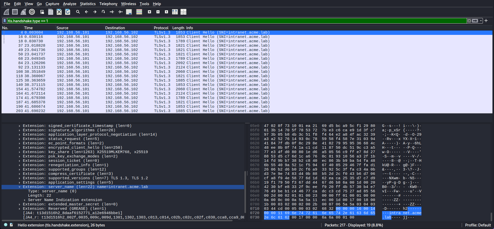
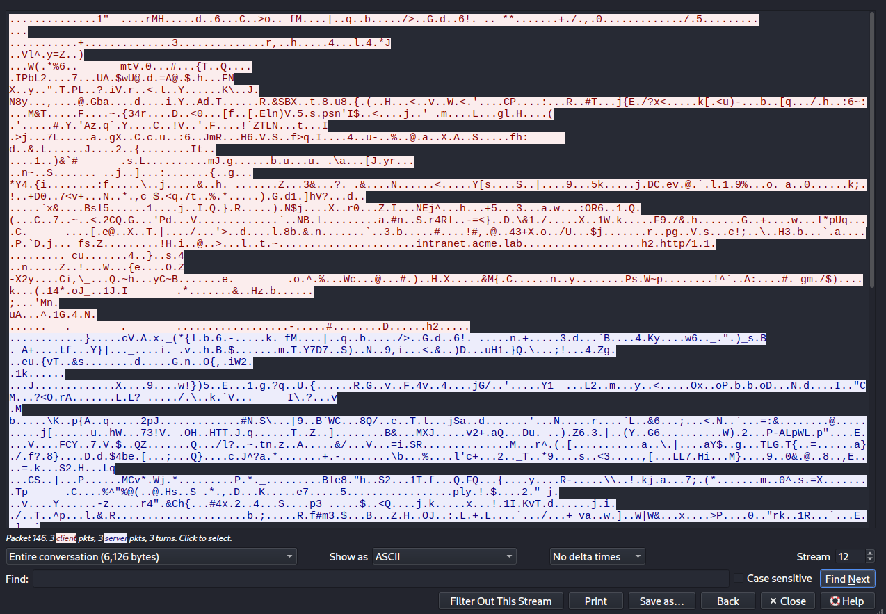
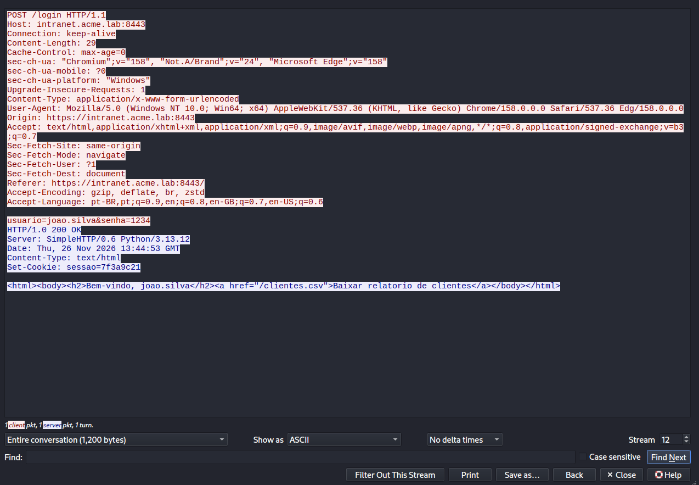
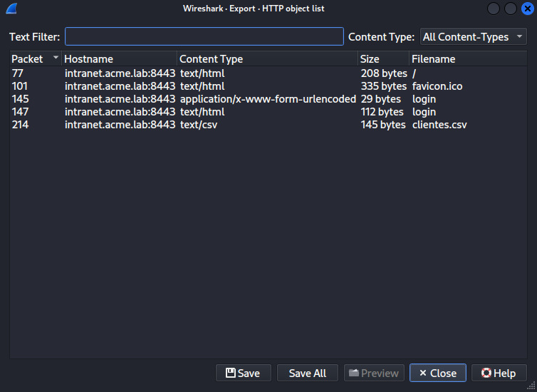
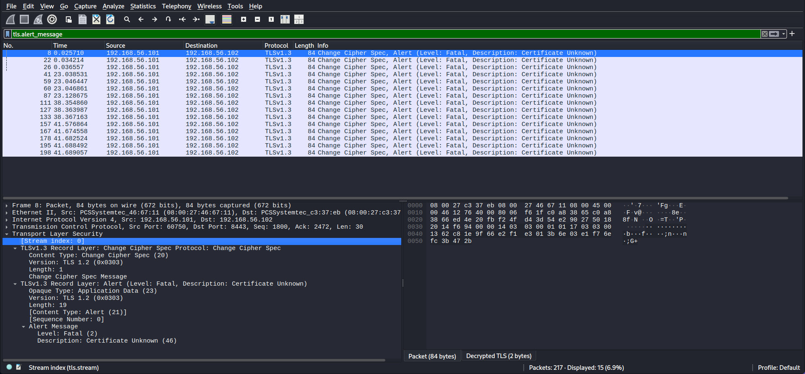

# LAB 13 — TLS: What Encryption Hides and What Still Leaks

`Module 03 — Traffic Analysis` · `TLS 1.3 · HTTPS · Wireshark · tcpdump · SSLKEYLOGFILE` · `Date: 2026-11-26` · `Status: Complete`

## Objective

Repeat the LAB 12 scenario (login and file download on a fake intranet) over HTTPS. Then answer three questions:

1. What can an observer on the path still see?
2. What does encryption actually hide?
3. What changes when the analyst holds the session keys?

## Repository contents

| Path | Content |
|---|---|
| `README.md` | This write-up |
| `site/intranet_tls.py` | Lab-only fake intranet over HTTPS (same pages as LAB 12) |
| `site/clientes.csv` | The "confidential" file (three **fictitious** customers, same as LAB 12) |
| `screenshots/` | SNI, encrypted stream, decrypted stream, Export Objects, TLS alerts |
| `evidence/lab13-tls.pcap` | The capture (217 packets, 42 s, lab-only addresses) |
| `evidence/lab13-tls-keys-filtered.log` | TLS session secrets for the 19 connections in the capture only (see Section 4) |
| `evidence/SHA256SUMS` | SHA-256 of both files |

All credentials and data are invented. The certificate is self-signed and exists only in the lab.

---

## 1. Setup

| Item | Value |
|---|---|
| Server | Kali `192.168.56.102`, `site/intranet_tls.py` on TCP **8443** (Python `ThreadingHTTPServer` + `ssl`) |
| Certificate | Self-signed, `CN=intranet.acme.lab`, SAN `DNS:intranet.acme.lab`, RSA 2048 |
| Client | Windows 10 VM `192.168.56.101`, Microsoft Edge 158 |
| Name resolution | Windows `hosts` file: `192.168.56.102 intranet.acme.lab` |
| Key logging | Windows user variable `SSLKEYLOGFILE` → `tls-keys.log` |
| Capture | `tcpdump` on Kali `eth1`, `port 8443` |

```console
# Kali
openssl req -x509 -newkey rsa:2048 -nodes -keyout key.pem -out cert.pem -days 30 \
  -subj "/CN=intranet.acme.lab" -addext "subjectAltName=DNS:intranet.acme.lab"
python3 intranet_tls.py > /dev/null 2>&1 &
sudo -v
sudo tcpdump -i eth1 -w ~/lab13/lab13-tls.pcap port 8443 > /dev/null 2>&1 &
```

```powershell
# Windows (administrator PowerShell)
Add-Content -Path C:\Windows\System32\drivers\etc\hosts -Value "192.168.56.102 intranet.acme.lab"
[Environment]::SetEnvironmentVariable("SSLKEYLOGFILE", "$env:USERPROFILE\Desktop\tls-keys.log", "User")
taskkill /f /im msedge.exe
```

**Why a hostname:** browsers do not send the Server Name Indication (SNI) when connecting to a bare IP address. The `hosts` entry makes Edge connect by name, as it would to a real site.

**Why kill Edge:** the browser reads `SSLKEYLOGFILE` only at start-up. Although no window was open, `taskkill` ended **7** background `msedge.exe` processes. A program that looks closed is not necessarily stopped.

On the Windows VM: open `https://intranet.acme.lab:8443`, accept the certificate warning ("Advanced → Continue"), log in as `joao.silva` / `1234`, download `clientes.csv`.

---

## 2. Key concepts

| Term | Definition |
|---|---|
| **TLS** | The protocol that encrypts HTTP into HTTPS |
| **Handshake** | Opening exchange where both sides agree on session keys |
| **Client Hello** | The browser's first message; sent in cleartext |
| **SNI** | Site name inside the Client Hello, visible to any observer |
| **Certificate** | The server's signed ID ("I am `intranet.acme.lab`") |
| **CA** | Certificate authority: a signer the client already trusts |
| **Session keys** | Per-connection secrets that encrypt the data; never sent on the wire |
| **Key log (`SSLKEYLOGFILE`)** | File where the browser writes its session secrets |
| **TLS alert** | A "something is wrong, closing" message between the two sides |
| **JA4** | Fingerprint of a client computed from how it builds its Client Hello |

---

## 3. Preserving the evidence

```console
$ sudo pkill tcpdump
$ wait %2
[2]  - done       sudo tcpdump -i eth1 -w ~/lab13/lab13-tls.pcap port 8443
$ jobs
[1]  + running    python3 intranet_tls.py
$ ls -l lab13-tls.pcap
-rw-r--r-- 1 tcpdump tcpdump 99834 Nov 26 13:45 lab13-tls.pcap
$ sha256sum lab13-tls.pcap | tee SHA256SUMS
c5009f0fdf8f43510012c34860a3112bb31157b7dbf3f6eec7d9452f7de8b18c  lab13-tls.pcap
```

The key log was copied from the Windows VM to Kali via the clipboard and hashed on arrival: 259 lines, SHA-256 `f5d44f6095fd1f1f9702ecf0d262dd7880e11af25327307680500f86e9265123`. Both files were copied to the analysis host and their hashes re-verified.

---

## 4. The key log contains more than the lab

The raw key log held secrets for 71 TLS connections (58 TLS 1.3, 13 TLS 1.2), far more than the 19 to the intranet. The rest is consistent with Edge's own background HTTPS sessions through the VM's NAT adapter, which this capture (port 8443 on the host-only link) does not contain.

| | Lines | Client randoms |
|---|---|---|
| Raw `tls-keys.log` (kept private, hash above) | 258 (plus one empty line) | 71, of which 52 are not in the capture |
| `lab13-tls-keys-filtered.log` (published) | 50 | exactly the 19 Client Hellos in `lab13-tls.pcap` |

Each line of a key log is indexed by the Client Hello's random value. The filtered file keeps only lines whose random appears in the capture, which was checked with a script. It decrypts this capture and nothing else. Publishing the raw file would expose secrets for real sessions outside the lab.

---

## 5. Part A — Without keys: what an observer sees

### 5.1 The site name travels in cleartext

Filter `tls.handshake.type == 1` (Client Hello):



| Observation | Meaning |
|---|---|
| `Extension: server_name ... name=intranet.acme.lab` | The destination site is readable, even in the hex pane |
| 19 Client Hellos in 42 s | 19 TLS connections attempted |
| `key_share (len=1263) X25519MLKEM768` | Post-quantum hybrid key exchange; a 1.2 KB key share per connection |
| `encrypted_client_hello (len=250)` | ECH extension present, but the real SNI is still sent in clear (no ECH configuration for this site) |
| `JA4: t13d1516h2_8daaf6152771_a12e6946bbe1` | Client fingerprint, available without decryption |

**Size:** the same login and download took **99,834 B** here versus **7,283 B** over HTTP in LAB 12. Each Client Hello is about 1.8 KB, mostly the post-quantum key share, and there were 19 of them. Each server response carried the certificate. Encryption has a visible cost in volume.

### 5.2 The content is unreadable

**Follow → TCP Stream** on the login connection (stream 12):



No `usuario=`, no `senha=`, no `Set-Cookie`. The only readable strings are `intranet.acme.lab` and `h2` / `http/1.1`: the SNI and ALPN (protocols offered) from the cleartext Client Hello. Export Objects → HTTP returns nothing.

### 5.3 What still leaks without keys

| Visible | Hidden |
|---|---|
| Client and server IPs and ports | URLs and paths (`/login`, `/clientes.csv`) |
| Site name (SNI) and protocols offered (ALPN) | Credentials, cookies, headers |
| Timing of each connection (0 s, 23 s, 38 s, 41 s) | Page and file contents |
| Bytes per connection and direction | Which connection carried which action |
| Client fingerprint (JA4) | |
| That 15 connections ended right after the server's certificate | Why they ended (the alert is encrypted, see 6.3) |

---

## 6. Part B — With the key log: decryption

**Edit → Preferences → Protocols → TLS → (Pre)-Master-Secret log filename** → `tls-keys.log`.

### 6.1 Credentials and cookie



The exact LAB 12 content reappears: `usuario=joao.silva&senha=1234` and `Set-Cookie: sessao=7f3a9c21`. Decryption also reveals headers absent from the LAB 12 capture, because Edge sends some client hints only over HTTPS:

```text
sec-ch-ua: "Chromium";v="158", "Not.A/Brand";v="24", "Microsoft Edge";v="158"
sec-ch-ua-platform: "Windows"
```

### 6.2 The file, rebuilt from inside TLS



```console
$ sha256sum clientes-extraido.csv site/clientes.csv
76d5db5823b89b808d65c589715191aa0ffd53869972c60af7f9b47672f97b2e  clientes-extraido.csv
76d5db5823b89b808d65c589715191aa0ffd53869972c60af7f9b47672f97b2e  site/clientes.csv
```

The file extracted from the decrypted capture (frame 214) is byte-identical to the original. It is also the same file as in LAB 12.

### 6.3 Why 15 of 19 connections failed

Filter `tls.alert_message`:



**Observed:** 15 alerts, all from the client (`192.168.56.101`), all `Level: Fatal, Description: Certificate Unknown (46)`. Each one came right after the server sent its certificate. The 4 connections that completed (at 23.05 s, 23.13 s, 38.37 s and 41.69 s) are the page load, favicon, login and download.

**Interpretation:** consistent with Edge rejecting a certificate not signed by any authority it trusts (self-signed). After the user clicked "Continue", the browser used the overridden connection for the page actions. The extra connections it opened on its own were still rejected, which is why alerts appear even at 38 s and 41 s.

**Note:** in TLS 1.3 the alert itself is encrypted (`Opaque Type: Application Data`, "Decrypted TLS (2 bytes)"). Without the key log, an observer sees only short connections dying after the certificate. With it, the exact reason is readable.

**Investigative value:** repeated `Certificate Unknown` towards one site can indicate a self-signed internal service, a misconfiguration, or TLS interception by an untrusted middlebox.

---

## 7. Findings

| # | Finding | Confidence |
|---|---|---|
| 1 | Without keys, the destination site name (`intranet.acme.lab`), timing, volume and client fingerprint were visible; credentials, cookie, paths and file content were not | High: screenshots 01–02 |
| 2 | With the client's key log, the full LAB 12 content was recovered: credentials, session cookie, and `clientes.csv` byte-identical to the original | High: screenshots 03–04, matching SHA-256 |
| 3 | 15 of 19 connections were closed by the client with `Certificate Unknown`, consistent with Edge rejecting the self-signed certificate | High: 15 decrypted alerts |
| 4 | The same activity took about 14× more bytes over TLS 1.3 than over HTTP, mainly from 19 handshakes with post-quantum key shares | High: file sizes and Client Hello lengths |
| 5 | The raw key log contained secrets for unrelated real sessions and was published only in filtered form | High: client-random match against the capture |

---

## 8. Key takeaways

- **HTTPS hides the content, not the envelope.** Who, when, how much, and the site name (SNI) remain visible on the path.
- **The encryption was not broken.** It was bypassed by taking the keys from an endpoint, where data exists in cleartext before encryption and after decryption.
- **The endpoints are the weak point.** Malware, malicious extensions, compromised servers and corporate TLS inspection all work at the ends, not on the wire.
- **For DFIR:** the network shows who, when and how much; the "what" of encrypted traffic usually comes from the endpoint (memory, browser, server logs). The two sources complement each other.
- **Key logs are sensitive evidence.** They decrypt real sessions, so they must be scoped to the case and disabled afterwards.
- **TLS 1.3 encrypts more than the data:** even the certificate and the alerts. Without keys, the reason for a failure has to be inferred from patterns.

---

## 9. Cleanup

```powershell
[Environment]::SetEnvironmentVariable("SSLKEYLOGFILE", $null, "User")
taskkill /f /im msedge.exe
Remove-Item "$env:USERPROFILE\Desktop\tls-keys.log"
```

Leaving `SSLKEYLOGFILE` set would make every future HTTPS session on the VM decryptable by anyone who can read that file.

---

## Reproduce / verify

```console
cd evidence
sha256sum -c SHA256SUMS
```

In Wireshark, set TLS → (Pre)-Master-Secret log filename to `evidence/lab13-tls-keys-filtered.log`, then filter `http` or `tls.alert_message`.

**References:** RFC 8446 (TLS 1.3), RFC 6066 (SNI), RFC 7301 (ALPN), RFC 5280 (certificates), RFC 9110 (HTTP), IETF draft "The SSLKEYLOGFILE Format for TLS", RFC 3227 and ISO/IEC 27037 (evidence collection and preservation).
